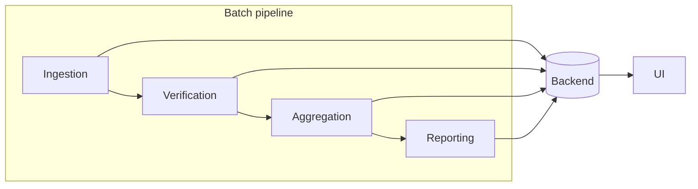

# cartelex -- extracting facts from EU cartel cases with LLM

Structured fact extraction from EU competition (cartel and abuse-of-dominance)
decisions.

The European Commission publishes its competition decisions as CELEX documents:
long, semi-structured legal prose. Answering a research question such as *"which
undertakings were fined under Article 101 for market sharing between 1990 and
2005, and what was the cartel duration in each case?"* means reading hundreds of
decisions by hand.

`cartelex` turns that corpus into a queryable fact store. Decision markdown is
chunked with structure preserved, embedded into PostgreSQL/pgvector, and mined by
a catalogue of declarative DSPy extractors. Every extracted fact is written to an
EAV store together with its provenance -- the chunks it came from, the facts it
was derived from, and a verification verdict from an evidence ledger -- so a
downstream claim can always be traced back to the paragraph that supports it.





The project delivered ingestion pipelines extracting facts and 
a open-webui based user interface for querying the cases.

Status: research system, single-operator deployment. Not a hosted product.
It is designed for **local, isolated use only** -- no authentication, no
tenancy, no transport security. Read [Security](#security) before running it
anywhere but your own machine.

---

## Features

- **Declarative fact catalogue.** 51 facts defined as data in
  [config_main/FACT_EXTRACTOR.yaml](config_main/FACT_EXTRACTOR.yaml) -- question,
  output schema, pipeline, dependency conditions -- not as bespoke code. Adding a
  fact is a YAML edit.
- **19 extraction pipelines** behind one dispatcher: `universal` LLM extraction,
  `keyword_search`, `keyword_regex`, `detail_retriever`, `fact_comparison`,
  `case_summary`, NACE classification, HeidelTime temporal pipelines, and a
  `book_*` family that cross-checks facts against a reference monograph.
- **Structure-aware chunking.** `TokenTargetMarkdownSplitter` keeps a header plus
  its subheaders and body in one chunk instead of shattering a legal section into
  fixed-size windows.
- **Hybrid retrieval.** A Postgres FTS lexical leg (`websearch_to_tsquery`) and a
  pgvector dense leg fused by Reciprocal Rank Fusion, reranked by a cross-encoder
  (BGE by default, FlashRank for A/B) plus a structural boost that favours the
  decision sections a given fact actually lives in. A lexical reserve guarantees
  FTS hits survive the `top_k` cut.
- **Fact dependencies.** Facts declare predecessors and boolean `condition`
  expressions; the batch runner topologically sorts the catalogue so derived facts
  see their inputs.
- **Provenance and verification.** `fact_source_link`, `fact_provenance`, and
  `fact_evidence` record chunk-level and fact-to-fact lineage plus a
  deterministic-first evidence verdict per fact.
- **Temporal precision.** HeidelTime normalises temporal expressions to dated
  events, because dense embeddings are poor at date ranges.
- **Entity resolution.** Investigated companies are resolved against
  OpenCorporates, GLEIF/LEI, and the German Handelsregister, with a cloud-LLM
  fallback for the residue no register could match.
- **Entity graph.** A deterministic projection of the EAV fact store into typed
  nodes and lineage-grounded edges (`entities`, `entity_edges`) -- knowledge graph
  in Postgres CTEs, no separate graph database.
- **Chat UI.** An OpenAI-compatible FastAPI server exposes the DSPy QA pipeline,
  so Open WebUI (or any OpenAI client) can query the corpus, with clickable links
  back to the source chunk, markdown, and original PDF.
- **Reporting.** XLSX and PDF fact reports over the whole corpus.

---

## Architecture

```text
  EU decision PDFs  ──MinerU/OCR──>  markdown  (~/a/celex_docs)
                                        │
                                        ▼
                       TokenTargetMarkdownSplitter  (header-preserving)
                                        │
                            qwen3-embedding:8b (Ollama)
                                        │
                                        ▼
        ┌──────────────────  PostgreSQL 18 + pgvector  ──────────────────┐
        │  pg_embedding_qwen   chunks + FTS + section_type + context     │
        │  facts               EAV fact store (celex_id, name, value)    │
        │  fact_source_link    chunk-level and fact-to-fact lineage      │
        │  fact_evidence       verification ledger                       │
        │  entities/edges      materialised entity graph                 │
        │  celex_case_id       identifier registry (CELEX <-> case no.)  │
        └────────────────────────────────────────────────────────────────┘
                    ▲                                    │
                    │ writes                             │ reads
        ┌───────────┴────────────┐          ┌────────────▼─────────────┐
        │  Batch extraction      │          │  Retrieval layer         │
        │  src/batch/Main_*.py   │          │  HybridSearch (FTS+dense │
        │  BatchJobRunner        │◄────────►│   -> RRF -> reranker)    │
        │  FACT_EXTRACTOR.yaml   │          │  EnumerationSearch (BM25)│
        │  DSPy modules          │          │  KeywordSearch / Regex   │
        └────────────────────────┘          └────────────┬─────────────┘
                    │                                    │
                    │                       ┌────────────▼─────────────┐
                    │                       │ oi_dspy FastAPI  :7777   │
                    │                       │ OpenAI-compatible /v1    │
                    │                       └────────────┬─────────────┘
                    ▼                                    ▼
        reports (XLSX / PDF)                    Open WebUI  :3000

        Inference: remote Ollama on the LAN (LLM + embeddings)
                   DeepSeek cloud API for the corporate-index profile
```

Design rules the code follows (see [CLAUDE.md](CLAUDE.md) for the full contract):

- **Signatures are declarative.** Every task is a `dspy.Signature` with `desc=` on
  each field. No f-string prompt templates.
- **Logic-free signatures.** SQL, vector search, and business logic live in the
  `forward()` of a `dspy.Module`.
- **Structured outputs.** Extraction `OutputField`s reference a `pydantic.BaseModel`.
- **Provisioner pattern.** DB clients, vector stores, and rankers are injected in
  `__init__`, never constructed inside `forward()`.

---

## Prerequisites

| Requirement | Notes |
|---|---|
| Python 3.12 (<3.14) | `.python-version` pins the interpreter |
| PostgreSQL 18 + pgvector | supplied by the `pgvector/pgvector:pg18-trixie` image |
| Docker + Docker Compose | for the database, Open WebUI, and the backend image |
| LiteLLM  | currently Ollama endpoint with remote host with enough VRAM for `qwen3-coder:30b` and `qwen3-embedding:8b` |
| Java runtime | required by `py-heideltime` (temporal extraction) |
| NVIDIA Container Toolkit | optional; only for GPU cross-encoder reranking |
| DeepSeek API key | optional; cloud LLM profiles |
| OpenCorporates API token | optional; only for company resolution |

Inference hardly runs on the local workstation GPU 
Use the remote Ollama host or a cloud API.

---

## Installation

```bash
git clone <repository-url> cartelex
cd cartelex

python3.12 -m venv .venv
```

Install from a generated lock file, never from `pyproject.toml` directly --
`torch` arrives transitively via `sentence-transformers`, and a bare
`pip install -e .` resolves the wrong (CUDA 13) build:

```bash
# GPU host (torch 2.13.0+cu126, carries sm_50..sm_90)
.venv/bin/pip install -r requirements.txt

# CPU-only host (~4.8 GB smaller, no nvidia-* wheels)
.venv/bin/pip install -r requirements-cpu.txt

# development (adds ruff, pip-tools, playwright)
.venv/bin/pip install -r requirements-dev.txt

.venv/bin/pip install -e . --no-deps
```

Regenerating the locks is documented in the comment block at the top of
[pyproject.toml](pyproject.toml). The GPU and CPU locks must stay identical apart
from `torch` and the `nvidia-*`/`triton` packages.

### Database schema

```bash
psql "$DATABASE_URL" -f src/pipelines/rag/pgvector/celex-facts-dll-20260426.sql
psql "$DATABASE_URL" -f src/pipelines/rag/pgvector/migrate_fts_extensions.sql
# then apply the remaining migrate_*.sql files in src/pipelines/rag/pgvector/
psql "$DATABASE_URL" -f src/pipelines/rag/pgvector/schema_comments.sql
```

---

## Configuration

All configuration flows through the `Config` class in
[src/config/settings.py](src/config/settings.py). Every value is env-overridable;
nothing is hardcoded at a call site. Secrets live in `config_main/.env`, which is
gitignored and must never be committed.

`config_main/.env` -- required:

```bash
DATABASE_URL=postgresql+psycopg://celex_facts:<password>@localhost:5433/celex
POSTGRES_PASSWORD=<password>
DEEPSEEK_API_KEY=<key>
opencorporates_api_token=<token>
PGADMIN_DEFAULT_EMAIL=you@example.com
```

`./.env` (read by Docker Compose only) -- required:

```bash
CELEX_DB_PASSWORD=<password>
```

`CELEX_DB_PASSWORD`, not `POSTGRES_PASSWORD`: the latter is commonly exported
globally as the cluster superuser password, and the process environment beats
`./.env` in Compose -- reusing that name silently authenticates the application
as the superuser.

Frequently changed settings:

| Variable | Default | Purpose |
|---|---|---|
| `LLM_MODEL_ID` | `qwen3-coder:30b` | extraction model on Ollama |
| `OLLAMA_HOST` | `http://localhost:11434` | remote inference endpoint |
| `EMBEDDING_TABLE` | `pg_embedding_qwen` | chunk/embedding table |
| `RERANKER_BACKEND` | `bge` | `bge` or `flashrank` for the batch ingestion CLIs |
| `REQUIREMENTS_FILE` | `requirements-ui.txt` | build arg: which dependency tree the backend image installs, and so which reranker backends exist in it |
| `RERANKER_MODEL_ID` | `BAAI/bge-reranker-v2-m3` | any CrossEncoder-compatible model |
| `UI_RERANKER_BACKEND` | `flashrank` | reranker inside the chat UI container; `bge` to match the batch |
| `RANKER_BOOST_MODE` | `section_type` | structural boost; `legal_climax` for A/B |
| `HYBRID_SEARCH_TOP_K` / `RRF_K` | `50` / `60` | retrieval breadth and RRF constant |
| `UI_LLM_PROVIDER` | `ollama` | `ollama` or `deepseek` for the chat UI |
| `CELEX_DOCS_DIR` | `~/a/celex_docs` | source markdown and PDF corpus |

The extraction catalogue itself is configuration:
[config_main/FACT_EXTRACTOR.yaml](config_main/FACT_EXTRACTOR.yaml), validated
against [config_main/schema.json](config_main/schema.json).

---

## Usage

### Bring up the infrastructure

```bash
docker compose up -d postgres_db pgadmin
docker compose up -d celex-facts-backend-oi_dspy open-webui

# hosts without a GPU
docker compose -f docker-compose.yml -f docker-compose.cpu.yml up -d
```

| Service | URL |
|---|---|
| PostgreSQL | `localhost:5433` |
| pgAdmin | http://localhost:15080 |
| Fact QA backend (OpenAI-compatible) | http://localhost:7777 |
| Open WebUI | http://localhost:3000 |

### Ingest a decision corpus

```bash
export PYTHONPATH=src
.venv/bin/python src/batch/Main_ingest_case_markdown2pgvector.py
.venv/bin/python src/batch/Main_classify_sections.py      # section_type backfill
.venv/bin/python src/batch/Main_enrich_chunk_context.py   # contextual retrieval prefixes
```

### Extract facts

All `Main_*.py` scripts share the `BatchJobRunner` flags:

```bash
# every fact marked run_state_active in the YAML, whole corpus
.venv/bin/python src/batch/Main_ingest_generic_facts.py

# one fact, one document, nothing written
.venv/bin/python src/batch/Main_ingest_generic_facts.py \
    --filter-celex-id CELEX-31990D0645 \
    --filter-fact infringement_category_procedural \
    --dry-run

# re-extract the full catalogue for the first 20 documents, 4 workers
.venv/bin/python src/batch/Main_ingest_generic_facts.py \
    --all-facts --overwrite --limit 20 --max-workers 4
```

| Flag | Meaning |
|---|---|
| `--filter-celex-id ID` | single document, ignoring the input list |
| `--filter-fact NAME` | single `target_fact_name` |
| `--all-facts` | whole catalogue, overruling `run_state_active` |
| `--overwrite` | re-extract facts that already have rows |
| `--limit N` | first N CELEX ids (`0` = all) |
| `--max-workers N` | concurrent workers (default 1, serial) |
| `--celex-list-file PATH` | one CELEX id per line; supersedes the descriptor sheet |
| `--dry-run` | print actions, no DB writes and no LLM calls |
| `--audit-file PATH` | JSONL audit trail (default `./logs/pipeline_audit.jsonl`) |

CELEX ids are stored **with** the `CELEX-` prefix (`CELEX-31990D0645`); stripping
it returns zero chunks. The corpus also carries `AT_`-style and bare numeric case
ids, resolved through the identifier registry.

### Verification, cross-checks, and enrichment

```bash
.venv/bin/python src/batch/Main_verify_facts_backfill.py        # evidence ledger
.venv/bin/python src/batch/Main_cross_check_facts_vs_book.py    # vs. reference monograph
.venv/bin/python src/batch/Main_materialize_entity_graph.py     # entity graph
.venv/bin/python src/batch/Main_ingest_opencorp_index_companies.py
.venv/bin/python src/batch/Main_LLM_corp_index_searcher.py
.venv/bin/python src/batch/Main_audit_chunk_language.py         # non-English ingest audit
```

### Ad-hoc search

```bash
./scripts/search_facts.sh CELEX-31975D0358 "list all fines" 10
./scripts/search_doc_chunks.sh
.venv/bin/python src/pipelines/utils/search_facts.py --query "cartel duration" --top_k 5
```

### Query the API

```bash
curl http://localhost:7777/v1/models

# One JSON completion (the OpenAI default when "stream" is omitted)
curl -X POST http://localhost:7777/v1/chat/completions \
  -H 'Content-Type: application/json' \
  -d '{
        "model": "celex-dspy-agent",
        "messages": [
          {"role": "user",
           "content": "Which companies were investigated in CELEX-31990D0645?"}
        ]
      }'

# Server-Sent Events, as Open WebUI asks for them
curl -N -X POST http://localhost:7777/v1/chat/completions \
  -H 'Content-Type: application/json' \
  -d '{
        "model": "celex-dspy-agent",
        "stream": true,
        "messages": [
          {"role": "user",
           "content": "Which companies were investigated in CELEX-31990D0645?"}
        ]
      }'
```

`stream` follows the OpenAI contract: `true` returns `text/event-stream` chunks,
`false` (the default, and what Open WebUI's background title/tag tasks send)
returns a single `chat.completion` object whose message is the concatenation of
those chunks.

Source-inspection endpoints, linked from every answer:

```text
GET /chunk/{chunk_id}     rendered chunk with its metadata
GET /doc/{celex_id}       document overview
GET /doc/{celex_id}/md    source markdown
GET /doc/{celex_id}/pdf   original PDF
```

### Reports

```bash
.venv/bin/python src/reporting/report_celex_facts.py
.venv/bin/python src/reporting/retrieve_case_summary_md2disk.py
```

---

## Repository Structure

```text
celex-facts/
├── config_main/                  # FACT_EXTRACTOR.yaml, schema.json, .env (gitignored)
├── docs/                         # ADRs, design docs, Obsidian vault
├── scripts/                      # shell wrappers: backup, search, test suites
├── src/
│   ├── batch/                    # Main_*.py entry points + BatchJobRunner
│   ├── config/                   # settings.py, llm_factory.py
│   ├── extract/rag/              # HybridSearch, EnumerationSearch, rankers
│   ├── pipelines/
│   │   ├── agent_dspy/           # DSPy signatures and modules
│   │   ├── corp_index/           # OpenCorporates / GLEIF / LEI resolution
│   │   ├── graph/                # entity graph projection
│   │   ├── heideltime/           # temporal extraction
│   │   ├── legal/                # treaty renumbering, provisions
│   │   ├── nace/                 # NACE classification
│   │   ├── rag/pgvector/         # repositories, DDL, migrations
│   │   └── utils/                # markdown splitter, search CLIs
│   ├── reporting/                # XLSX / PDF reports
│   ├── tools/                    # FactIngestor, CELEX identifier tooling
│   └── ui/backend_server/        # oi_dspy.py -- OpenAI-compatible FastAPI
├── tests/, src/**/tests/         # unittest suites (121 test modules)
├── docker-compose.yml            # postgres, pgadmin, backend, Open WebUI
├── docker-compose.cpu.yml        # CPU-only override
├── pyproject.toml                # dependency intent
├── requirements*.txt             # generated locks (gpu / cpu / dev)
├── ISSUES.md                     # open issues, newest first
└── CLAUDE.md                     # engineering contract
```

Tests live in a `./tests/` directory next to the code they cover, each with an
`__init__.py`.

---

## Testing

The framework is `unittest` -- a project convention honoring Kent Beck, not pytest.

```bash
# everything except the browser-driven UI tests
./scripts/run_test_suite_wo_usr.sh

# UI tests only (needs the backend, browser instrumentation such as chrome, playwright and Open WebUI running)
./scripts/run_test_suite_ui_only.sh

# single module
PYTHONPATH=src .venv/bin/python -m unittest \
    src.extract.rag.tests.test_hybrid_search_keyword_reserve -v

# lint (run before delivering code)
.venv/bin/ruff check
```

Unit tests must be runnable in isolation: mocks are injected only at system
boundaries (DB, LLM). Integration tests, where demanded, read real configuration
from `config.settings`.

Anything that patches the reranker model boundary must call `reset_ranker_cache()`
-- `ranker_factory` caches one live instance per backend/model so the ~2.3 GB
weights are not duplicated.

---

## Deployment

```bash
docker compose build celex-facts-backend-oi_dspy
docker compose up -d celex-facts-backend-oi_dspy
```

The image installs from `requirements-ui.txt`, the serving-path lock, which has
no `torch` and no `sentence-transformers` in it at all. `BgeReranker` is their
only importer in the tree, so the chat image ships the FlashRank backend and
nothing else, and the service reserves no GPU. The `REQUIREMENTS_FILE` build arg
selects a different tree:

| Lock | Image (measured) | Reranker backends available |
|---|---|---|
| `requirements-ui.txt` | 2.09 GB | FlashRank only (the default) |
| `requirements-cpu.txt` | 2.67 GB | FlashRank and BGE, CPU |
| `requirements.txt` | 8.48 GB | FlashRank and BGE, CUDA |

Dropping the BGE stack accounts for 0.58 GB of that; the rest of the 8.48 GB
saving is the CUDA wheels the GPU lock carries. What remains is dominated by
batch tooling rather than by the serving path: `py_heideltime` (350 MB),
the polars runtime (168 MB), `pyarrow` (156 MB) and `connectorx` (128 MB).

`UI_RERANKER_BACKEND=bge` is therefore a rebuild rather than an environment flip.
Use `docker-compose.cpu.yml` for BGE on CPU; for BGE on a GPU, build with
`REQUIREMENTS_FILE=requirements.txt` and restore a `deploy.resources` device
reservation on the service. Asking the default image for `bge` raises a
`RuntimeError` at startup naming the lock to rebuild with.

Cross-encoder weights are cached in the `hf_cache` volume via
`RERANKER_CACHE_DIR=/app/data/cache/huggingface`. Point `RERANKER_MODEL_ID` at a
directory instead of a Hub repo id to take huggingface.co out of the startup path:

```bash
.venv/bin/hf download BAAI/bge-reranker-v2-m3 --local-dir ./models/bge-reranker-v2-m3
```

The default chat reranker is FlashRank (`UI_RERANKER_BACKEND=flashrank`), whose
ONNX model is fetched with plain `requests` on the first start and is outside
every Hugging Face offline switch. On a host without egress, bake it into the
image instead (the `PREFETCH_RERANKER` build arg does the same for the BGE
weights):

```bash
PREFETCH_FLASHRANK=true docker compose build celex-facts-backend-oi_dspy
```

The prefetch seeds the `hf_cache` volume only when that volume is created;
remove an existing empty one first (`docker volume rm celex-facts_hf_cache`)
or seed it by hand from a host with egress:

```bash
docker compose run --rm --no-deps celex-facts-backend-oi_dspy \
  python -c "import os; from flashrank import Ranker; Ranker(model_name='ms-marco-MiniLM-L-12-v2', cache_dir=os.environ['CACHE_DIR'])"
```

Database backup and restore:

```bash
./scripts/pg_basebackup_cluster.sh
./scripts/dump_pgsql.sh
./scripts/restore_pgsql.sh
```

Run `Main_*` batches directly on the host with the `.venv` -- they are long-running
and talk to the same database.

---

## Security

> [!CAUTION]
> **This project is built for local, single-operator, isolated use only. It is
> not designed, hardened, or tested for multi-user or internet-facing
> deployment. Do not put it on a public network.**
>
> Concretely, the stack has none of the controls such a deployment requires:
>
> - **No authentication and no authorization anywhere.** The `oi_dspy` backend on
>   port 7777 answers any request that reaches it. There are no users, no
>   sessions, no API keys, no roles, and no per-document access control -- every
>   caller sees the entire corpus and every extracted fact.
> - **No tenancy boundary.** All state lives in one `celex_facts` schema with a
>   single database role. Nothing in the data model separates one user's data,
>   queries, or documents from another's.
> - **No rate limiting or quota enforcement.** A single caller can drive
>   unbounded LLM inference against the Ollama host and unbounded spend against
>   the metered DeepSeek and OpenCorporates APIs whose keys the process holds.
> - **No transport security.** Every service is plain HTTP, and the database
>   connection is unencrypted. Credentials and document content cross the wire in
>   the clear.
> - **Deep-link endpoints serve raw source files.** `GET /doc/{celex_id}/md` and
>   `/pdf` read from `CELEX_DOCS_DIR` on the host filesystem, and pgAdmin on port
>   15080 has a backup directory mounted into it.
> - **Untrusted input reaches an LLM with tool access.** Prompt injection embedded
>   in a decision document or a chat message is an accepted risk in a trusted
>   single-user setting; it is not an acceptable one when arbitrary parties can
>   submit input.
> - **No audit trail of who did what.** `pipeline_audit.jsonl` records extraction
>   runs, not request identity.
>
> Run it bound to `localhost`, or on a trusted LAN segment behind a firewall.
> Making it safe for shared or public use is a project of its own -- an
> authenticating reverse proxy in front of port 7777 is a starting point, not a
> solution.

- Secrets live in `config_main/.env` and `./.env`. Both are gitignored. Do not
  commit them, and do not bake credentials into `docker-compose.yml`.
- The application connects as the `celex_facts` role, never as the cluster
  superuser. See the `CELEX_DB_PASSWORD` note under *Configuration*.
- PostgreSQL is published on `localhost:5433` and pgAdmin on `localhost:15080` --
  bind them to a LAN address only behind a trusted network.
- The `oi_dspy` backend has no authentication. Do not expose port 7777 to the
  public internet.
- Third-party API tokens (DeepSeek, OpenCorporates) are read from the environment
  and never logged.
- Report vulnerabilities privately to the maintainer rather than opening a public
  issue.

---

## Contributing

1. Read [CLAUDE.md](CLAUDE.md) -- the DSPy, Pydantic, and code-style rules are
   non-negotiable and are what review checks against.
2. Fork the repository and create a feature branch off `main`.
3. Keep changes scoped: edit existing modules rather than adding new ones, no
   backwards-compat shims, no `_unused` placeholders.
4. Add tests in the `./tests/` directory next to the code.
5. Run `.venv/bin/ruff check` and `./scripts/run_test_suite_wo_usr.sh`.
6. Anything that surfaces a new problem gets a line at the top of
   [ISSUES.md](ISSUES.md): `- [ ] #high YYYYMMDD <description>`.
7. Open a pull request describing the behaviour change and the verification you
   ran.

House rules worth repeating: no emoji or emoji-like unicode anywhere in the
codebase; `logging.getLogger(__name__)`, never `print()`; polars, never pandas;
constants from `settings`, never inline literals.

---

## CI/CD

There is no hosted pipeline. The release loop is local and gated on:

1. `.venv/bin/ruff check` -- zero errors.
2. `./scripts/run_test_suite_wo_usr.sh` -- unit and integration suites.
3. `./scripts/run_test_suite_ui_only.sh` -- Playwright against a live stack.
4. `docker compose build celex-facts-backend-oi_dspy`.
5. `skylos` quality gate, configured in [pyproject.toml](pyproject.toml)
   (`fail_on_critical`, `max_high = 5`, `max_security = 0`).

Notes and options are in [docs/ci-cd/CICD.md](docs/ci-cd/CICD.md).

---

## Troubleshooting

| Issue | Solution |
|---|---|
| Query returns zero chunks for a known decision | Use the stored id format with the prefix: `CELEX-31990D0645`, not `31990D0645`. |
| `torch` kernel launches fail on the workstation GPU | The PyPI `torch` is the CUDA 13 build and dropped Pascal (sm_61). Install from `requirements.txt`, which pins `2.13.0+cu126`. |
| `pip-compile` dies with `ImportError: stdlib_pkgs` | pip 26.2 removed it; pip-tools 7.6 still imports it. Hold `pip<26.2` in the venv. |
| Reranker re-downloads ~2.3 GB on every container recreate | Set `RERANKER_CACHE_DIR=/app/data/cache/huggingface` so the weights land in the `hf_cache` volume. |
| Backend raises `RuntimeError` naming sentence-transformers at startup | `UI_RERANKER_BACKEND=bge` on an image built from `requirements-ui.txt`, which has no BGE stack. Rebuild with `docker-compose.cpu.yml` or set the backend back to `flashrank`. |
| FlashRank model re-downloads on every container recreate | Keep `CACHE_DIR=/app/data/cache/huggingface/flashrank` (set by compose) so the ONNX model lands in the same `hf_cache` volume. |
| Backend restart-loops with `ConnectionError` to huggingface.co at import | FlashRank's first download needs egress and ignores `HF_HUB_OFFLINE`. Build with `PREFETCH_FLASHRANK=true`, or seed the `hf_cache` volume once from a host with egress (see Deployment). |
| Backend authenticates as the Postgres superuser | A global `POSTGRES_PASSWORD` export is winning. Use `CELEX_DB_PASSWORD` in `./.env`. |
| Port 5433 / 3000 / 7777 already in use | Override `OI_DSPY_PORT` or `OPEN_WEBUI_PORT` in `./.env`, or edit the port mapping. |
| Ollama calls time out | Raise `OLLAMA_TIMEOUT` (default 150 s), or lower `OLLAMA_LLM_INFERENCE_TOKEN_LIMIT` for long decisions. |
| A fact is never extracted | Check `run_state_active` and the `condition` expression in `FACT_EXTRACTOR.yaml`; a false predecessor condition skips the fact silently. |
| Facts exist but re-runs do nothing | Extraction is idempotent per fact. Pass `--overwrite`, or set `force_override: true` for that fact. |
| A newly loaded CELEX id is not detected in the UI | The identifier index is cached for the process lifetime; restart the backend container. |
| HeidelTime raises a Java error | `py-heideltime` needs a JRE on the PATH. |
| A decision is invisible to English extractors | It was ingested from a non-English source. Run `Main_audit_chunk_language.py`. |

---

## Roadmap

- Backfill `celex_facts.celex_case_id` to full corpus coverage, or declare the
  identifier precedence rule in the schema rather than in application code.
- TTL or reload endpoint for the identifier index so runtime-added ids are visible
  without a container restart.
- Refresh the corpus-wide fact reports and case summaries; add a JSON report
  format alongside XLSX and PDF.
- Extend the entity graph projection beyond companies to products and markets.
- Broaden the court-decision fact coverage (see
  [docs/court_facts_gap_analysis.md](docs/court_facts_gap_analysis.md)).

Live task list, newest first: [ISSUES.md](ISSUES.md). Tasks are `- [ ]` when open
and `- [x]` when solved.

---

## License

Licensed under the **Apache License 2.0** (see [LICENSE](LICENSE)), which
includes an explicit patent grant.

SPDX: `Apache-2.0`. Unless you state otherwise, any contribution you submit is
licensed the same way, with no additional terms.

The repository was created under GPL-3.0 and relicensed on 2026-08-27 by the
sole copyright holder. Anything obtained before that date remains available
under GPL-3.0.

### Third-party components

Dependencies are installed from PyPI, not vendored, and carry their own terms --
overwhelmingly MIT, Apache-2.0, and BSD, with LGPL (`psycopg`, `pycountry`) and
MPL-2.0 (`certifi`, `tqdm`, `orjson`) among them. None of these impose their
terms on this project's own code.

One exception is worth knowing about: `py-heideltime` bundles the HeidelTime
standalone JAR, which is **GPL-3.0**. This project invokes it as a separate Java
subprocess from the ingestion pipeline, so it is not a derivative work -- and
GPL obligations attach to *distribution*, which does not happen here: the stack
is run locally and no built artifact is published. If that ever changes, note
that `py-heideltime` is a core dependency in `pyproject.toml` and is therefore
present in both locks and in the backend image today, even though only the
batch ingestion path uses it. Moving it to an optional `ingest` extra would keep
the GPL-3.0 JAR out of any image intended for distribution.

---

## Authors / Maintainers

Maintained by the repository owner (`cartelex.dev (@) gmail.com `). Not accepting external maintainers at
this time.

---

## References

- [CLAUDE.md](CLAUDE.md) -- engineering contract: DSPy rules, code style, testing.
- [README-old.md](README-old.md) -- the original architecture decision records
  (PDF conversion, chunking strategy, vector store selection, temporal extraction).
- [docs/ADR Architecture Decision Record.md](docs/ADR%20Architecture%20Decision%20Record.md)
- [docs/Data Model.md](docs/Data%20Model.md),
  [docs/Data Table Catalogue.md](docs/Data%20Table%20Catalogue.md)
- [docs/Design BgeRanker.md](docs/Design%20BgeRanker.md) -- reranker design.
- [docs/ADR Knowledge Graph in psql CTE vs. neo4j.md](docs/ADR%20Knowledge%20Graph%20in%20psql%20CTE%20vs.%20neo4j.md)
- [docs/Data Lineage Option & Implementation.md](docs/Data%20Lineage%20Option%20&%20Implementation.md)
- [docs/claude/plans/](docs/claude/plans/) -- implementation plans.
- External: [DSPy](https://dspy.ai), [pgvector](https://github.com/pgvector/pgvector),
  [HeidelTime](https://github.com/HeidelTime/heideltime),
  [EUR-Lex CELEX numbering](https://eur-lex.europa.eu/content/help/faq/celex-number.html).


---

## AI Usage
This project is based on a refactored application using pdf extraction, pytesseract, ocr, and chroma-db.
[coauthored status](AI_USAGE-md)


---

## Changelog

No `CHANGELOG.md` is maintained. The commit history and [ISSUES.md](ISSUES.md)
are the record of change.
