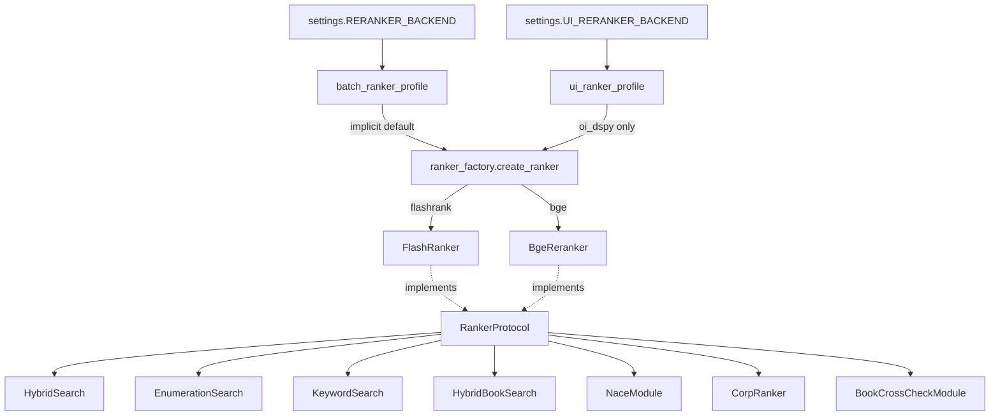

#ranking
# Design — BgeReranker (CrossEncoder reranker backend)

This document describes the role, architecture, scoring, configuration, and
operational setup of `BgeReranker` — the sentence-transformers `CrossEncoder`
reranker backend introduced in **design-review Phase 2** (Weakness 3: *"the
reranker is generic, dated, and being compensated for by heuristics"*).

It complements two existing docs:

- [FlashRanker (obsolete)](FlashRanker%20(obsolete).md) — the incumbent default backend (`ms-marco-MiniLM-L-12-v2`). `BgeReranker` mirrors its interface exactly and shares the Legal Climax boost; read that doc for the integration points, which are unchanged.
- [BGE-Reranker](BGE-Reranker.md) — background on *why* a cross-encoder reranker corrects the pgvector bi-encoder's "rough" ranking (bi-encoder vs cross-encoder).

Related: [DESIGN Search](DESIGN%20Search.md) (where the reranker sits in each search strategy), [Design UI Modules](Design%20UI%20Modules.md) (the `ui` profile in the serving path, and FlashRank's first-start egress), [Design 101 -- Provisioner Pattern](Design%20101%20--%20Provisioner%20Pattern.md).

---

## 1. Overview

`ms-marco-MiniLM-L-12-v2` (FlashRank's default) is a 2021-era **English** web-QA
cross-encoder with a **512-token** limit. This corpus is legal **German/English**
Commission decision text, so the incumbent reranker was leaning on positional
priors (the Legal Climax boost) to compensate for content it could not judge.

`BgeReranker` wraps a sentence-transformers
[`CrossEncoder`](https://www.sbert.net/docs/cross_encoder/usage/usage.html)
(default **`BAAI/bge-reranker-v2-m3`**): a *true* cross-encoder — it scores each
`(query, passage)` pair in a single joint forward pass — that is **multilingual
(100+ languages)** with an **8k-token** context. It is a strict upgrade for this
text while remaining a drop-in behind the same injection points.

The backend is **model-agnostic**: `settings.RERANKER_MODEL_ID` may point at any
CrossEncoder-compatible reranker (e.g. a `Qwen/Qwen3-Reranker-*` size served on a
GPU) with no code change — see §7.

Source: [bge_reranker.py](file://~/a/celex-facts/src/extract/rag/ranker/bge_reranker.py).

---

## 2. Backend selection — the factory

Every retrieval call site injects *"a ranker"* (the structural `RankerProtocol`)
and, when none is injected, falls back to `create_ranker()`, which builds the
backend a `RankerProfile` names. Two profiles are configured, mirroring the LLM
profiles in `config/llm_factory.py` so repointing one consumer leaves the
other alone:

| Profile | Settings | Default | Who gets it |
| :--- | :--- | :--- | :--- |
| `batch` (`batch_ranker_profile()`) | `RERANKER_BACKEND` / `RERANKER_MODEL_ID` | `bge` | every bare `create_ranker()`: ingestion CLIs, `ranker or create_ranker()` fallbacks, integration tests |
| `ui` (`ui_ranker_profile()`) | `UI_RERANKER_BACKEND` / `UI_RERANKER_MODEL_ID` | `flashrank` | the oi_dspy backend server only, passed explicitly |

A blank model id means the backend's shared default (`RERANKER_MODEL_ID` for
bge); a flashrank profile always carries an empty model id, since FlashRank
pins its own bundled model. The UI variable is deliberately not
`RERANKER_BACKEND`: compose interpolates the host shell, and a batch run's
export would otherwise re-point the container at creation time.



- `RankerProtocol` (both `rank_chunkvo` + `rank_nacevo`) and `create_ranker()` live in [ranker_factory.py](file://~/a/celex-facts/src/extract/rag/ranker/ranker_factory.py). Concrete backends are imported **lazily** inside `create_ranker`, so importing the protocol for a type hint never pulls in `torch`/`flashrank`.
- Call sites that previously said `ranker: FlashRanker` now say `ranker: RankerProtocol`; call sites that instantiated `FlashRanker()` directly now call `create_ranker()`.
- **The factory caches instances** by `(backend, model id)` — never by profile name, so a process using both profiles on the same weights still loads them once — and the ten call sites that fall back to `create_ranker()` share one loaded model instead of each holding its own ~2.2 GB copy (which exhausted the 6 GB dev GPU it shares with Ollama). The cache is a `WeakValueDictionary` behind a lock: the weights live exactly as long as some caller holds its ranker, and a process that releases them all gets the memory back. `create_ranker(use_cache=False)` builds a throwaway instance for A/B runs, and `reset_ranker_cache()` drops every entry — mandatory in any test that patches a model boundary, so a mocked ranker cannot be handed to a later test.

---

## 3. Core implementation

`BgeReranker` follows the **Provisioner Pattern**: the model is a heavy, reusable
dependency built once in `__init__`, never inside a ranking call.

```python
class BgeReranker:
    def __init__(self, model_name: str | None = None, max_length: int | None = None):
        self.model_name = model_name or settings.RERANKER_MODEL_ID   # BAAI/bge-reranker-v2-m3
        self.cache_dir  = settings.RERANKER_CACHE_DIR                # ~/.cache/huggingface
        self.max_length = max_length or settings.RERANKER_MAX_LENGTH # 512
        self.model = CrossEncoder(
            self.model_name,
            max_length=self.max_length,
            cache_folder=self.cache_dir,
            activation_fn=torch.nn.Sigmoid(),   # raw logit -> (0, 1) relevance prob
        )
```

### Interface (identical to FlashRanker)

1. **`rank_chunkvo(query, chunks, top_k=None, apply_position_boost=True) -> list[RankedChunkVo]`**
   - Scores every `(query, chunk.chunk)` pair in one batch; `CrossEncoder.predict` preserves input order so scores align positionally with `chunks`.
   - Applies the shared **Legal Climax** depth boost unless `apply_position_boost=False` (the enumeration / recall mode — see [DESIGN Search](DESIGN%20Search.md)).
   - Returns `RankedChunkVo` sorted descending by adjusted `score`, with `base_score` (raw model score) retained for observability.
2. **`rank_nacevo(query, nodes, top_k=None) -> list[RankedNaceVo]`**
   - Ranks NACE taxonomy nodes using the node `title` as passage text. *No position boost* (NACE nodes have no document-depth structure).

### Sigmoid scoring — why

`bge-reranker-v2-m3` emits a raw logit. `BgeReranker` applies an explicit
`Sigmoid` so `base_score` lands in `(0, 1)`, the **same regime FlashRank's
ms-marco scores occupy**. This matters because the Legal Climax boost adds up to
`+1.84` on top of the base score; keeping both backends on a 0-1 base keeps that
additive boost comparable and the boost's tuning valid across backends.

---

## 4. The "Legal Climax" position boost (shared)

The boost is no longer duplicated inside each ranker: it was extracted to one
pure helper, [position_boost.py](file://~/a/celex-facts/src/extract/rag/ranker/position_boost.py),
used by both `FlashRanker` and `BgeReranker`. The formula is unchanged —
`depth = doc_pos / local_max`, capped at `0.98`, `boost = capped_depth**4 * 2.0`,
`adjusted = base_score + boost` — see [FlashRanker §3](FlashRanker%20(obsolete).md) for the
rationale (the operative orders climax near the end of a decision, above the
signature boilerplate).

This positional prior is a placeholder for real structure; it is scheduled to be
**retired in Phase 3** once a `section_type` metadata classifier exists. Keeping
it in a single module makes that removal a one-file change.

---

## 5. Configuration & settings

Governed by [settings.py](file://~/a/celex-facts/src/config/settings.py):

| Setting | Default | Purpose |
| :--- | :--- | :--- |
| `RERANKER_BACKEND` | `bge` | `flashrank` (ms-marco) or `bge` (CrossEncoder) for the **batch** profile: ingestion CLIs and every injection fallback. |
| `RERANKER_MODEL_ID` | `BAAI/bge-reranker-v2-m3` | Any CrossEncoder-compatible reranker id (HF hub) **or an absolute path to a directory of downloaded weights**, which resolves offline with no hub call at all. Also the shared default for a bge `ui` profile whose own model id is blank. |
| `UI_RERANKER_BACKEND` | `flashrank` | Backend for the **ui** profile (oi_dspy backend server only). `bge` reranks the chat with the batch cross-encoder. |
| `UI_RERANKER_MODEL_ID` | *(blank)* | Model id for a bge `ui` profile; blank follows `RERANKER_MODEL_ID`. Ignored by flashrank. |
| `CACHE_DIR` | `~/.cache/flashrank` | FlashRank's ONNX model directory. The compose backend service sets it to `/app/data/cache/huggingface/flashrank`, inside the `hf_cache` volume, so the model survives a container recreate. The image ENV sets the same path, and the `PREFETCH_FLASHRANK=true` build arg downloads the model there at build time for hosts without egress (FlashRank fetches with plain `requests`, outside every HF offline switch). |
| `RERANKER_CACHE_DIR` | `~/.cache/huggingface` | Where the CrossEncoder weights are cached (~2.2 GB for bge-m3). Separate from FlashRank's `CACHE_DIR` (`~/.cache/flashrank`). |
| `RERANKER_LOCAL_FILES_ONLY` | `false` | Resolve a *repo id* from `RERANKER_CACHE_DIR` only, never from the hub. Requires a populated cache; construction otherwise fails fast naming the `hf download` command. Implied (and needs no setting) when `RERANKER_MODEL_ID` is a directory. |
| `RERANKER_MAX_LENGTH` | `512` | Max tokens per `(query, chunk)` pair. bge-m3 supports up to **8192**; higher = better recall on long chunks, slower on CPU. |
| `RERANKER_DEVICE` | `auto` | torch device for the CrossEncoder: `auto` lets sentence-transformers choose (CUDA when visible), or pin `cpu` / `cuda` / `cuda:1`. On a CUDA OOM at load time `BgeReranker` logs a warning and retries on CPU — the local GPU also serves the Qwen3 embeddings via Ollama. |

All are env-overridable (e.g. `RERANKER_BACKEND=bge`).

---

## 6. Model download / cache setup

`BgeReranker` **auto-downloads** its weights from the HuggingFace Hub on first
construction (i.e. the first request once `RERANKER_BACKEND=bge`). `bge-reranker-v2-m3`
is **~2.2 GB**; the download lands at:

```
~/.cache/huggingface/models--BAAI--bge-reranker-v2-m3
```

To **pre-warm** the cache (recommended before enabling `bge` in production, so the
first live request does not pay the download):

### Option A — via the project (matches `settings.RERANKER_CACHE_DIR` exactly)

```bash
cd ~/a/celex-facts
.venv/bin/python -c "from extract.rag.ranker.bge_reranker import BgeReranker; BgeReranker(); print('cached')"
```

This constructs the ranker with the configured model id and cache dir, so the
weights land at the exact path above regardless of `HF_HOME`.

### Option B — via the HuggingFace CLI

```bash
# hf CLI ships with huggingface_hub (already a dependency)
.venv/bin/hf download BAAI/bge-reranker-v2-m3 --cache-dir ~/.cache/huggingface
# (legacy alias: .venv/bin/huggingface-cli download BAAI/bge-reranker-v2-m3 --cache-dir ~/.cache/huggingface)
```

`--cache-dir ~/.cache/huggingface` is required so the layout matches
`RERANKER_CACHE_DIR`; without it the CLI defaults to `~/.cache/huggingface/hub/…`,
which `BgeReranker` will not find.

### Option C — run the integration test (downloads + verifies in one step)
**!!  preferred !!**
#install

#### python requirements
* transformers
* torch
* sentence_transformers
```bash
RUN_RERANKER_INTEGRATION=1 .venv/bin/python -m unittest \
    extract.rag.ranker.tests.test_bge_reranker_integration
```

### Option D — download into a plain directory and point the config at it
**(the only option that removes the hub from the startup path entirely)**

```bash
.venv/bin/hf download BAAI/bge-reranker-v2-m3 --local-dir /opt/models/bge-reranker-v2-m3
# then, in config_main/.env:
#   RERANKER_MODEL_ID=/opt/models/bge-reranker-v2-m3
```

`--local-dir` writes the repo's files as an ordinary directory rather than the
`models--BAAI--…` blob/symlink layout. `BgeReranker` detects that the model id is
a directory and loads with `local_files_only=True`, so there is no resolve call,
no `modules.json` 404 in the log, no anonymous-request warning, and no cold-start
stall when huggingface.co is slow or unreachable. This is the recommended shape
for containers: bake or bind-mount the directory and the reranker starts
identically with or without egress.

### Notes

- **Relocating the cache:** set `RERANKER_CACHE_DIR=/some/big/disk` (and pass the same to `hf download --cache-dir`). Confirm free space first — `df -h ~`.
- **Offline / air-gapped after download:** `RERANKER_LOCAL_FILES_ONLY=true` (per-model, and the failure message names the fix) or `export HF_HUB_OFFLINE=1` (process-wide, covers any other hub user). Either way the cache must already hold the weights.
- **The `modules.json` 404 is harmless:** `bge-reranker-v2-m3` is a plain transformers cross-encoder with no sentence-transformers module config, so ST falls back to building a `CrossEncoder` itself — that is the expected path, not an error. It disappears with offline resolution simply because no lookup happens.
- **Rate limits:** unauthenticated hub downloads are rate-limited; set `HF_TOKEN` for faster pulls. The "unauthenticated requests" warning is only about runtime pulls and goes away on its own once resolution is local.
- **Verify presence:** `du -sh ~/.cache/huggingface/models--BAAI--bge-reranker-v2-m3` should report ~2.2 GB.

---

## 7. Using a Qwen3-Reranker (or any other model)

`BgeReranker` is not bge-specific. To switch models, set `RERANKER_MODEL_ID` — no
code change:

```bash
RERANKER_BACKEND=bge RERANKER_MODEL_ID=Qwen/Qwen3-Reranker-0.6B ...
```

Caveats for **Qwen3-Reranker** specifically:

- It is a **causal-LM** reranker (scores via the yes/no final-token logit
  difference), not a classic cross-encoder. It runs via `transformers` /
  `sentence-transformers`, **not Ollama** — Ollama has no rerank endpoint.
- The **8B** size needs a GPU. This host is CPU-only, so the practical path for
  the 8B is to serve it on the GPU box (TEI / Infinity / vLLM) and add an
  HTTP-client ranker backend to `create_ranker()`, or point `RERANKER_MODEL_ID`
  at a locally-served CrossEncoder there. See ISSUES.md (Phase 2 considerations).

---

## 8. Verification & tests

- **Unit** — [test_bge_reranker.py](file://~/a/celex-facts/src/extract/rag/ranker/tests/test_bge_reranker.py): the `CrossEncoder` is mocked at the model boundary (no download); covers VO marshalling, `top_k`, descending sort, the boost and its opt-out, and `rank_nacevo`. Mirrors `test_flash_ranker.py`.
- **Factory** — [test_ranker_factory.py](file://~/a/celex-facts/src/extract/rag/ranker/tests/test_ranker_factory.py): `RankerProfile` validation (backend normalised, unknown backend -> `ValueError`, a flashrank profile drops its model id, a bge profile needs one, frozen); the configured profiles (`ui` defaults to `flashrank`, follows `UI_RERANKER_*`, a blank ui model id follows `RERANKER_MODEL_ID`, `batch` follows `RERANKER_BACKEND`, repointing the ui leaves the batch alone); and the factory — bare `create_ranker()` is the batch profile, profiles with the same backend and model share one instance, different backend/model ids are separate entries, `use_cache=False` does not disturb the cached instance, `reset_ranker_cache()` clears it, and a dropped ranker is collected rather than pinned.
- **Integration** — [test_bge_reranker_integration.py](file://~/a/celex-facts/src/extract/rag/ranker/tests/test_bge_reranker_integration.py): loads the **real** model (gated behind `RUN_RERANKER_INTEGRATION=1`). Observed on `bge-reranker-v2-m3`:
  - A `3.4.4 FINAL AMOUNT OF THE FINES` chunk scores **0.97** for a fines-amount query; product-market and signature-boilerplate chunks score **~1.6e-05** (a ~60,000x margin) — the model reads operative content that ms-marco could not.
  - A **German** leniency passage outranks an unrelated English one for an English query — the multilingual capability the upgrade buys.

---

## 9. Which profile is in charge?

Ask which *profile* the process resolved, not which backend is "the default":

- A bare `create_ranker()` is the **batch** profile: `settings.RERANKER_BACKEND`
  (`bge` unless overridden). Every ingestion CLI and every
  `ranker or create_ranker()` fallback lands here.
- The oi_dspy backend server passes `ui_ranker_profile()` explicitly:
  `settings.UI_RERANKER_BACKEND` (`flashrank` unless overridden). The compose
  service sets it under its own name so a host shell that exported
  `RERANKER_BACKEND` for a batch run cannot re-point the container.
- The factory logs `Loading reranker for profile <name>: backend=<b> model=<m>`
  exactly once per loaded model; that line is the authoritative answer for a
  running process.

To make the chat UI rerank with the cross-encoder, set `UI_RERANKER_BACKEND=bge`
in the root `./.env` and recreate the service; to make a batch run use
FlashRank for an A/B pass, run it with `RERANKER_BACKEND=flashrank`. Neither
touches the other.

Since 2026-09-09 the flip is not free on the container side: the oi_dspy image
installs `requirements-ui.txt` and has no `torch`/`sentence-transformers` in it,
so `UI_RERANKER_BACKEND=bge` needs a rebuild (`docker-compose.cpu.yml`) before it
can resolve. `create_ranker` raises a `RuntimeError` naming that lock when the
backend is missing. Batch entry points are unaffected: they run in the `.venv`,
which installs `requirements-dev.txt` and keeps the full stack.

One asymmetry between the backends is worth carrying in your head when you flip
that switch. `BgeReranker` resolves through `huggingface_hub`, so
`RERANKER_LOCAL_FILES_ONLY=true` or a directory path for `RERANKER_MODEL_ID`
takes the network out of its startup entirely. `FlashRanker` does not: it
downloads its zip with plain `requests` in `__init__`, outside every Hugging
Face offline switch, so its first start on an empty cache **requires egress**
regardless of how the HF variables are set. The container-side answers -- the
`CACHE_DIR` inside the `hf_cache` volume and the `PREFETCH_FLASHRANK` build arg
-- are in [Design UI Modules](Design%20UI%20Modules.md#the-reranker-why-this-service-runs-its-own-profile).
