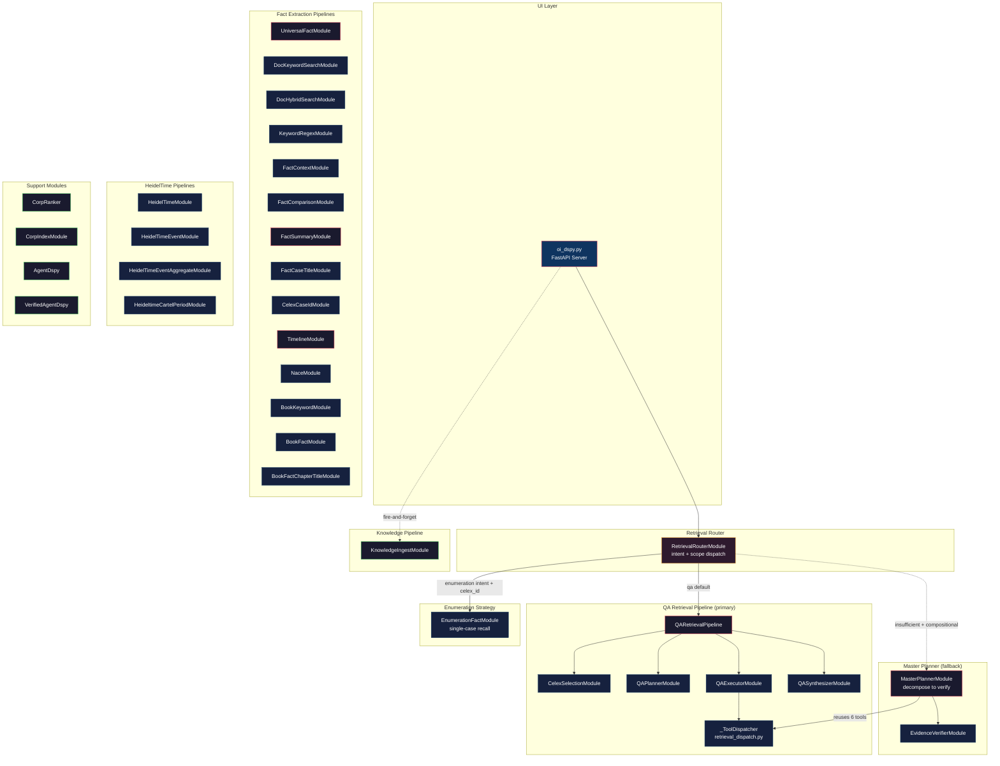
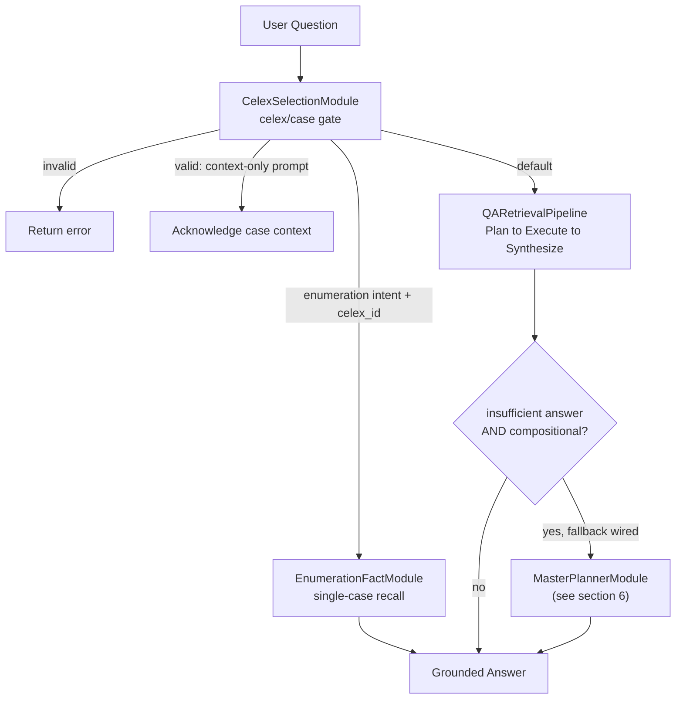
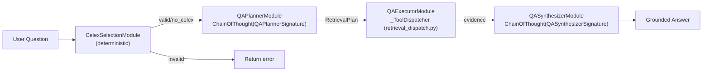
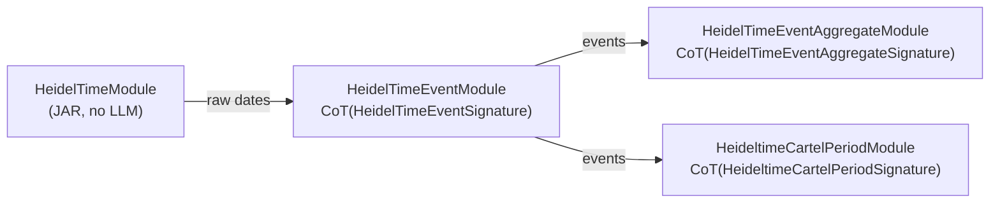
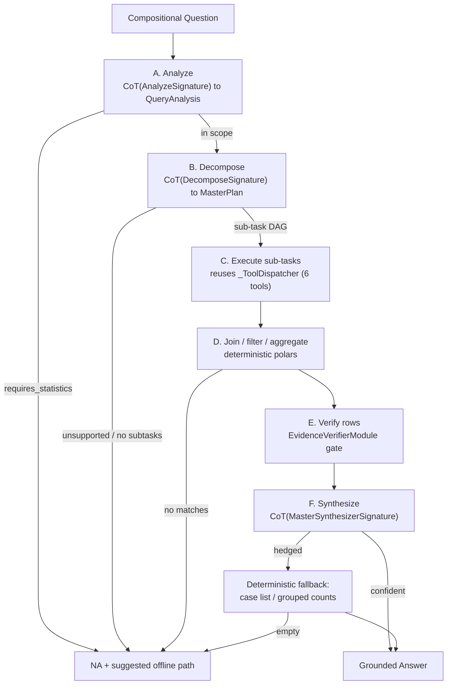

# DSPy Architecture — Complete Module & Signature Map

> **Reranker note:** `FlashRanker` mentions below (e.g. NaceModule) are the default backend of a now-pluggable reranker — see **[Design BgeRanker](Design%20BgeRanker.md)** (`settings.RERANKER_BACKEND`, `ranker_factory.create_ranker()`).

## System Overview

---

## 0. Retrieval Router (`retrieval_router.py`)

The top-level user-facing orchestrator built in `oi_dspy.py`. It gates the
celex/case reference, then dispatches each question across two axes
(enumeration intent + single-case scope) and escalates thin QA answers to the
Master Planner fallback.

| Module | Role | LLM? |
|---|---|---|
| [RetrievalRouterModule](file://~/a/celex-facts/src/pipelines/agent_dspy/retrieval_router.py#L300) | Intent + scope dispatch; Master Planner escalation gate | ❌ (heuristic `classify_retrieval_intent`) |
| [EnumerationFactModule](file://~/a/celex-facts/src/pipelines/agent_dspy/enumeration_fact_module.py#L120) | Single-case map-then-aggregate entity recall | ✅ |
| [QueryRouterModule](file://~/a/celex-facts/src/pipelines/agent_dspy/query_router.py#L78) | Per-case fact-extraction dispatch (batch side, YAML-driven) | ❌ |

---

## 1. QA Retrieval Pipeline (`retrieval_modules.py`)

The primary QA strategy, invoked by `RetrievalRouterModule` for default questions.

| Module | Signature Used | LLM? | Injected Protocols |
|---|---|---|---|
| [CelexSelectionModule](file://~/a/celex-facts/src/pipelines/agent_dspy/retrieval_modules.py#L923) | *(none — deterministic regex + DB)* | ❌ | `CelexValidator` |
| [QAPlannerModule](file://~/a/celex-facts/src/pipelines/agent_dspy/retrieval_modules.py#L1021) | `QAPlannerSignature` | ✅ CoT | `kb_schema` string |
| [QAExecutorModule](file://~/a/celex-facts/src/pipelines/agent_dspy/retrieval_modules.py#L1050) | *(none — dispatches tools)* | ❌ | `SQLFactStore`, `KBFactSearcher`, `CrossCaseAggregator`, `HybridSearcher`, `DocChunkSearcher` |
| [QASynthesizerModule](file://~/a/celex-facts/src/pipelines/agent_dspy/retrieval_modules.py#L1267) | `QASynthesizerSignature` | ✅ CoT | *(none)* |
| [QARetrievalPipeline](file://~/a/celex-facts/src/pipelines/agent_dspy/retrieval_modules.py#L1284) | *(orchestrator — composes above 4)* | — | All of the above |

---

## 2. Fact Extraction Modules (`universal_modules.py`)

Batch fact ingestion pipelines dispatched by `Main_ingest_generic_facts.py`.

| Module | Signature(s) | LLM? | Pipeline Config Name | Purpose |
|---|---|---|---|---|
| [UniversalFactModule](file://~/a/celex-facts/src/pipelines/agent_dspy/universal_modules.py#L313) | `GenericExtractionSignature`, `GenericVerificationSignature`, `DetermineSupportingChunksSignature` | ✅ CoT ×3 | `universal` | Core extraction + optional verification |
| [DocKeywordSearchModule](file://~/a/celex-facts/src/pipelines/agent_dspy/universal_modules.py#L444) | *(none)* | ❌ | `keyword_search` | SQL ILIKE boolean probe |
| [BookKeywordModule](file://~/a/celex-facts/src/pipelines/agent_dspy/universal_modules.py#L490) | *(none)* | ❌ | `book_keyword_exists` | Book embedding keyword probe |
| [BookFactModule](file://~/a/celex-facts/src/pipelines/agent_dspy/universal_modules.py#L565) | `GenericExtractionSignature` | ✅ CoT | `book_fact_extract` | Book hybrid search + LLM extraction |
| [BookFactChapterTitleModule](file://~/a/celex-facts/src/pipelines/agent_dspy/universal_modules.py#L654) | *(none)* | ❌ | `book_fact_extract` | Book chapter title lookup |
| [DocHybridSearchModule](file://~/a/celex-facts/src/pipelines/agent_dspy/universal_modules.py#L753) | *(none)* | ❌ | `doc_search` | Hybrid boolean probe |
| [KeywordRegexModule](file://~/a/celex-facts/src/pipelines/agent_dspy/universal_modules.py#L800) | *(none)* | ❌ | `doc_search` | Regex term matching |
| [FactContextModule](file://~/a/celex-facts/src/pipelines/agent_dspy/universal_modules.py#L839) | `DependentFactExtractionSignature` | ✅ CoT | `context_extraction` | Dependent-fact extraction (no doc search) |
| [FactComparisonModule](file://~/a/celex-facts/src/pipelines/agent_dspy/universal_modules.py#L902) | `FactComparisonSignature` | ✅ CoT | `comparison` | Legacy vs LLM fact comparison |
| [NaceModule](file://~/a/celex-facts/src/pipelines/agent_dspy/universal_modules.py#L975) | *(none — FlashRanker)* | ❌ | `nace` | NACE code classification |
| [FactSummaryModule](file://~/a/celex-facts/src/pipelines/agent_dspy/universal_modules.py#L1036) | `CaseSummarySignature` | ✅ CoT | `summary` | All-facts → wiki summary |
| [CelexCaseIdModule](file://~/a/celex-facts/src/pipelines/agent_dspy/universal_modules.py#L1103) | *(none)* | ❌ | `celex_case_id` | Pure SQL celex → case_id mapping |
| [FactCaseTitleModule](file://~/a/celex-facts/src/pipelines/agent_dspy/universal_modules.py#L1147) | `FactCaseTitleSignature` | ✅ Predict | `case_title` | Extract case title from first page |
| [TimelineModule](file://~/a/celex-facts/src/pipelines/agent_dspy/universal_modules.py#L1212) | `TimelineExtractionSignature` | ✅ CoT | `timeline` | Timeline table extraction |

---

## 3. HeidelTime Pipeline (`heideltime_module.py`)

Temporal expression extraction chain — deterministic JAR → LLM enrichment → LLM aggregation.

| Module | Signature | LLM? | Pipeline Config Name |
|---|---|---|---|
| [HeidelTimeModule](file://~/a/celex-facts/src/pipelines/heideltime/heideltime_module.py#L38) | *(none — HeidelTime JAR)* | ❌ | `heideltime_raw` |
| [HeidelTimeEventModule](file://~/a/celex-facts/src/pipelines/heideltime/heideltime_module.py#L144) | `HeidelTimeEventSignature` | ✅ CoT | `heideltime_event` |
| [HeidelTimeEventAggregateModule](file://~/a/celex-facts/src/pipelines/heideltime/heideltime_module.py#L243) | `HeidelTimeEventAggregateSignature` | ✅ CoT | `heideltime_event_agg` |
| [HeideltimeCartelPeriodModule](file://~/a/celex-facts/src/pipelines/heideltime/heideltime_module.py#L310) | `HeideltimeCartelPeriodSignature` | ✅ CoT | `heideltime_cartel_period` |

---

## 4. Knowledge Pipeline (`knowledge_ingest_module.py`)

Post-answer ingestion — extracts reusable know-how from agent traces.

| Module | Signature(s) | LLM? |
|---|---|---|
| [KnowledgeIngestModule](file://~/a/celex-facts/src/pipelines/agent_dspy/knowledge_ingest_module.py#L35) | `KnowHowExtractionSignature`, `QuestionVariantSignature` | ✅ Predict ×2 |

Knowledge signatures also include [KnowHowJudgeSignature](file://~/a/celex-facts/src/pipelines/agent_dspy/knowledge_signatures.py#L156) — used by `KnowledgeIngestor` directly.

---

## 5. Support Modules

| Module | File | Signature(s) | LLM? | Purpose |
|---|---|---|---|---|
| [CorpRanker](file://~/a/celex-facts/src/extract/rag/ranker/corp_ranker.py#L68) | `corp_ranker.py` | `ClassifyAliasSignature` | ✅ Predict | Corporate alias classification |
| [CorpIndexModule](file://~/a/celex-facts/src/pipelines/corp_index/corp_index_module.py#L51) | `corp_index_module.py` | `CorpIndexLookupSignature` | ✅ Predict (DeepSeek cloud) | BRIS/EUID/LEI resolution |
| [AgentDspy](file://~/a/celex-facts/src/agents/AgentDspy.py#L24) | `AgentDspy.py` | `ContextQuestion`, `ContextQuestionSimple` | ✅ CoT + Predict | Generic context Q&A wrapper |
| [VerifiedAgentDspy](file://~/a/celex-facts/src/agents/VerifiedAgentDspy.py#L17) | `VerifiedAgentDspy.py` | *(dynamic signatures)* | ✅ Refine + CoT | Constraint-verified extraction |

---

## 6. Master Planner Fallback (`master_planner_module.py`)

A fallback over the primary QA pipeline, invoked by `RetrievalRouterModule`
only when the answer is insufficient *and* the question is compositional
(multi-entity filtering or count / group-by aggregation). A static
decompose-then-execute DAG; all logic lives in `forward` / `run_events`
(Rule 2). Out-of-scope queries (statistical / causal / trend inference)
short-circuit to a clean NA.

| Stage | Signature | LLM? | Output |
|---|---|---|---|
| A. Analyze | `AnalyzeSignature` | ✅ CoT | `QueryAnalysis` (entities, target_type, NA flag) |
| B. Decompose | `DecomposeSignature` | ✅ CoT | `MasterPlan` (typed `SubTask` DAG) |
| C. Execute | *(none — `_ToolDispatcher`)* | ❌ | per-subtask evidence (celex/chunk/fact ids) |
| D. Join/Aggregate | *(none — polars)* | ❌ | `rows_df`, `group_df` |
| E. Verify | *(via `EvidenceVerifierModule`)* | ✅ | verified rows |
| F. Synthesize | `MasterSynthesizerSignature` | ✅ CoT | `MasterAnswer` (answer_md, confident, cited ids) |

| Module | File | Signature(s) | Purpose |
|---|---|---|---|
| [MasterPlannerModule](file://~/a/celex-facts/src/pipelines/agent_dspy/master_planner_module.py#L123) | `master_planner_module.py` | `AnalyzeSignature`, `DecomposeSignature`, `MasterSynthesizerSignature` | Compositional fallback agent |
| [EvidenceVerifierModule](file://~/a/celex-facts/src/pipelines/agent_dspy/evidence_verifier_module.py#L551) | `evidence_verifier_module.py` | *(per-row evidence gate)* | Keep only verifier-supported rows |

Master Planner signatures live in [master_planner_signature.py](file://~/a/celex-facts/src/pipelines/agent_dspy/master_planner_signature.py); pure catalog-grounding helpers (fact-name catalog, role synonyms, insufficiency/compositional detection) live in [master_planner_text.py](file://~/a/celex-facts/src/pipelines/agent_dspy/master_planner_text.py). The shared `_ToolDispatcher` and `KB_SCHEMA_DESCRIPTION` now live in [retrieval_dispatch.py](file://~/a/celex-facts/src/pipelines/agent_dspy/retrieval_dispatch.py#L300).

---

## Complete Signature Registry (`dspy_signature.py`)

All declarative signatures defined in [dspy_signature.py](file://~/a/celex-facts/src/pipelines/agent_dspy/dspy_signature.py):

| Signature | Output Type | Used By |
|---|---|---|
| `GenericExtractionSignature` | `ExtractionOutput` (Pydantic) | `UniversalFactModule`, `BookFactModule` |
| `GenericVerificationSignature` | `VerificationOutput` (Pydantic) | `UniversalFactModule` |
| `DetermineSupportingChunksSignature` | `SupportingChunksOutput` (Pydantic) | `UniversalFactModule` |
| `DependentFactExtractionSignature` | `ExtractionOutput` (Pydantic) | `FactContextModule` |
| `FactComparisonSignature` | `ComparisonOutput` (Pydantic) | `FactComparisonModule` |
| `NaceCodeSignature` | `NaceOutput` (Pydantic) | *(unused — NaceModule uses FlashRanker)* |
| `CaseSummarySignature` | `CaseSummaryChapters` (Pydantic) | `FactSummaryModule` |
| `FactCaseTitleSignature` | `CaseTitleOutput` (Pydantic) | `FactCaseTitleModule` |
| `TimelineExtractionSignature` | `TimelineOutput` (Pydantic) | `TimelineModule` |
| `HeidelTimeEventSignature` | `HeidelTimeEventOutput` (Pydantic) | `HeidelTimeEventModule` |
| `HeidelTimeEventAggregateSignature` | `HeidelTimeAggOutput` (Pydantic) | `HeidelTimeEventAggregateModule` |
| `HeideltimeCartelPeriodSignature` | `CartelPeriodOutput` (Pydantic) | `HeideltimeCartelPeriodModule` |
| `QAPlannerSignature` | `RetrievalPlan` (Pydantic) | `QAPlannerModule` |
| `QASynthesizerSignature` | `str` (answer) | `QASynthesizerModule` |

Knowledge signatures in [knowledge_signatures.py](file://~/a/celex-facts/src/pipelines/agent_dspy/knowledge_signatures.py):

| Signature | Output Type | Used By |
|---|---|---|
| `KnowHowExtractionSignature` | `KnowHowList` (Pydantic) | `KnowledgeIngestModule` |
| `QuestionVariantSignature` | `QuestionVariants` (Pydantic) | `KnowledgeIngestModule` |
| `KnowHowJudgeSignature` | `JudgeVerdict` (Pydantic) | `KnowledgeIngestor` |

Master Planner signatures in [master_planner_signature.py](file://~/a/celex-facts/src/pipelines/agent_dspy/master_planner_signature.py):

| Signature | Output Type | Used By |
|---|---|---|
| `AnalyzeSignature` | `QueryAnalysis` (Pydantic) | `MasterPlannerModule` |
| `DecomposeSignature` | `MasterPlan` (Pydantic) | `MasterPlannerModule` |
| `MasterSynthesizerSignature` | `MasterAnswer` (Pydantic) | `MasterPlannerModule` |

Other signatures:

| Signature | File | Used By |
|---|---|---|
| `CorpIndexLookupSignature` | [dspy_signature.py](file://~/a/celex-facts/src/pipelines/corp_index/dspy_signature.py) | `CorpIndexModule` |
| `ClassifyAliasSignature` | [corp_ranker.py](file://~/a/celex-facts/src/extract/rag/ranker/corp_ranker.py) | `CorpRanker` |
| `ContextQuestion` / `ContextQuestionSimple` | [AgentDspy.py](file://~/a/celex-facts/src/agents/AgentDspy.py) | `AgentDspy` |

---

## Summary Stats

Counts include the routing / Master Planner additions
(`RetrievalRouterModule`, `EnumerationFactModule`, `QueryRouterModule`,
`MasterPlannerModule`, `EvidenceVerifierModule`).

| Category | Count |
|---|---|
| **dspy.Module** subclasses | 29 |
| **dspy.Signature** subclasses | 23 (production) + 6 (test/play) |
| **LLM-calling** modules | 17 |
| **Deterministic** modules (no LLM) | 12 |
| Uses `ChainOfThought` | 15 |
| Uses `Predict` | 5 |
| Uses `Refine` | 1 (`VerifiedAgentDspy`) |

## universal_modules

Viewed retrieval_modules.py:1-800

Now let me see the rest of the file to understand `doc_search` more fully, and check for the test file:

Viewed retrieval_modules.py:686-780
Viewed dspy_protocols.py:1-169

Here's a clear breakdown of the two tools:

## `rag_search_in_case` vs `doc_search`

| Dimension                | `rag_search_in_case`                                                                                                                                               | `doc_search`                                                                                                                                                                                                                  |
| ------------------------ | ------------------------------------------------------------------------------------------------------------------------------------------------------------------ | ----------------------------------------------------------------------------------------------------------------------------------------------------------------------------------------------------------------------------- |
| **Scope**                | **Single case** — scoped to one `celex_id`                                                                                                                         | **Cross-case** — searches across all ~800 cases                                                                                                                                                                               |
| **Required input**       | `case_id` + `query`                                                                                                                                                | `query` only (no `case_id`)                                                                                                                                                                                                   |
| **Backend**              | [`HybridSearcher`](file://~/a/celex-facts/src/pipelines/agent_dspy/dspy_protocols.py#L123-L126) — a single `.search(celex_id, query, keyword, top_k)` call | [`DocChunkSearcher`](file://~/a/celex-facts/src/pipelines/agent_dspy/dspy_protocols.py#L35-L65) — three separate calls: `keyword_search_chunks_all_cases`, `semantic_search_chunks`, `keyword_count_chunks_all_cases` |
| **Search strategy**      | Hybrid (BM25 + semantic) within one document, using an ILIKE keyword extracted from `_UNSTRUCTURED_TOPICS`                                                         | **Keyword-first, then semantic supplement** — ILIKE keyword pass runs first (one chunk per case), semantic pass backfills cases the keyword pass missed                                                                       |
| **Deduplication**        | None — returns up to **15 raw chunks** from the document, potentially multiple chunks from the same position                                                       | Deduplicates by **`celex_id`** — at most one sample chunk per case, so the result is a case-level listing                                                                                                                     |
| **Counting support**     | ❌ No aggregate counts                                                                                                                                              | ✅ Emits a per-case keyword-count header via `keyword_count_chunks_all_cases`, enabling "how many…" answers                                                                                                                    |
| **Title enrichment**     | ❌ No case-title enrichment                                                                                                                                         | ✅ Enriches each result with `case_title` from the facts table                                                                                                                                                                 |
| **Chunk preview length** | 800 chars per chunk                                                                                                                                                | 400 chars per chunk                                                                                                                                                                                                           |
| **Typical use case**     | "Were there any court appeals in case 38344_5856_3?"                                                                                                               | "Which cases mention Koninklijke?" or "How many cases reference dawn raids?"                                                                                                                                                  |

### When each is chosen

The [post-plan injection gate](file://~/a/celex-facts/src/pipelines/agent_dspy/retrieval_modules.py#L331-L381) (`_inject_rag_step`) decides between the two:
- If a `case_id` is available from an earlier plan step → injects **`rag_search_in_case`**
- If no `case_id` is available (cross-case question) → injects **`doc_search`**

**TL;DR**: `rag_search_in_case` is a deep dive into one case's document chunks (hybrid search, 15 chunks, 800-char previews). `doc_search` is a wide sweep across all cases (keyword + semantic, deduplicated to one chunk per case, with aggregate counts for "how many" questions).
## heideltime_module
dspy modules is implemented in heideltime_module  rather than heideltime/src/pipelines/agent_dspy/universal_modules.py 

The separation is appropriate. Here's the reasoning:

**`universal_modules.py`** contains reusable modules built on generic protocols (`HybridSearcher`, `RegexRetriever`, etc.) — they could serve any fact type. Moving HeidelTime-specific code there would violate single-responsibility and pull in `HeidelTimeIngestor`, the JAR wrapper, and `heideltime_extractions` table details as dependencies.

**`heideltime_module.py`** is the right home because both modules are tightly coupled to HeidelTime's data flow:

- `HeidelTimeModule` depends on `HeidelTimeIngestor` and the JAR wrapper — neither belongs in a generic module
- `HeidelTimeEventModule` reads `celex_facts.heideltime_extractions` via `HeidelTimeEventRetriever`, which is a HeidelTime-specific protocol

The pattern is consistent with what `universal_modules.py` already does for timeline ([TimelineExtractionModule](vscode-webview://0j52sitmv3flu88jv314acsl5a6f5ct662vmvi6o9rad7mt2d0ll/src/pipelines/agent_dspy/universal_modules.py) uses `TimelineEventRetriever`) — the difference is that HeidelTime's retriever is specific enough that colocation with the JAR pipeline is cleaner.

One thing to watch: [heideltime_module.py](vscode-webview://0j52sitmv3flu88jv314acsl5a6f5ct662vmvi6o9rad7mt2d0ll/src/pipelines/heideltime/heideltime_module.py) imports from `pipelines.agent_dspy.*` (protocols, signatures, param VO). That's fine as a one-way dependency — `agent_dspy` stays unaware of `heideltime`. If that ever reverses, it's a smell worth addressing.

facts where name = 'heideltime_event'
CELEX-32000D0146

| event_date | actor                       | predicate_object                                                                                       |
| :--------- | :-------------------------- | :----------------------------------------------------------------------------------------------------- |
| 1962-02-06 | redacted                    | Council Regulation No 17 adopted                                                                       |
| 1970-07-15 | redacted                    | no activity described in text                                                                          |
| 1980-10-29 | redacted                    | no activity described in text                                                                          |
| 1986-01-28 | Court of Justice            | ruled on recommendations falling outside Article 81(1)                                                 |
| 1992-02-24 | Anheuser-Busch and Courage  | notified Commission of brewing, distribution, and marketing agreements                                 |
| 1993-05-14 | Anheuser-Busch and Courage  | amended brewing, distribution, and marketing agreements                                                |
| 1993-07-20 | redacted                    | Commission received copies of agreements                                                               |
| 1995-05-06 | redacted                    | entered into Beer Supply Agreement containing restrictions                                             |
| 1996-01-11 | Commission                  | wrote to S & N for confirmation of continued operation of agreements                                   |
| 1996-02-09 | S & N                       | informed the Commission of the agreements                                                              |
| 1996-02-09 | S & N                       | informed Commission of revised arrangements                                                            |
| 1997-02-27 | parties                     | discussed guidelines with Commission                                                                   |
| 1997-02-27 | S & N                       | acknowledged communication of guidelines and agreed to comply with Budweiser marketing guidelines      |
| 1997-02-27 | redacted                    | no activity described in text                                                                          |
| 1997-02-27 | Anheuser-Busch              | communicated Budweiser marketing guidelines to S & N                                                   |
| 1997-02-27 | Anheuser-Busch and S&N      | issued Budweiser marketing guidelines                                                                  |
| 1997-02-27 | Anheuser-Busch              | issued Budweiser marketing guidelines to major brewer-wholesaler customers                             |
| 1997-02-27 | Anheuser-Busch              | sent letter to Scottish Courage Limited                                                                |
| 1997-02-28 | S & N                       | provided comments on draft guidelines and pledged to use reasonable efforts to ensure compliance       |
| 1997-02-28 | Anheuser-Busch              | sent letter to Scottish Courage Limited                                                                |
| 1997-03-14 | S & N                       | issued letter asserting relationship governed by 1995 agreements                                       |
| 1997-03-14 | S & N                       | informed the Commission about the relationship governed by 1995 agreements                             |
| 1997-06-03 | redacted                    | no activity described in text                                                                          |
| 1997-06-03 | Commission                  | made a formal request for information                                                                  |
| 1997-06-03 | European Commission         | sent request for information                                                                           |
| 1997-06-03 | Commission                  | informed of no further changes in agreements                                                           |
| 1997-07-02 | redacted                    | anticipated completion of renegotiation                                                                |
| 1997-07-02 | Anheuser-Busch Inc. and S&N | supplied incorrect information in response to request                                                  |
| 1997-07-02 | redacted                    | began period of incorrect information supply                                                           |
| 1997-12-17 | Anheuser-Busch Inc.         | submitted incorrect information hindering investigation                                                |
| 1997-12-17 | Commission                  | notified Anheuser-Busch and S&N of preliminary assessment                                              |
| 1998-02-16 | Anheuser-Busch              | furnished guidelines to the Commission                                                                 |
| 1998-02-16 | redacted                    | voluntarily supplied guidelines to Commission                                                          |
| 1998-02-16 | Commission                  | received folder containing 34 documents                                                                |
| 1998-02-28 | Anheuser-Busch              | indicated that S & N's commitment to the guidelines was important                                      |
| 1998-03-18 | Commission                  | met with representatives of Anheuser-Busch and S&N                                                     |
| 1998-04-23 | S & N                       | issued unilateral letter attacking commercial relationship                                             |
| 1998-04-23 | Scottish Courage            | referenced marketing guidelines as part of agreement                                                   |
| 1998-04-23 | S & N                       | clearly indicated that S & N is and was of the view that the guidelines alter the overall arrangements |
| 1998-04-23 | S&N Strategy Director       | responded to informal requests for information and drew attention to Budweiser marketing guidelines    |
| 1998-04-27 | Anheuser-Busch Incorporated | submitted replies to Statement of Objections                                                           |
| 1998-05-03 | redacted                    | no activity described in text                                                                          |
| 1998-07-13 | Commission                  | issued second warning letter concerning marketing guidelines                                           |
| 1998-08-04 | Commission                  | sent Statement of Objections                                                                           |
| 1998-08-04 | redacted                    | no activity described in text                                                                          |
| 1998-10-16 | Anheuser-Busch Incorporated | submitted reply to Statement of Objections                                                             |
| 1998-10-27 | Scottish & Newcastle plc    | submitted reply to Statement of Objections                                                             |
| 1999-05-06 | Scottish & Newcastle plc    | submitted further replies to Statement of Objections                                                   |
| 1999-12-14 | Commission                  | adopted Commission Decision                                                                            |
| 1999-12-14 | redacted                    | issued Decision on fines and liability                                                                 |

## Main_ingest_generic_facts

src/batch/Main_ingest_generic_facts.py:
if a   pipeline such as  heideltime_event defines a predecessors such as   heideltime_raw
and this predecessor does not exists, 
the pipeline shall not start 
AND not insert anything to the fact table.

| event_date | actor                                                          | predicate_object                                                                                                   |
| :--------- | :------------------------------------------------------------- | :----------------------------------------------------------------------------------------------------------------- |
| 2002-12-16 | redacted                                                       | Council Regulation (EC) No 1/2003 adopted                                                                          |
| 2004-04-07 | redacted                                                       | Commission Regulation (EC) No 773/2004 adopted                                                                     |
| 2004-07-07 | Valeo S.A. and Valeo Service SAS                               | participated in coordinated pricing conspiracy                                                                     |
| 2004-07-07 | Commission                                                     | concludes duration of infringement                                                                                 |
| 2004-07-07 | Valeo                                                          | infringement period began                                                                                          |
| 2004-07-07 | Valeo                                                          | began business relationship with VW, General Motors, BMW, Fiat, PSA, Renault, and Iveco                            |
| 2004-07-07 | Valeo Service SAS                                              | acknowledged liability for direct participation in the infringement                                                |
| 2004-07-07 | Valeo                                                          | sales occurred                                                                                                     |
| 2004-07-07 | redacted                                                       | no activity described in text                                                                                      |
| 2004-07-07 | redacted                                                       | infringement began                                                                                                 |
| 2005-05-20 | Valeo Vision SAS                                               | participated in coordinated pricing conspiracy                                                                     |
| 2005-05-20 | Valeo Vision SAS                                               | acknowledged liability for direct participation in the infringement                                                |
| 2006-01-01 | Hella KGaA Hueck & Co.                                         | participated in coordinated pricing conspiracy                                                                     |
| 2006-01-01 | AutomotiveLighting                                             | infringement period began                                                                                          |
| 2006-01-01 | AutomotiveLighting                                             | began business relationship with Daimler Chrysler                                                                  |
| 2006-01-01 | Hella KGaA Hueck & Co.                                         | acknowledged liability for direct participation in the infringement                                                |
| 2006-01-01 | Automotive Lighting                                            | sales occurred                                                                                                     |
| 2007-01-01 | Hella                                                          | begins participation in infringement                                                                               |
| 2007-01-01 | AutomotiveLighting                                             | infringement period began                                                                                          |
| 2007-01-01 | redacted                                                       | began business relationship with all other customers                                                               |
| 2007-01-01 | Valeo                                                          | sales occurred                                                                                                     |
| 2007-01-01 | redacted                                                       | infringement period commenced for Group 2 customers                                                                |
| 2007-07-07 | redacted                                                       | no activity described in text                                                                                      |
| 2007-10-25 | Automotive Lighting Reutlingen GmbH and Magneti Marelli S.p.A. | ended participation in coordinated pricing conspiracy                                                              |
| 2007-10-25 | Commission                                                     | concludes end of infringement                                                                                      |
| 2007-10-25 | Valeo                                                          | infringement period ended                                                                                          |
| 2007-10-25 | redacted                                                       | ended business relationship with all customers                                                                     |
| 2007-10-25 | Commission                                                     | imputed liability jointly and severally to all parties involved                                                    |
| 2007-10-25 | Hella                                                          | sales concluded                                                                                                    |
| 2007-10-25 | redacted                                                       | no activity described in text                                                                                      |
| 2007-10-25 | redacted                                                       | end of participation in the infringement                                                                           |
| 2007-10-25 | redacted                                                       | infringement period concluded for Group 2 customers                                                                |
| 2007-10-25 | redacted                                                       | infringement ended                                                                                                 |
| 2012-01-25 | Valeo                                                          | submitted immunity application under Leniency Notice                                                               |
| 2012-01-25 | Valeo                                                          | applied for immunity under the Leniency Notice                                                                     |
| 2012-07-31 | the Commission                                                 | carried out unannounced inspections at the premises of Automotive Lighting and Hella                               |
| 2012-08-07 | redacted                                                       | no activity described in text                                                                                      |
| 2012-08-10 | Automotive Lighting                                            | applied for reduction of fines                                                                                     |
| 2012-08-10 | Automotive Lighting                                            | applied for a reduction of a fine under the Leniency Notice                                                        |
| 2012-09-18 | Hella                                                          | applied for reduction of fines                                                                                     |
| 2012-09-18 | Hella                                                          | applied for a reduction of a fine under the Leniency Notice                                                        |
| 2015-06-01 | redacted                                                       | no activity described in text                                                                                      |
| 2016-01-01 | redacted                                                       | no activity described in text                                                                                      |
| 2016-05-18 | redacted                                                       | Commission initiated proceedings                                                                                   |
| 2016-05-18 | Valeo                                                          | granted conditional immunity from fines                                                                            |
| 2016-05-18 | the Commission                                                 | granted conditional immunity from fines and initiated proceedings against the parties                              |
| 2016-05-31 | redacted                                                       | no activity described in text                                                                                      |
| 2016-07-06 | redacted                                                       | no activity described in text                                                                                      |
| 2016-12-31 | redacted                                                       | no activity described in text                                                                                      |
| 2017-05-10 | Commission                                                     | adopted Statement of Objections addressed to the parties                                                           |
| 2017-05-10 | parties                                                        | replied to the Statement of Objections by confirming settlement submissions and commitment to settlement procedure |
| 2017-06-21 | redacted                                                       | Commission decision published                                                                                      |
| 2017-06-21 | redacted                                                       | no activity described in text                                                                                      |

| event      | actor                                                          | predicate object                                                                                                   |
| :--------- | :------------------------------------------------------------- | :----------------------------------------------------------------------------------------------------------------- |
| 2004-07-07 | Valeo S.A. and Valeo Service SAS                               | participated in coordinated pricing conspiracy                                                                     |
| 2004-07-07 | Valeo                                                          | infringement period began                                                                                          |
| 2004-07-07 | Valeo Service SAS                                              | acknowledged liability for direct participation in the infringement                                                |
| 2005-05-20 | Valeo Vision SAS                                               | participated in coordinated pricing conspiracy                                                                     |
| 2005-05-20 | Valeo Vision SAS                                               | acknowledged liability for direct participation in the infringement                                                |
| 2006-01-01 | Hella KGaA Hueck & Co.                                         | participated in coordinated pricing conspiracy                                                                     |
| 2006-01-01 | Hella KGaA Hueck & Co.                                         | acknowledged liability for direct participation in the infringement                                                |
| 2006-01-01 | AutomotiveLighting                                             | infringement period began                                                                                          |
| 2007-01-01 | Hella                                                          | begins participation in infringement                                                                               |
| 2012-01-25 | Valeo                                                          | submitted immunity application under Leniency Notice                                                               |
| 2012-08-10 | Automotive Lighting                                            | applied for reduction of fines                                                                                     |
| 2012-09-18 | Hella                                                          | applied for reduction of fines                                                                                     |
| event_date | actor                                                          | predicate_object                                                                                                   |
| 2002-12-16 | redacted                                                       | Council Regulation (EC) No 1/2003 adopted                                                                          |
| 2004-04-07 | redacted                                                       | Commission Regulation (EC) No 773/2004 adopted                                                                     |
| 2004-07-07 | Valeo S.A. and Valeo Service SAS                               | participated in coordinated pricing conspiracy                                                                     |
| 2004-07-07 | Commission                                                     | concludes duration of infringement                                                                                 |
| 2004-07-07 | Valeo                                                          | infringement period began                                                                                          |
| 2004-07-07 | Valeo                                                          | began business relationship with VW, General Motors, BMW, Fiat, PSA, Renault, and Iveco                            |
| 2004-07-07 | Valeo Service SAS                                              | acknowledged liability for direct participation in the infringement                                                |
| 2004-07-07 | Valeo                                                          | sales occurred                                                                                                     |
| 2004-07-07 | redacted                                                       | no activity described in text                                                                                      |
| 2004-07-07 | redacted                                                       | infringement began                                                                                                 |
| 2005-05-20 | Valeo Vision SAS                                               | participated in coordinated pricing conspiracy                                                                     |
| 2005-05-20 | Valeo Vision SAS                                               | acknowledged liability for direct participation in the infringement                                                |
| 2006-01-01 | Hella KGaA Hueck & Co.                                         | participated in coordinated pricing conspiracy                                                                     |
| 2006-01-01 | AutomotiveLighting                                             | infringement period began                                                                                          |
| 2006-01-01 | AutomotiveLighting                                             | began business relationship with Daimler Chrysler                                                                  |
| 2006-01-01 | Hella KGaA Hueck & Co.                                         | acknowledged liability for direct participation in the infringement                                                |
| 2006-01-01 | Automotive Lighting                                            | sales occurred                                                                                                     |
| 2007-01-01 | Hella                                                          | begins participation in infringement                                                                               |
| 2007-01-01 | AutomotiveLighting                                             | infringement period began                                                                                          |
| 2007-01-01 | redacted                                                       | began business relationship with all other customers                                                               |
| 2007-01-01 | Valeo                                                          | sales occurred                                                                                                     |
| 2007-01-01 | redacted                                                       | infringement period commenced for Group 2 customers                                                                |
| 2007-07-07 | redacted                                                       | no activity described in text                                                                                      |
| 2007-10-25 | Automotive Lighting Reutlingen GmbH and Magneti Marelli S.p.A. | ended participation in coordinated pricing conspiracy                                                              |
| 2007-10-25 | Commission                                                     | concludes end of infringement                                                                                      |
| 2007-10-25 | Valeo                                                          | infringement period ended                                                                                          |
| 2007-10-25 | redacted                                                       | ended business relationship with all customers                                                                     |
| 2007-10-25 | Commission                                                     | imputed liability jointly and severally to all parties involved                                                    |
| 2007-10-25 | Hella                                                          | sales concluded                                                                                                    |
| 2007-10-25 | redacted                                                       | no activity described in text                                                                                      |
| 2007-10-25 | redacted                                                       | end of participation in the infringement                                                                           |
| 2007-10-25 | redacted                                                       | infringement period concluded for Group 2 customers                                                                |
| 2007-10-25 | redacted                                                       | infringement ended                                                                                                 |
| 2012-01-25 | Valeo                                                          | submitted immunity application under Leniency Notice                                                               |
| 2012-01-25 | Valeo                                                          | applied for immunity under the Leniency Notice                                                                     |
| 2012-07-31 | the Commission                                                 | carried out unannounced inspections at the premises of Automotive Lighting and Hella                               |
| 2012-08-07 | redacted                                                       | no activity described in text                                                                                      |
| 2012-08-10 | Automotive Lighting                                            | applied for reduction of fines                                                                                     |
| 2012-08-10 | Automotive Lighting                                            | applied for a reduction of a fine under the Leniency Notice                                                        |
| 2012-09-18 | Hella                                                          | applied for reduction of fines                                                                                     |
| 2012-09-18 | Hella                                                          | applied for a reduction of a fine under the Leniency Notice                                                        |
| 2015-06-01 | redacted                                                       | no activity described in text                                                                                      |
| 2016-01-01 | redacted                                                       | no activity described in text                                                                                      |
| 2016-05-18 | redacted                                                       | Commission initiated proceedings                                                                                   |
| 2016-05-18 | Valeo                                                          | granted conditional immunity from fines                                                                            |
| 2016-05-18 | the Commission                                                 | granted conditional immunity from fines and initiated proceedings against the parties                              |
| 2016-05-31 | redacted                                                       | no activity described in text                                                                                      |
| 2016-07-06 | redacted                                                       | no activity described in text                                                                                      |
| 2016-12-31 | redacted                                                       | no activity described in text                                                                                      |
| 2017-05-10 | Commission                                                     | adopted Statement of Objections addressed to the parties                                                           |
| 2017-05-10 | parties                                                        | replied to the Statement of Objections by confirming settlement submissions and commitment to settlement procedure |
| 2017-06-21 | redacted                                                       | Commission decision published                                                                                      |
| 2017-06-21 | redacted                                                       | no activity described in text                                                                                      |

## anomalie: if heideltime_raw is not given, the LLM is doing its own thing see 40013_1084_2:
- [ ] anomalie: if heideltime_raw is not given, the LLM is doing its own thing see 40013_1084_2 ⏫
 
40013_1084_2	heideltime_raw	NA
40013_1084_2	heideltime_event_agg	"| event      | actor                            | predicate object                                                    |
|:-----------|:---------------------------------|:--------------------------------------------------------------------|
| 2004-07-07 | Valeo S.A. and Valeo Service SAS | participated in coordinated pricing conspiracy                      |
| 2004-07-07 | Valeo                            | infringement period began                                           |
| 2004-07-07 | Valeo Service SAS                | acknowledged liability for direct participation in the infringement |
| 2005-05-20 | Valeo Vision SAS                 | participated in coordinated pricing conspiracy                      |
| 2005-05-20 | Valeo Vision SAS                 | acknowledged liability for direct participation in the infringement |
| 2006-01-01 | Hella KGaA Hueck & Co.           | participated in coordinated pricing conspiracy                      |
| 2006-01-01 | Hella KGaA Hueck & Co.           | acknowledged liability for direct participation in the infringement |
| 2006-01-01 | AutomotiveLighting               | infringement period began                                           |
| 2007-01-01 | Hella                            | begins participation in infringement                                |
| 2012-01-25 | Valeo                            | submitted immunity application under Leniency Notice                |
| 2012-08-10 | Automotive Lighting              | applied for reduction of fines                                      |
| 2012-09-18 | Hella                            | applied for reduction of fines                                      |"
40013_1084_2	heideltime_event	"| event_date   | actor                                                          | predicate_object                                                                                                   |
|:-------------|:---------------------------------------------------------------|:-------------------------------------------------------------------------------------------------------------------|
| 2002-12-16   | redacted                                                       | Council Regulation (EC) No 1/2003 adopted                                                                          |
| 2004-04-07   | redacted                                                       | Commission Regulation (EC) No 773/2004 adopted                                                                     |
| 2004-07-07   | Valeo S.A. and Valeo Service SAS                               | participated in coordinated pricing conspiracy                                                                     |
| 2004-07-07   | Commission                                                     | concludes duration of infringement                                                                                 |
| 2004-07-07   | Valeo                                                          | infringement period began                                                                                          |
| 2004-07-07   | Valeo                                                          | began business relationship with VW, General Motors, BMW, Fiat, PSA, Renault, and Iveco                            |
| 2004-07-07   | Valeo Service SAS                                              | acknowledged liability for direct participation in the infringement                                                |
| 2004-07-07   | Valeo                                                          | sales occurred                                                                                                     |
| 2004-07-07   | redacted                                                       | no activity described in text                                                                                      |
| 2004-07-07   | redacted                                                       | infringement began                                                                                                 |
| 2005-05-20   | Valeo Vision SAS                                               | participated in coordinated pricing conspiracy                                                                     |
| 2005-05-20   | Valeo Vision SAS                                               | acknowledged liability for direct participation in the infringement                                                |
| 2006-01-01   | Hella KGaA Hueck & Co.                                         | participated in coordinated pricing conspiracy                                                                     |
| 2006-01-01   | AutomotiveLighting                                             | infringement period began                                                                                          |
| 2006-01-01   | AutomotiveLighting                                             | began business relationship with Daimler Chrysler                                                                  |
| 2006-01-01   | Hella KGaA Hueck & Co.                                         | acknowledged liability for direct participation in the infringement                                                |
| 2006-01-01   | Automotive Lighting                                            | sales occurred                                                                                                     |
| 2007-01-01   | Hella                                                          | begins participation in infringement                                                                               |
| 2007-01-01   | AutomotiveLighting                                             | infringement period began                                                                                          |
| 2007-01-01   | redacted                                                       | began business relationship with all other customers                                                               |
| 2007-01-01   | Valeo                                                          | sales occurred                                                                                                     |
| 2007-01-01   | redacted                                                       | infringement period commenced for Group 2 customers                                                                |
| 2007-07-07   | redacted                                                       | no activity described in text                                                                                      |
| 2007-10-25   | Automotive Lighting Reutlingen GmbH and Magneti Marelli S.p.A. | ended participation in coordinated pricing conspiracy                                                              |
| 2007-10-25   | Commission                                                     | concludes end of infringement                                                                                      |
| 2007-10-25   | Valeo                                                          | infringement period ended                                                                                          |
| 2007-10-25   | redacted                                                       | ended business relationship with all customers                                                                     |
| 2007-10-25   | Commission                                                     | imputed liability jointly and severally to all parties involved                                                    |
| 2007-10-25   | Hella                                                          | sales concluded                                                                                                    |
| 2007-10-25   | redacted                                                       | no activity described in text                                                                                      |
| 2007-10-25   | redacted                                                       | end of participation in the infringement                                                                           |
| 2007-10-25   | redacted                                                       | infringement period concluded for Group 2 customers                                                                |
| 2007-10-25   | redacted                                                       | infringement ended                                                                                                 |
| 2012-01-25   | Valeo                                                          | submitted immunity application under Leniency Notice                                                               |
| 2012-01-25   | Valeo                                                          | applied for immunity under the Leniency Notice                                                                     |
| 2012-07-31   | the Commission                                                 | carried out unannounced inspections at the premises of Automotive Lighting and Hella                               |
| 2012-08-07   | redacted                                                       | no activity described in text                                                                                      |
| 2012-08-10   | Automotive Lighting                                            | applied for reduction of fines                                                                                     |
| 2012-08-10   | Automotive Lighting                                            | applied for a reduction of a fine under the Leniency Notice                                                        |
| 2012-09-18   | Hella                                                          | applied for reduction of fines                                                                                     |
| 2012-09-18   | Hella                                                          | applied for a reduction of a fine under the Leniency Notice                                                        |
| 2015-06-01   | redacted                                                       | no activity described in text                                                                                      |
| 2016-01-01   | redacted                                                       | no activity described in text                                                                                      |
| 2016-05-18   | redacted                                                       | Commission initiated proceedings                                                                                   |
| 2016-05-18   | Valeo                                                          | granted conditional immunity from fines                                                                            |
| 2016-05-18   | the Commission                                                 | granted conditional immunity from fines and initiated proceedings against the parties                              |
| 2016-05-31   | redacted                                                       | no activity described in text                                                                                      |
| 2016-07-06   | redacted                                                       | no activity described in text                                                                                      |
| 2016-12-31   | redacted                                                       | no activity described in text                                                                                      |
| 2017-05-10   | Commission                                                     | adopted Statement of Objections addressed to the parties                                                           |
| 2017-05-10   | parties                                                        | replied to the Statement of Objections by confirming settlement submissions and commitment to settlement procedure |
| 2017-06-21   | redacted                                                       | Commission decision published                                                                                      |
| 2017-06-21   | redacted                                                       | no activity described in text                                                                                      |"

| event      | actor                                                                                            | predicate object                                                    |
|:-----------|:-------------------------------------------------------------------------------------------------|:--------------------------------------------------------------------|
| 2004-07-07 | Valeo S.A. and Valeo Service SAS, Automotive Lighting Reutlingen GmbH and Magneti Marelli S.p.A. | coordinated prices and trading conditions                           |
| 2004-07-07 | Valeo                                                                                            | began participating in infringement                                 |
| 2004-07-07 | Valeo Service SAS                                                                                | acknowledged liability for direct participation in the infringement |
| 2005-05-20 | Valeo Vision SAS                                                                                 | joined coordinated pricing                                          |
| 2005-05-20 | Valeo Vision SAS                                                                                 | acknowledged liability for direct participation in the infringement |
| 2006-01-01 | Hella KGaA Hueck & Co.                                                                           | joined coordinated pricing                                          |
| 2006-01-01 | Hella KGaA Hueck & Co.                                                                           | acknowledged liability for direct participation in the infringement |
| 2007-01-01 | Hella                                                                                            | began participating in infringement                                 |
| 2012-01-25 | Valeo                                                                                            | submitted immunity application under Leniency Notice                |
| 2016-05-18 | Valeo                                                                                            | was granted conditional immunity from fines                         |
| 2017-06-21 | European Commission                                                                              | issued decision in case                                             |
| 2017-06-21 | Commission Margrethe VESTAGER                                                                    | signed decision                                                     |

## Q-prompt
currently, I use ~/a/celex-facts/src/batch/Main_ingest_heideltime.py to ingest date events into celex_facts.heideltime_extractions but I want to add the pipeline into ~/a/celex-facts/src/batch/Main_ingest_generic_facts.py and using proxy fact heideltime_raw to point to the celex_facts.heideltime_extractions table for dependency management. The output of heideltime_extractions is typically hundreds of dates/events and wouldnt fit in the concept of facts table. Please review any options I have to keep heideltime_extractions table with the raw dates/events but leverage celex_facts.facts where name = 'heideltime_raw' for predecessor mangement

proxy-fact approach into the generic pipeline.

heideltime_raw now behaves as a lightweight dependency marker instead of trying to mirror hundreds of raw TIMEX rows into celex_facts.facts. The raw source of truth stays in celex_facts.heideltime_extractions, and the generic pipeline persists a compact proxy payload like counts/min-max dates through src/pipelines/heideltime/heideltime_module.py and src/pipelines/rag/pgvector/heideltime_ingestor.py. I also re-enabled heideltime_event -> heideltime_raw in config_main/FACT_EXTRACTOR.yaml, so predecessor management now works through the existing facts machinery.

This is the best fit for your current codebase because it preserves the existing dependency checks in Main_ingest_generic_facts.py without forcing raw HeidelTime rows into the facts model. The main tradeoff is that the proxy row can drift from heideltime_extractions if someone deletes raw rows manually while leaving facts.name = 'heideltime_raw' behind. If you want stricter consistency later, the next step would be to give heideltime_raw a custom exists() check that validates both the proxy fact and the raw table before skipping.

Verification: the targeted unit suites passed with .venv/bin/python -m unittest src.pipelines.heideltime.tests.test_extract_heideltime.TestHeidelTimeModule -v and .venv/bin/python -m unittest src.batch.tests.test_Main_ingest_generic_facts.TestFactIngestionOrchestratorDependencies -v. The broader HeidelTime test module still has one pre-existing integration failure because the live PostgreSQL connection was unavailable in this environment.