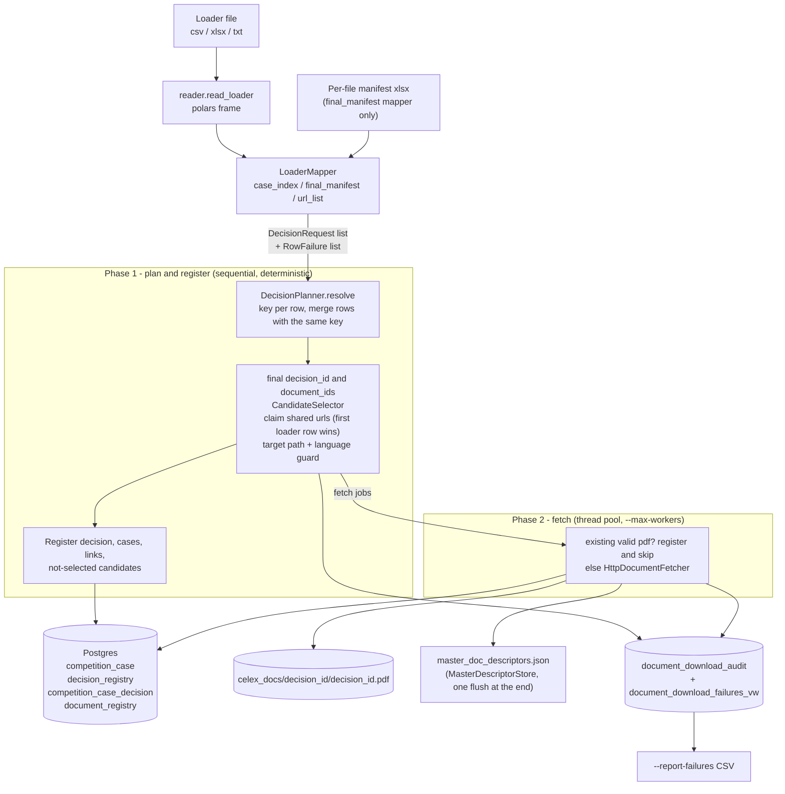
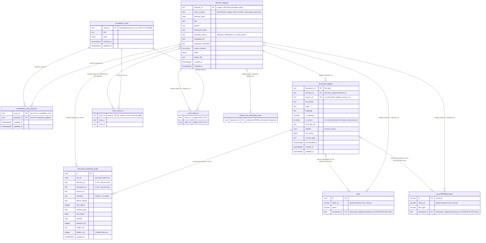

`20261028

#ingestion
# Design — HTTP Document Downloader

This document describes what was **built** for the HTTP document downloader: a batch that reads a loader file (csv, xlsx or a plain url list) of EU competition decisions, picks the PDF to keep per decision, downloads it, and records the result in the Postgres document registry, the master descriptor JSON and an append-only audit table. Where the code differs from the approved design, the code wins; the differences are listed in [Differences from the original design](#differences-from-the-original-design).

Plans: [approved design](claude/plans/2026-10-25-http-document-downloader-design.md), [implementation plan](claude/plans/2026-10-27-http-document-downloader-implementation.md). Related: [Design BgeRanker](Design%20BgeRanker.md) (sibling design doc), [Design 101 -- Provisioner Pattern](Design%20101%20--%20Provisioner%20Pattern.md) (repositories and the fetcher are injected, not created inside the orchestrator).

---

## 1. Intent and non-goals

**Intent.** Lists of decision documents arrive ad hoc (CELEX numbers, EC case PDFs, db-comp.eu documents). Each decision gets one stored PDF (English first), a master-JSON entry that the later MinerU and fact pipelines pick up, a registry row per candidate document, and an audit row for every attempt, so that "what is still missing" is one query.

**Non-goals.**

- No HTML processing: HTML URLs are registered as `not_selected` candidates, never fetched (MinerU input is PDF).
- No translation and no language decision after OCR; see [section 11](#11-known-limitations-and-follow-ups).
- No change to the legacy tables `celex_case_id` and `case_celex_id`; they are not written or altered.
- No inference of any kind; the batch is plain HTTP, SQL and file IO.

---

## 2. Data flow



**Two-phase run.** `DownloadOrchestrator.run` first plans and registers **all** decisions one after another (through a per-run `DecisionPlanner`), then fetches the selected candidates on a thread pool. Planning is sequential so that decision ids, collision suffixes and shared-URL ownership do not depend on download completion order. A source URL is **claimed** in phase 1 and the **first loader row wins**; a later decision that selects the same URL is audited `not_selected` with reason `url_claimed_by_<decision_id>` plus a review reason, not `failed`. Claims are only taken for **selected** candidates, so a not-selected URL in decision A cannot deprive a later decision B that selects it.

**Merge of duplicate rows.** Before planning, `DecisionPlanner.resolve` computes each row's key (no collision suffix yet): the CELEX key, or the existing master key, or the provisional id. Rows that resolve to the **same key** are merged into the first row's decision (case ids and candidates united, candidates deduplicated by URL; the first row's fields, meta, title and `loader_row` win, blank fields are filled from later rows), with the review reason `merged duplicate row <row> of <file> (<id>)`. The merged decision is selected **once**, so two language versions of one decision never become two master entries: real rows 272 (EN PDF) and 274 (DE PDF only) of the filtered manifest, both CELEX `31988D0172`, become one decision with the EN document selected. Only `DEC-` fallback ids are never merged; they keep the `_2` collision suffix.

**Master-key reuse.** When a row's CELEX key is not itself a master key but its selected PDF URL is already the `url_pdf` of master entry K, K is reused as the decision id with the review reason `CELEX <x> differs from master key <K>` (real case: the case-index row with celex `CELEX-32002D0758` whose URL is the `(01)` act stored as `CELEX-32002D0758_01`).

**Dry-run guarantee.** With `--dry-run` no writer is called (`OutcomeRecorder` is the single place that guards registry and audit writes; the store and the fetcher are not reached): no file, no master JSON write or backup, no registry row, no audit row (the audit included). Registry and store reads still happen (existence checks, table probe), so a dry run against a database whose migration is not applied exits 2. Planned fetches count as `downloaded` in the summary.

The master JSON is flushed once at the end of the run (also if the run fails part-way), so a crash mid-run leaves the previous file intact.

---

## 3. Module map

| Module                                                                                                                                   | Responsibility                                                                                                                                                                                                                                                         |
| :--------------------------------------------------------------------------------------------------------------------------------------- | :--------------------------------------------------------------------------------------------------------------------------------------------------------------------------------------------------------------------------------------------------------------------- |
| `src/batch/Main_download_documents.py`                                                                                                   | CLI: argument parsing, loader read and map, pipeline wiring, summary log, failure CSV, exit codes.                                                                                                                                                                     |
| `src/pipelines/download/models.py`                                                                                                       | Pydantic models: `Outcome`, `SelectionStatus`, `CandidateDocument`, `DecisionRequest`, `RowFailure`, `FetchResult`, `MapperResult`.                                                                                                                                    |
| `src/pipelines/download/reader.py`                                                                                                       | `read_loader`: csv (delimiter sniffing), xlsx, txt into a polars frame; blank rows dropped.                                                                                                                                                                            |
| `src/pipelines/download/mappers.py`                                                                                                      | The three `LoaderMapper` classes, `mapper_for` (name, header or extension detection) and `build_mapper`.                                                                                                                                                               |
| `src/pipelines/download/mapping_rules.py`                                                                                                | Shared mapper helpers: cell cleaning, case id and date parsing, origin and format inference, duplicate-CELEX detection, candidate building.                                                                                                                            |
| `src/pipelines/download/identifiers.py`                                                                                                  | `celex_key`, `decision_id_for`, `document_id_for`, `detect_language`, `normalize_case_id`, `pdf_url_key`; raises `UnsafeIdentifier`.                                                                                                                                   |
| `src/pipelines/download/selector.py`                                                                                                     | `CandidateSelector`: the EN-first selection rules. Pure logic.                                                                                                                                                                                                         |
| `src/pipelines/download/fetcher.py`                                                                                                      | `HttpDocumentFetcher`: streamed, hashed, `%PDF-` checked, atomic download with retries.                                                                                                                                                                                |
| `src/pipelines/download/local_pdf.py`                                                                                                    | Target path layout, `is_valid_pdf`, `existing_file_result` (describe an existing file without HTTP).                                                                                                                                                                   |
| `src/pipelines/download/descriptor_store.py`                                                                                             | `MasterDescriptorStore`: merge-only, atomic writer of the master JSON; read-only accessors `has_key`, `local_file_pdf`, `language_init`, `url_pdf`, `find_key_by_pdf_url`.                                                                                             |
| `src/pipelines/download/planner.py`                                                                                                      | `DecisionPlanner`: key resolution and merge of duplicate rows, master-key reuse, final ids and collision suffix, candidate id re-derivation, URL claims, target paths with the language guard, decision registration before any fetch; `FetchJob`, `ResolvedDecision`. |
| `src/pipelines/download/outcome_recorder.py`                                                                                             | `OutcomeRecorder`: summary counters, review reasons, decision / metadata / audit writes; the single dry-run write guard.                                                                                                                                               |
| `src/pipelines/download/orchestrator.py`                                                                                                 | `DownloadOrchestrator`: the run loop (guarded per decision), the "already exists" check, the thread-pool fetch, registration of fetched files (sets `document_registry.local_file_md` to the layout path `<pdf folder>/mineru/<pdf stem>.md`) and the master upsert.                                                                                                   |
| `src/pipelines/download/run_summary.py`                                                                                                  | `RunSummary`: counters and `exit_code`.                                                                                                                                                                                                                                |
| `src/pipelines/download/master_identity.py`                                                                                              | `MasterIdentityIndex`: identity of a mapped decision against the master entries and their registry alias URLs (section 5); `resolution`.                                                                                                                               |
| `src/pipelines/rag/pgvector/document_registry_repository.py`                                                                             | `DocumentRegistryRepository`: idempotent upserts of decisions, cases, links and documents; `DocumentOwnershipConflict`. Inherits the reads below.                                                                                                                      |
| `src/pipelines/rag/pgvector/document_registry_reads.py`                                                                                  | `DocumentRegistryReads`: read-only lookups `source_document_id`, `decision_of_content` (content net), `is_registered`, `pdf_urls_of` (alias URLs of the master keys).                                                                                                  |
| `src/batch/Main_dedupe_registry.py`, `src/pipelines/download/dedupe_plan.py`, `src/pipelines/rag/pgvector/registry_dedupe_repository.py` | The one-off clean-up (run book step 3): CLI and apply order, the read-only plan, the registry reads and the per-decision merge into K.                                                                                                                                 |
| `src/pipelines/rag/pgvector/source_document_resolver.py`                                                                                 | `SourceDocumentResolver`: per-run cache of each decision's `is_source` document for the lineage writers (chunk ingestion, `FactIngestor`); never raises, degrades to `NULL`.                                                                                           |
| `src/pipelines/rag/pgvector/download_audit_repository.py`                                                                                | `DownloadAuditRepository`: `record` (append) and `failures` (read the view).                                                                                                                                                                                           |
| `src/pipelines/rag/pgvector/migrate_document_registry.sql`                                                                               | DDL of the five tables and the failures view.                                                                                                                                                                                                                          |
| `src/pipelines/rag/pgvector/migrate_document_lineage.sql`                                                                                | `document_id` FKs on `facts` and `pg_embedding_qwen`; raises first when `document_registry` is missing.                                                                                                                                                                |
| `src/pipelines/rag/pgvector/schema_comments.sql`                                                                                         | Table and column comments (comments live only here, not in the migration).                                                                                                                                                                                             |

---

## 4. Identifier rules

| Id | Rule |
| :--- | :--- |
| `decision_id` | Master JSON key and folder name. Order: CELEX (`CELEX-<number>`; but see master-key reuse in section 2), else the matched existing master key, else `DEC-<case alphanumerics>-<YYYYMMDD>`. Must match `^[A-Za-z0-9][A-Za-z0-9._-]*$` without `..`; anything else raises `UnsafeIdentifier` and the row is audited as a row failure instead of being slugified. |
| `celex_key` | `31964D0233` -> `CELEX-31964D0233`; a parenthesised suffix becomes `_NN` (`32002D0758(01)` -> `CELEX-32002D0758_01`). Idempotent; an existing `CELEX-` prefix is never doubled; the number is upper-cased. **Strict syntax:** sector digit or `C`/`E`, 4-digit year, 1-2 letters, 4 or more digits, optional `(NN)` or `_NN`. Anything else (`c1417`, `35388_9_5`) raises `UnsafeIdentifier`, and the case-index mapper then uses the value as a master key (`celex_number` `NULL`, review reason `non-CELEX master key`). |
| `decision_registry.celex_number` | The real CELEX number with the `CELEX-` prefix (without any collision suffix); `NULL` for `DEC-` keys and for master-style keys such as `35388_9_5`. Mappers emit `None`, never `''`. It is **not** the join key to the legacy and fact tables: those join on `decision_id` (see the note below the join table). |
| `document_id` | File stem of one candidate. eur-lex: `<decision_id>_<LANG>`; db-comp document pages: `dbcomp-<n>`; others: the URL file stem. Non-pdf formats get a `_<format>` suffix (`<decision>_<LANG>_html`). |
| Provisional vs final | Mapper ids are **provisional**: the mapper does not know which ids are taken. The orchestrator assigns the final `decision_id` (per-run `taken` set) and then **re-derives every candidate `document_id`** from it, because eur-lex ids contain the decision id. |
| Collision suffix | Ids are collision-checked within the run; a clash gets `_2`, `_3` and a review reason `decision id collision: <base> already taken`. Since rows with the same CELEX or master key are merged first (section 2), in practice only `DEC-` fallback ids still collide. |
| `_other_` fallback | A non-pdf candidate with no deterministic id gets `<decision_id>_other_<first 8 hex of sha256(url)>`, so it is audited truthfully as `not_selected` instead of becoming a mapper failure. A pdf URL with no safe id raises `UnsafeIdentifier` and is audited per candidate. |

---

## 5. Candidate selection

`CandidateSelector.select` considers only `pdf` candidates; everything else is `not_selected`.

1. A decision with **no pdf** candidate gets status `no_pdf_source` (audit outcome `no_pdf_source`).
2. **English first.** If any PDF is marked `EN`, exactly one is chosen (origin priority `eur-lex`, `ec.europa.eu`, `db-comp`, then unknown). Status `selected`, `language_init` `en`.
3. **Undecided.** Else, if there are PDFs without a language marker, **all** unmarked PDFs are kept as selected candidates under status `undecided`, `language_init` `NA`; the language is decided later, after OCR.
4. **Original language.** Else one marked non-EN PDF is chosen: best origin, then `DE` first, then language code, then document id. Status `selected`, `language_init` the lower-case code.

The language marker comes from the eur-lex URL (`/<LL>/TXT/PDF|HTML/`). Every input candidate appears exactly once in `selected` or `not_selected`; `not_selected` candidates are still registered in `document_registry` (`is_selected` false, no file) and audited.

**File layout.** The single selected document is stored at `<celex_docs>/<decision_id>/<decision_id>.pdf`; undecided candidates go to `<celex_docs>/<decision_id>/candidates/<document_id>.pdf`. For an existing master entry the stored `local_file_pdf` is used as the target instead (743 real entries, 2 of them with a non-standard path).

**Language guard.** The stored `local_file_pdf` is reused only when it holds the selected language: the selected candidate's language is unknown, the entry's `language_init` is unknown (absent or `NA`) or equal (case-insensitive), or the entry's `url_pdf` is the selected URL (compared with `pdf_url_key`). Otherwise the selected file is downloaded to `candidates/<document_id>.pdf`, the master entry and the stored file are left untouched, and the review reason `master entry <K> holds <lang> file; selected <lang> staged in candidates` is added. On the filtered manifest this applies to 12 decisions whose master entry holds the German file while the EN eur-lex PDF is selected.

### Recognising existing master entries

Before a decision gets its own key, `master_identity.py` (`MasterIdentityIndex.match`, used by `DecisionPlanner._resolve_key`) asks whether it is already master entry K. The first rule that holds wins; **only rules 1 and 2 reuse K**. The binding rule text is in `docs/claude/plans/2026-10-30-master-identity-dedupe.md`; where the code differs, the code is described here.

| # | Rule (name) | Evidence | Effect |
| :--- | :--- | :--- | :--- |
| 1 | `celex` | the decision's own key (CELEX key, or the provisional id of a loader without CELEX) is a master key | K is the own key. |
| 2a | `url` | a **selected** PDF candidate's URL equals K's `url_pdf`, or one of K's registry alias URLs, under `identifiers.pdf_url_key` | K is reused; review reason `matched master entry <K> by url`. |
| 2b | `url` | only when 2a finds no key: **any** PDF candidate's URL (not only selected), including the audited URLs the clean-up reads from the registry | same as 2a. |
| 2c | `url+case` | a tier finds several keys: keep those whose case number equals one of the decision's case numbers; exactly one left is the match | K is reused, reason `... by url+case`. |
| 3 | `case+date` | a case number and the decision date match K | **hint only**: the decision keeps its own key, review reason `possible duplicate of master entry <K> (case+date)`. |

- **Alias URLs (persistent identity).** At the start of a run the orchestrator reads, in one read-only query (`DocumentRegistryReads.pdf_urls_of`), the PDF `source_url`s that `document_registry` holds under each master key, and passes them to the index. They are treated exactly like the key's `url_pdf` (same date guard, same tie-break). They include K's own candidate rows and the rows the dedupe clean-up re-pointed from a duplicate D to K (step 3 of the run book), so a manifest row whose duplicate was found only by sha256 maps to K by `url` on the next run. Rows re-pointed to K are K's own documents (their ids are re-derived for K), so the planner's metadata upserts of such a row hit no ownership conflict. On the real data (2026-10-30) the alias URLs of the current registry change no mapping; after the clean-up they add the 44 re-pointed PDF URLs.
- **Date guard (rule 2).** Before the tie-break a URL tier drops every key whose master decision date is known and differs from a known decision date; a blank date on either side never excludes. A tier left without keys finds nothing, so 2b and then rule 3 are tried. When nothing else matches the decision gets its **own key** and the review reason `url matches master entry <K> but date differs (<d_master> vs <d_decision>)`.
- **Ambiguity.** When a rule leaves more than one key, nothing is reused: own key and review reason `ambiguous master match: <keys>`.
- **`case_number()` rule.** The case number is the longest digit run of a case id, dots and spaces removed, leading zeros dropped: `IV/32.800` gives `32800` (pattern `IV/N`), `AT.40462` gives `40462` (pattern `AT.N`), `COMP/E-1/38.069` gives `38069` (the `1` of `E-1` is a shorter run); an id without any digit gives none. A sub-file suffix (`IV/34179-1`) is kept separately.
- **CELEX and sub-file guards (rule 3).** K is excluded when both sides carry a CELEX number and they differ, or when both carry a sub-file suffix for that case number and the suffixes differ. `match()` still returns such matches (rule `case+date`) so the clean-up can report them.

**Why these rules.**

- *URLs move.* The Commission re-published files: the manifest links `.../36571_222_1...` for the decision whose master entry stores `cases1/202514/AT_36571_222.pdf`. Case and date data agree with the master only sometimes; the PDF identity is the stable fact, so the URL rule (with a tie-break by case) is the main reuse signal. Before the rules existed such rows became new `DEC-` decisions beside the master entry, i.e. duplicates.
- *Master dates are unreliable.* `40127_2661_3` stores the PDF of the 27.9.2019 decision under the master date 2021-11-19; the manifest rows with the date 2021-11-19 are later amending decisions of the same case. Matching on case and date would therefore merge a different decision into the entry. Hence rule 3 is a hint only, and the date guard stops a URL match whose date is known to differ (8 master entries with wrong dates are listed in `ISSUES.md`).
- *CELEX key vs master key.* The railway decision `CELEX-31992D0568` was created by an earlier downloader run as its own master entry, although the master already holds it as `33585_2_4` under the same URL. Rule 1 keeps `CELEX-31992D0568` while it is a master key, so the clean-up (below) removes that one entry first; afterwards the URL rule maps the decision to `33585_2_4`.

A true case+date duplicate that rule 3 does not reuse is caught after the download by the content safety net (section 6).

---

## 6. Download rules

`HttpDocumentFetcher.fetch` streams into a `.part` temp file next to the target, hashes on the fly, checks the body and moves it into place with `os.replace`; nothing is left at the target on failure.

- **Schemes.** `http` and `https`. **Plain http is allowed for PDFs by user decision 2026-10-27** (the payload must still be a valid PDF; a warning is logged when a document is fetched over http or after an https to http redirect). This supersedes the earlier implementation ruling that rejected `http://` input URLs and downgrade redirects. **https certificates are always verified**; there is no switch to turn verification off.
- **EUR-Lex PDFs come from Cellar** (since 2026-10-29). The EUR-Lex website answers automated requests with a bot check, so an EUR-Lex `/legal-content/<LL>/TXT/PDF/?uri=CELEX:<number>` URL is fetched from the Publications Office Cellar REST API instead (`pipelines/download/cellar.py`, injected into the fetcher as `route`): `DOWNLOAD_CELLAR_BASE_URL<number>` with content negotiation, `Accept: DOWNLOAD_CELLAR_ACCEPT` (the PDF variants pdfa1a, pdfa1b, pdfa2a, pdf; a bare `application/pdf` is not served) and `Accept-Language` from the URL. The registry, document ids, URL claims and the audit keep the EUR-Lex URL as `source_url`. When Cellar holds no PDF in that language (no expression in the language, or one without a PDF manifestation) it answers 404 "does not hold a content datastream of the requested type": the reason is `not_available_in_language`, not retried (typical for decisions before 1973 without an English edition). The CELEX value is upper-cased and must be alphanumeric with an optional `(NN)` suffix; anything else is not routed. The 404 body is probed only up to 4 KiB. Other URLs (ec.europa.eu, db-comp, EUR-Lex HTML) are fetched as given. Cellar redirects from https to a plain-http file URL (allowed for PDFs, warning logged). Switch off with `DOWNLOAD_CELLAR_ENABLED=false`. Verified by hand on 2026-10-29: 31988D0172 EN (200, 1.3 MB), 31965D0366 DE (200), 31965D0366 EN (404, no English expression).
- **Validation.** The first bytes must be `%PDF-` (`not_a_pdf` otherwise), the body must be non-empty (`empty_body`). A **202 response without a PDF** is reported as `access_challenge` instead: EUR-Lex answers automated requests with `202`, an empty `text/html` body (a bot check), observed 2026-10-29 on 13 of 100 decisions; it is never retried, because retrying only hammers the protection. A plain empty `200` keeps `empty_body`. The `Content-Type` header is recorded, not trusted. There is no `%%EOF` completeness check.
- **Retries.** Transport errors, timeouts, HTTP 429 and 5xx are retried up to `DOWNLOAD_MAX_RETRIES` with a fixed `DOWNLOAD_RETRY_BACKOFF_SECONDS` wait (`Retry-After` is ignored). Other 4xx are final.
- **Existing files.** A valid stored PDF (exists, non-empty, `%PDF-`) is not downloaded: `skipped_exists` if already registered, `registered_existing` if it is registered now (the file is hashed). `--force` re-downloads.
- **Failure reasons** recorded in `failure_reason`: `http_<status>`, `timeout`, `transport_error`, `tls_error`, `unsupported_protocol`, `too_many_redirects`, `decoding_error`, `request_error`, `access_challenge`, `not_available_in_language`, `empty_body`, `not_a_pdf`, `file_invalid_after_download`, `document_owned_by_other_decision`, `unsafe_decision_id`, `unsafe_document_id`, `duplicate_document_id`, `registry_rejected` and `unexpected_error` (with the exception repr). The run summary counts the text before the first `:`. Not a failure but a `not_selected` reason: `duplicate_content_of_<decision_id>` (content safety net below), next to `url_claimed_by_<id>`.
- **Content safety net** (identity by content). After a download, and for an existing unregistered file before its `registered_existing` registration, the file's sha256 is compared with the registry (`decision_of_content`): the `sha256` of another decision's document that is `is_source` or `is_selected`, or of the decision's **own** `is_source` document under another document id. On a hit the file is not registered; it is audited `not_selected` with reason `duplicate_content_of_<decision_id>` and the decision gets a review reason. Only a file the run **just downloaded** is removed; a file that existed before the run is never deleted (audit only, also in the `registered_existing` path). A selected candidate that reuses the master entry's stored file under a URL other than the entry's `url_pdf` usually has the same sha256 as K's source document, so the content net blocks it entirely (audited `duplicate_content_of_<K>`, nothing registered); only otherwise (different bytes) is it registered, and then without `is_source`, so the original source row (the lineage target) is never cleared. This catches identical files whose case or date data differ (the `38866` pair, dates 2010-07-20 and 2010-10-20) and two new decisions sharing one file. The lookup uses the partial index `ix_document_registry_sha256` on `document_registry (sha256) WHERE sha256 IS NOT NULL AND (is_source OR is_selected)`, created by `migrate_document_lineage.sql` (section 3 of that file, run book step 4); without it the lookup scans the table.
- **New review reasons** (identity, section 5): `matched master entry <K> by <url|url+case>`, `url matches master entry <K> but date differs (<d_master> vs <d_decision>)`, `possible duplicate of master entry <K> (case+date)`, `ambiguous master match: <keys>`, plus `CELEX <x> differs from master key <K>` and the content-net review reason naming `duplicate_content_of_<id>`.

Audit outcomes: `downloaded`, `registered_existing`, `skipped_exists`, `not_selected`, `no_pdf_source`, `failed` (pinned by a CHECK constraint in the database).

---

## 7. Master JSON merge rules

`MasterDescriptorStore` owns `settings.MASTER_DOC_DESCRIPTORS_PATH` (`master_doc_descriptors.json`, shape `{"documents": {<decision_id>: {...}}}`).

- **New entry:** created with `CELEX` (= decision id), `local_file_pdf`, `txt_md_file` (`<pdf folder>/mineru/<pdf stem>.md`, the same path as `document_registry.local_file_md`), `mineru_flag` false, `language_init`, `language_translated` `NA`, `case_ids` and a `webDocDescriptor` block.
- **New entry, extra keys:** loader meta keys beyond the standard `webDocDescriptor` keys (`case`, `url_pdf`, `url_html`, `year`, `text`, `comment`, `title`, `decision_date`, `firms`, `nace`) are written into a **new** entry's `webDocDescriptor` only.
- **Existing entry:** only `case_ids` (union, order kept) and the standard `webDocDescriptor` keys change, and only where the stored value is missing or blank: a non-blank stored value is never rewritten (no date reformatting, no `url_pdf` respelling) and no extra meta key is added. MinerU and fact fields and unknown keys are preserved; `local_file_pdf` is never overwritten; a blank supplied value never clears a stored one. All loader columns stay available in `decision_registry.meta`. This applies to the downloader and the backfill alike and deviates from the design's "`webDocDescriptor` keys the loader supplies": the master JSON is the legacy source being phased out, and copying the 80 loader columns into 596 old entries would nearly triple the file with no consumer.
- **url_pdf conflict:** a supplied `url_pdf` that differs from a non-blank stored one (compared with `identifiers.pdf_url_key`: scheme-insensitive, host lower-cased, the eur-lex `from` query parameter ignored, so `http`/`https` and `&from=EN` spellings are no conflict) is **not applied** (the preserved `local_file_pdf` belongs to the stored URL); the conflict is logged and returned as the review reason `url_pdf conflict: stored <u1> supplied <u2>`.
- **Backup:** one `master_doc_descriptors.json.bak-<YYYYmmdd-HHMMSS>[-n]` copy per run before the first write, never overwriting an older backup.
- **Stale-write guard:** the file signature (mtime and size) is compared at flush time. If somebody else (the user, MinerU, a fact pipeline) changed the file since load, the store re-reads it and **replays this run's upserts** before writing. This is best effort: an edit that leaves mtime and size identical is not detected, and a file deleted during the run is not reloaded.
- **Atomic write:** temp file in the same directory, then `os.replace`; on failure the original is untouched.

---

## 8. ERD

The five **new** tables (hard foreign keys) and their **extension** to the existing schema: the legacy tables are joined softly (no foreign key, they are not owned by the registry migration and hold non-CELEX keys too), while `facts` and `pg_embedding_qwen` gain a **hard** nullable FK `document_id` to `document_registry` (`migrate_document_lineage.sql`, `ON DELETE SET NULL`). Names are identical to `migrate_document_registry.sql` and `migrate_document_lineage.sql`; all tables live in schema `celex_facts`.



Notes on the diagram:

- `competition_case_decision` has the composite primary key `(case_id, decision_id)` (constraint `competition_case_decision_pkey`); both columns are also foreign keys, shown only as `PK` to keep the diagram portable.
- `document_download_audit` is append-only and **deliberately has no foreign keys**: a failed row may reference a decision or document that was never registered, and a mapper row failure has neither (`decision_id` and `document_id` are `NULL`; it is located by `loader_file` and `loader_row`).
- The five new tables are drawn with **all** their columns. `celex_case_id` has **no primary key in the live database** (`\d` shows `celex_id text not null`, `case_x`, `case_id`, no indexes); `celex_case_id.sql` declares one, but the live table and the 20260426 dump show none, so one `celex_id` can occur on several rows.
- `text_array` stands for `text[]`, `char` for `char(64)`; Mermaid attribute types cannot contain brackets or parentheses.
- `document_registry.is_source` is protected by the partial unique index `uq_document_registry_one_source` (at most one source document per decision). `facts.document_id` and `pg_embedding_qwen.document_id` exist only after `migrate_document_lineage.sql` is applied (`document_id` FKs `fk_facts_document_id`, `fk_pg_embedding_qwen_document_id`).
- `facts` and `pg_embedding_qwen` are drawn with only the join and lineage columns. `pg_embedding_qwen` is `settings.EMBEDDING_TABLE`. All other `celex_id`-keyed fact side tables (events, company links, audit trail) join the same way and are omitted.
- `master_doc_descriptors_json` stands for the file `master_doc_descriptors.json` (`settings.MASTER_DOC_DESCRIPTORS_PATH`), not a table. Its `documents` map is keyed by the same `decision_id`; there is no database constraint, the downloader keeps both in step.

### Join table

| From | To | Columns | Hard FK or soft join | Cardinality |
| :--- | :--- | :--- | :--- | :--- |
| `competition_case_decision` | `competition_case` | `case_id` | hard FK | many to one (a case has many decisions) |
| `competition_case_decision` | `decision_registry` | `decision_id` | hard FK | many to one (a decision may belong to several cases) |
| `document_registry` | `decision_registry` | `decision_id` | hard FK | many to one (a decision has several candidate documents) |
| `document_registry` | itself | `source_url` | unique constraint `uq_document_registry_source_url` | one URL belongs to one document row |
| `document_download_audit` | `decision_registry` | `decision_id` | soft (no FK, may be NULL) | many to zero-or-one |
| `document_download_audit` | `document_registry` | `document_id` | soft (no FK, may be NULL) | many to zero-or-one |
| `decision_registry` | `celex_case_id` | `decision_registry.decision_id = celex_case_id.celex_id` | soft join (legacy table, not altered) | zero-or-one to zero-or-more, not enforced (the live table has no key) |
| `decision_registry` | `case_celex_id` | `decision_registry.decision_id = case_celex_id.celex_id` | soft join (legacy table, not altered) | one to many (legacy N:M link) |
| `competition_case` | `case_celex_id` | `competition_case.case_id = case_celex_id.case_id` | soft join; spelling of case ids is not guaranteed equal, normalise before comparing | one to many |
| `competition_case` | `celex_case_id` | `competition_case.case_id = celex_case_id.case_id` | soft join, same caveat | one to many |
| `decision_registry` | `facts` | `decision_id = facts.celex_id` | soft join | one to many |
| `document_registry` | `facts` | `facts.document_id` | hard FK, nullable, `ON DELETE SET NULL` | one to many (facts cite their source document) |
| `decision_registry` | `pg_embedding_qwen` | `decision_id = pg_embedding_qwen.celex_id` | soft join | one to many (chunks) |
| `document_registry` | `pg_embedding_qwen` | `pg_embedding_qwen.document_id` | hard FK, nullable, `ON DELETE SET NULL` | one to many (chunks cite their source document) |
| `decision_registry` | `master_doc_descriptors.json` | `decision_id` = key of `documents` | external store, no constraint | one to one |

**Key naming.** In this project `celex_id` is the *generic decision key*: it equals the master JSON key and therefore `decision_registry.decision_id` (a `CELEX-<number>` spelling, but also `35388_9_5`, `AT_40013_...` or `DEC-...`; the prefix is optional). `decision_registry.celex_number` is only the real CELEX number. All soft joins therefore use `decision_id`, which also matches decisions without a CELEX number. Chunk and embedding tables keep the `CELEX-` prefix (`CELEX-31990D0645`); stripping it returns zero rows.

### How to query

All statements are read-only and follow the definitions in the migration.

```sql
-- Case timeline: all decisions of one case in date order.
SELECT ccd.case_id, d.decision_date, d.decision_id, d.celex_number, d.title,
       d.selection_status
FROM celex_facts.competition_case_decision AS ccd
JOIN celex_facts.decision_registry AS d ON d.decision_id = ccd.decision_id
WHERE ccd.case_id = 'IV/223'
ORDER BY d.decision_date NULLS LAST, d.decision_id;

-- Decision -> documents (selected file first, then candidates).
SELECT doc.document_id, doc.is_selected, doc.language, doc.origin,
       doc.source_url, doc.local_file_pdf, doc.sha256, doc.downloaded_at
FROM celex_facts.document_registry AS doc
WHERE doc.decision_id = 'CELEX-31990D0645'
ORDER BY doc.is_selected DESC, doc.document_id;

-- Decision -> legacy case ids via celex_case_id (soft join on the decision key).
SELECT d.decision_id, d.celex_number, l.case_x, l.case_id AS legacy_case_id
FROM celex_facts.decision_registry AS d
JOIN celex_facts.celex_case_id AS l ON l.celex_id = d.decision_id
WHERE d.decision_id = 'CELEX-31990D0645';

-- Same through the N:M table case_celex_id.
SELECT d.decision_id, c.case_id AS legacy_case_id
FROM celex_facts.decision_registry AS d
JOIN celex_facts.case_celex_id AS c ON c.celex_id = d.decision_id
WHERE d.decision_id = 'CELEX-31990D0645';

-- Failures view: failed candidates, no_pdf_source decisions without a usable
-- document, and row failures no later run has mapped.
SELECT decision_id, celex_number, loader_file, loader_row, source_url,
       outcome, failure_reason, http_status, title
FROM celex_facts.document_download_failures_vw
ORDER BY created_at DESC, decision_id, document_id;

-- Failures of one batch run only.
SELECT * FROM celex_facts.document_download_failures_vw
WHERE run_id = '00000000-0000-0000-0000-000000000000'::uuid;
```

---

## 9. Audit outcomes and the failures view

`document_download_audit` gets one row per candidate per run (plus one `no_pdf_source` row per decision without a PDF and one row per mapper row failure). It is append-only; the id and `run_id` are uuids.

`document_download_failures_vw` answers "what is still missing after all runs so far":

1. the **latest** audit row per candidate, where a candidate is keyed by decision (`decision_id`, or `row:<loader_file>:<loader_row>` for a mapper row failure) and `document_id` (else `source_url`, else empty);
2. decisions with at least one candidate whose latest outcome is `downloaded`, `registered_existing` or `skipped_exists` are **usable**;
3. the result is **every** latest `failed` row (a failed candidate stays listed even when a sibling document of its decision was downloaded) plus the latest `no_pdf_source` row of decisions that are **not** usable. `not_selected` is a deliberate skip and never listed. A row-level failure (`decision_id` `NULL`) drops out only once a **later run** mapped the same loader position to a decision; later rows of the same run never suppress it.

Consequences: a failure disappears once a later run downloads or registers the same candidate; a later failed `--force` re-download keeps the candidate listed even though `local_file_pdf` still points at a file. `celex_number` and `title` come from `decision_registry` and are `NULL` for decisions never registered. The view is unordered; `DownloadAuditRepository.failures(run_id)` orders by `created_at DESC, decision_id, document_id` and optionally restricts to one run.

**`--report-failures <csv>`** writes the view rows of the current run to a CSV with the columns `decision_id, celex_number, loader_file, loader_row, source_url, outcome, failure_reason, http_status, title`. It is not written in `--dry-run`.

---

## 10. Run book

**Order of operations.** The steps below must run in this order; the sections referenced hold the details.

| Step | What | Where |
| :--- | :--- | :--- |
| 1 | Apply `migrate_document_registry.sql` (not `schema_comments.sql` yet). | Prepare, below |
| 2 | **Backfill the existing corpus**: `--mapper master_backfill --offline`, `--dry-run` first. Registers the 743 master entries and their files as source documents without downloading. | Section 12 |
| 3 | **Dedupe clean-up** (`Main_dedupe_registry`): dry run, review the CSV, then `--apply`. Removes decisions that an earlier downloader run created beside an existing master entry. | Step 3 below |
| 4 | Apply `migrate_document_lineage.sql` (also creates `ix_document_registry_sha256`), then `schema_comments.sql`, with no batch running; restart running services. | Section 13 |
| 5 | `Main_backfill_document_lineage`, `--dry-run` first. | Section 13 |
| 6 | The downloader on new loaders, e.g. `filtered_final_manifest.xlsx`. | Example below |
| 7 | MinerU (`Main_convert_pdf_markdown`), then the source decision for undecided decisions (`.venv/bin/python -m batch.Main_decide_source_document`, dry run first, then `--apply`), then translate if not EN (`.venv/bin/python -m batch.Main_translate_markdown`, `--dry-run` first), then fact extraction. | [Design Source Decision](Design%20Source%20Decision.md), [Design Translator](Design%20Translator.md) |

**Why step 2 comes before step 6.** The downloader's language guard never replaces a master file: when the master holds the original-language PDF of a decision and the manifest also lists an English link, the English file is fetched (staged in `candidates/`) and the master's file stays the source. That master file is only registered as the decision's source document by the backfill. If the downloader runs first and the English version does not exist (`not_available_in_language`, typical before 1973), the decision is left without a source document until the backfill runs; running the backfill afterwards repairs it, because it derives the same `document_id` from the same URL and completes that row. Observed 2026-10-29: 13 such decisions (1965-1972) in a 200-decision run before the backfill.

**Prepare (once, by the operator, not by the batch).** Apply the registry migration with `psql` on the project database (take the connection string from `DATABASE_URL` in `config_main/.env`, minus the `+psycopg` driver suffix):

```bash
psql "$DB_URL" -v ON_ERROR_STOP=1 -f src/pipelines/rag/pgvector/migrate_document_registry.sql
```

Do **not** apply `schema_comments.sql` yet: it also comments `facts.document_id` and `pg_embedding_qwen.document_id`, which exist only after `migrate_document_lineage.sql`, so with `ON_ERROR_STOP` it would stop there and the registry comments would never apply. Apply it after the lineage migration (section 13). The migration is idempotent (verified by applying it twice on a throwaway PG18 cluster). Until it is applied, every run (dry or real) exits 2 with "document registry not ready: apply migrate_document_registry.sql first". `schema_comments.sql` must be re-applied after any change and after **every** re-run of either migration, because the registry migration's `DROP VIEW` discards the view comments (the `failure_reason` comment now names current reasons such as `tls_error`, `http_404`, `registry_rejected`; the view comment describes the corrected failures view).

**Settings** (all env-overridable, `src/config/settings.py`):

| Key | Default | Meaning |
| :--- | :--- | :--- |
| `DOWNLOAD_TIMEOUT_SECONDS` | `30` | HTTP timeout per request. |
| `DOWNLOAD_USER_AGENT` | `celex-facts-downloader/1.0` | Request User-Agent. |
| `DOWNLOAD_MAX_RETRIES` | `3` | Attempts per candidate for retryable errors. |
| `DOWNLOAD_RETRY_BACKOFF_SECONDS` | `2.0` | Wait between attempts. |
| `DOWNLOAD_FILE_MANIFEST_PATH` | `~/a/ec_cjeu-main/output/final_manifest/final_commission_file_manifest.xlsx` | Per-file manifest for the `final_manifest` mapper. |
| `DOWNLOAD_DEFAULT_MAX_WORKERS` | `4` | Default for `--max-workers`. |
| `DOWNLOAD_REVIEW_MAX_CASE_PDFS` | `8` | Review reason when one decision has more distinct case PDFs than this. |
| `DOWNLOAD_CELLAR_ENABLED` | `true` | Fetch EUR-Lex PDFs from Cellar (section 6). |
| `DOWNLOAD_CELLAR_BASE_URL` | `https://publications.europa.eu/resource/celex/` | Cellar celex resource prefix. |
| `DOWNLOAD_CELLAR_ACCEPT` | `application/pdf;type=pdfa1a, …;type=pdfa1b, …;type=pdfa2a, …;type=pdf` | Accepted PDF variants for content negotiation. |

Also used: `CELEX_DOCS_DIR` (document store root), `MASTER_DOC_DESCRIPTORS_PATH` (master JSON), `DB_SCHEMA`.

**CLI.**

```text
python -m batch.Main_download_documents --loader-file FILE
    [--mapper {case_index,final_manifest,master_backfill,url_list}] [--file-manifest FILE]
    [--force] [--dry-run] [--offline] [--initial-loader XLSX]
    [--limit N] [--max-workers N] [--report-failures CSV]
```

- `--mapper` defaults by detection: a frame with the columns `manifest_row_id` and `case_numbers` selects `final_manifest`; `.txt` selects `url_list`; anything else `case_index`. An explicit `--mapper` overrides (`master_backfill` is never auto-detected and requires `--offline`).
- `--offline` and `--initial-loader` belong to the backfill (section 12).
- `--file-manifest` defaults to `DOWNLOAD_FILE_MANIFEST_PATH` and is read only by `final_manifest`.
- `--limit N` caps the number of decisions after mapping (`0` = all); mapper row failures beyond the limit are still reported. It also applies to the backfill (`--mapper master_backfill --offline`), so a trial run of the whole run book needs only `--limit 10` (see the example in section 12).

**Step 2: backfill the existing corpus, dry run first** (run from the repository root `~/a/celex-facts`; details in section 12). `--loader-file` is the master JSON, not a loader spreadsheet:

```bash
cd ~/a/celex-facts
.venv/bin/python -m batch.Main_download_documents --mapper master_backfill \
  --loader-file ~/a/celex-facts/config_main/master_doc_descriptors.json \
  --initial-loader ~/a/celex_docs/all_merged_cases_urls_1964_2022_20230615.xlsx \
  --offline --dry-run
# then the same command without --dry-run
```

**Step 3: dedupe clean-up, after the backfill and before the downloader.** A downloader run made before the identity rules existed (section 5, *Recognising existing master entries*) mapped manifest rows that were already master entries to new decisions of their own, so the registry holds duplicate decisions (and one master entry, `CELEX-31992D0568`, that the downloader created). Re-running the downloader first would leave them in place, so remove them before step 6. Run from the repository root `~/a/celex-facts`:

```bash
cd ~/a/celex-facts
.venv/bin/python -m batch.Main_dedupe_registry --include-master-key CELEX-31992D0568
# read the CSV report, then:
.venv/bin/python -m batch.Main_dedupe_registry --include-master-key CELEX-31992D0568 --apply
```

- **Dry run is the default**; it writes only the report. `--apply` writes. `--include-master-key KEY` (repeatable) names a master entry the downloader created after the committed master, so it is treated as a duplicate candidate instead of an authoritative key; here only `CELEX-31992D0568`. Other master keys are never candidates.
- **Before `--apply`, commit or back up `config_main/master_doc_descriptors.json`**: the apply removes the included master entry and flushes the whole master JSON, including any uncommitted edits in it (the store also writes a `master_doc_descriptors.json.bak-<ts>` copy first).
- **Report:** `dedupe_registry_<ts>.csv` under `REPORT_PATH` (default `CELEX_DOCS_DIR/reports`), columns `decision_id, duplicate_of, signal, action, documents_repointed, case_links_moved, files_moved, master_entry_removed, outcome` (the two counts are planned in a dry run and actual after the apply; 0 for rows that are not `delete`). With `--apply` the file is written after the run and carries the final outcome. `action`: `delete` (planned removal), `review` (a human must look; nothing is changed), `conflict` (the evidence points to several master keys; nothing is changed), `ambiguous` (an identity rule left several keys; nothing is changed), `refused` (a planned delete that a safety check stopped: unsafe id, facts or embeddings still reference the decision (by `celex_id`, and by `document_id` once the lineage migration added it), its folder holds a PDF of the master entry, or K has no registry row to re-point to; nothing is changed). There is no `skip` action in the code (the plan names only these five). `outcome`: `planned` (dry run), `none` (not applied), `done`, `db_failed`, `move_failed`, `master_failed`, `refused`.
- **Evidence for a delete:** only the identity rules `celex`, `url`, `url+case` (signal `identity:<rule>`), or the sha256 of the decision's **own** selected or source PDF equal to a master entry's (signal `sha`). When both agree the signal is `sha+identity:<rule>` (for example `sha+identity:case+date`): the sha256 is the hard evidence, the identity rule only corroborates it, and may itself be the soft `case+date`. A case+date match alone (`identity:case+date`), a URL match the date guard dropped (`url-date`) and a sha256 shared only by a non-selected copy (`sha-copy`) are `review` rows and need a human; the signals can contradict (`conflict`).
- **Apply order per delete:** (1) remove the included master entry, with a backup first; (2) move `CELEX_DOCS_DIR/<D>/` to `CELEX_DOCS_DIR/_dedupe_quarantine/<ts>/<D>/` (reversible, nothing is deleted from disk); (3) in one transaction, merge D into K: **re-point** each `document_registry` row of D to K (`decision_id` K, `is_selected` and `is_source` false, `local_file_pdf` NULL because the file is quarantined; URL and sha256 kept; the document id re-derived for K, e.g. eur-lex `D_EN` becomes `K_EN`); a row whose re-derived id already exists is K's and is kept, D's row is deleted; insert D's missing `(case_id, K)` links and delete D's links (e.g. `DEC-AT35473-20031016` -> `35470_14_4` keeps `AT.35473` on K); delete D's `decision_registry` row. `document_download_audit` is append-only and untouched. The registry row goes last, so a partial failure leaves D a candidate and the command is **re-runnable**.
- **Why re-point instead of delete.** 28 of the 36 planned deletes rest on sha256 evidence, which the downloader cannot see before it downloads. Had D's rows simply been deleted, the next downloader run would recreate D from the manifest (a ghost decision; the content net would only drop its PDF). The re-pointed rows keep D's URLs under K as alias URLs, which the identity rule reads (section 5), so the identity persists in the registry. Simulated on 2026-10-30 (read-only, alias set built in memory from the plan): 33 of the 36 delete rows then map to K by `url` on the filtered manifest (9 without the aliases).
- **What still re-creates a decision.** The 3 date-guard cases `DEC-39181-20080625` (K `39181_1908_8`, master date 2008-10-01), `DEC-AT39904-20170412` (`39904_1110_5`, 2016-12-19) and `DEC-AT40127-20190927` (`40127_2661_3`, 2021-11-19): their URL is K's alias but the master date differs, so the planner keeps the own key with `url matches master entry <K> but date differs (...)`. The downloader then re-creates the decision row without documents: its candidates' URLs are owned by K (not-selected rows audited `document_owned_by_other_decision`), and the content net drops the downloaded PDF (`duplicate_content_of_<K>`). Correcting the master dates (`ISSUES.md`) removes them; until then delete the three rows again after the run or leave them as flagged ghosts.
- **Exit codes:** 0 success, 1 database or I/O error, 2 usage error or registry tables not migrated.
- **Observed 2026-10-30, read-only dry run:** plan of 127 rows: `delete` 36 (signal `identity:url` 8, `sha+identity:case+date` 20, `sha+identity:url` 1, `sha` 7; 73 document rows to re-point, 39 case links to add, 49 files to quarantine), `review` 90 (`identity:case+date` 81, `sha-copy` 9), `conflict` 1 (`DEC-AT40462-20221220`). The same dry run of the downloader (`--dry-run`, resolve step on the filtered manifest) maps 814 decisions: 431 keep their own master key (rule 1), 171 reuse a master key by URL, 101 carry a case+date hint, 21 have a URL match excluded by the date guard, 3 are ambiguous, 87 are new.

Steps 4 and 5 (lineage) are in section 13; they do not depend on the downloader and may also run after step 6.

Run the downloader only **after step 2**; otherwise decisions whose master holds the original-language file can end without a source document (see *Why step 2 comes before step 6* above).

**Step 6: the downloader on the filtered manifest, dry run first** (run from the repository root `~/a/celex-facts`; the first command writes nothing, but needs the migration applied):

```bash
cd ~/a/celex-facts
.venv/bin/python -m batch.Main_download_documents \
  --loader-file ~/a/celex_docs/filtered_final_manifest.xlsx --dry-run --limit 10
.venv/bin/python -m batch.Main_download_documents \
  --loader-file ~/a/celex_docs/filtered_final_manifest.xlsx --dry-run
# after reading the plan:
.venv/bin/python -m batch.Main_download_documents \
  --loader-file ~/a/celex_docs/filtered_final_manifest.xlsx \
  --max-workers 4 --report-failures ~/a/celex_docs/download_failures.csv
```

**Reading the summary.** The run logs `mapped N decisions, M row failures`, then per outcome a count, per failure reason a count, `row failures`, `review reasons` and `decisions registered / skipped / errored`. In a dry run the planned fetches show as `downloaded`.

**Exit codes.**

| Code | Meaning                                                                                        |
| :--- | :--------------------------------------------------------------------------------------------- |
| `0`  | Run finished; no candidate failed and no decision errored.                                     |
| `1`  | At least one candidate **failed** or one decision **errored** (`RunSummary.exit_code`).        |
| `2`  | Usage error, loader file missing or unreadable or unmappable, or registry tables not migrated. |

**Mapper row failures do not change the exit code**: a loader can carry permanent bad rows (the observed filtered manifest has one). They are audited and counted under `row failures`; query the failures view to see them.

**Observed on 2026-10-27** (real data, dry run, filtered manifest of 816 rows): 815 decisions and 1 row failure; candidates pdf 2099, html 1097, other 40; 5 PDF URLs use plain `http://`. The dry run against the not yet migrated database stopped with exit 2, as designed. A read-only analysis with fakes that fail on any write (and a copy of the 743-entry master JSON) before the final fixes planned 936 downloads, 415 `registered_existing`, 1885 `not_selected` and 24 `no_pdf_source`; after the merge and the language guard it plans 814 decisions (rows 272 and 274 merged), 947 downloads (12 of them EN files staged in `candidates/` by the language guard), 403 `registered_existing`, 1886 `not_selected` and 24 `no_pdf_source`.

---

## 11. Known limitations and follow-ups

- **Translation is a separate batch.** Non-English originals are stored as-is by the downloader (`language_init` the original code, `language_translated` `NA`); `Main_translate_markdown` later writes `<stem>_EN.md`, switches the source row and master to it and keeps the original in `original_file_md`. See [Design Translator](Design%20Translator.md).
- **Post-MinerU source decision is a separate batch.** `undecided` decisions keep all unmarked candidates under `candidates/`; `Main_decide_source_document` chooses, merges or splits them after MinerU. See [Design Source Decision](Design%20Source%20Decision.md).
- **Plain http.** Allowed by user decision for PDFs; the only integrity check is the `%PDF-` magic. A stricter mode (https upgrade or allow-list) is a possible follow-up. The redirect hop is followed before the downgrade is logged.
- **Row failures are not fatal.** They keep exit code 0 (a strict flag could be added). `loader_row` is the 1-based position among non-blank data rows, so it can differ from the spreadsheet row number when blank rows exist.
- **2 non-standard stored paths.** 2 of 743 real master entries have a `local_file_pdf` that is not the standard layout; the stored path is honoured. Stored paths are absolute host paths under `~/a/celex_docs`; a container with a different mount would download to that path inside the container.
- **Parked: stale metadata-only rows.** Leftover not-selected `document_registry` rows (no file, `is_selected` false) from an earlier run can block a later decision that selects the same URL (wasted download, `document_owned_by_other_decision`, exit 1). A fix is to let selected registration take over such a row. A duplicate URL inside one decision (selected and not-selected) also hits the unique constraint.
- **Duplicate CELEX.** Rows of a duplicate CELEX (for example `31988D0172`) are merged into one decision (section 2); fusing two genuinely distinct decisions that share a CELEX is the accepted risk. Two `DEC-` rows with the same case and date still get a `_2` id, and the second loses a shared URL to the first loader row (`url_claimed_by_<id>`).
- **Language guard keeps the master entry.** A staged EN file under `candidates/` does not replace the German `local_file_pdf` of the master entry; switching the entry is a manual or later step.
- **Same-stem document ids.** Two different PDF URLs with the same file stem under one decision get the same `document_id`; the second is audited as `duplicate_document_id`.
- **`decisions_errored` double count.** A decision can be counted more than once when several of its not-selected candidates fail to register.
- **No directory fsync.** The master JSON write fsyncs the temp file but not the directory after `os.replace`.
- **Phase-2 hashing on the calling thread.** Backfill files (`registered_existing`) are hashed during planning, on the calling thread, before any HTTP starts.
- **Selector tie-break.** The EN pick among candidates of the same origin is not order-independent; a `document_id` tie-break is a follow-up.
- **Case backfill (optional).** `competition_case` and `competition_case_decision` only contain what the loaders supply. Legacy cases could be back-filled from `celex_case_id` through `decision_registry.decision_id`; the master backfill (section 12) now does this for the 743 master entries, other legacy cases are not back-filled.
- **Master identity limits** (also in `ISSUES.md`). (a) 8 master entries have a wrong `webDocDescriptor.decision_date` or `url_pdf` (`40127_2661_3`, `38238_249_1`, `38589_4669_7`, `39914_8910_5`, `40018_2611_3`, `39824_6567_14`, `AT_38700_8179861_2920_3`, `40049_4172_3`); the dedupe can only review them, and a human must correct the master. (b) 3 pre-existing master duplicates stay unchanged: `39678_2514_15` / `39731_801_8`, `40410_1654_6` / `AT_40410_7557494_1654_9`, `39388_2796_3` / `39389_2761_1`. (c) Multi-case (joint) decisions stay ambiguous because the case tie-break cannot choose between their cases (`DEC-AT39678-20131218`, `DEC-AT40424-20220824`; `DEC-AT40013-20170621` because of a master duplicate). (d) 101 decisions have only a case+date hint and rely on the content net after the download. (e) Decisions like `DEC-AT36571-...` whose evidence is a case+date match or a shared non-selected copy land in the `review` rows of the clean-up and need a human decision; `DEC-AT40462-20221220` is a `conflict`. (f) `CELEX-31992D0568` is removed by the clean-up only with `--include-master-key`.
- **Small deferred items** (also in `ISSUES.md`). `.part` files after `kill -9` are not swept; `Retry-After` is ignored; there is no `%%EOF` completeness check; `loader_file` stores only the base name, so two loaders with the same base name are confused in the failures view; the repository statements were verified only on a throwaway cluster and with fakes, so smoke-test after applying the migration; the table probe reports any `RuntimeError` (including a connection failure) as "apply migration"; the migration hard-codes the schema `celex_facts` while the repositories use `settings.DB_SCHEMA`; there is no index on `(loader_file, loader_row)` for the failures view.
- **Lineage and backfill deferred items** (also in `ISSUES.md`). `skipped_exists` never re-marks `is_source` (only after manual master edits; the orphan log shows it). Two concurrent runs on one decision end in `unexpected_error` for one of them. The registry commits before the master flush (pre-existing two-store ordering). The planner meta mixes loader and descriptor keys (the loader shadows). `NULL` `celex_id` rows are counted as one orphan key; the orphan query full-scans `pg_embedding_qwen` per run (also in `--dry-run`); an orphan or CSV failure after successful linking exits 1 (a re-run is a no-op). The resolver cache is unlocked (GIL-safe, duplicate read-only lookups possible).

---

## 12. Backfill from the existing corpus

The 743 entries of `master_doc_descriptors.json` already have their PDFs on disk. The `master_backfill` mapper (`pipelines/download/master_backfill.py`) turns every master entry into one `DecisionRequest`, so the registry, the case links and `is_source` are filled **without any download**.

```bash
cd ~/a/celex-facts
.venv/bin/python -m batch.Main_download_documents --mapper master_backfill \
  --loader-file ~/a/celex-facts/config_main/master_doc_descriptors.json \
  --initial-loader ~/a/celex_docs/all_merged_cases_urls_1964_2022_20230615.xlsx \
  --offline --dry-run
# then the same command without --dry-run

# example 
cd ~/a/celex-facts
./.venv/bin/python -m batch.Main_download_documents --mapper master_backfill \
  --loader-file ~/a/celex-facts/config_main/master_doc_descriptors.json \
  --initial-loader ~/a/celex_docs/all_merged_cases_urls_1964_2022_20230615.xlsx \
  --offline --dry-run
```

- **`--loader-file`** is the master JSON itself and **must be** `settings.MASTER_DOC_DESCRIPTORS_PATH` (in this installation `~/a/celex-facts/config_main/master_doc_descriptors.json`; the examples use that path), **not** a loader spreadsheet such as `filtered_final_manifest.xlsx`: the single-master-path rule. Registry and master writes always go to the settings path, so any other file is refused (exit 2) instead of being half-written.
- **`--initial-loader`** is the original loader spreadsheet. It is read only by `master_backfill` and enriches an entry (title, parties, date, all columns as `meta`) when its `url_pdf` equals the entry's `url_pdf` under `identifiers.pdf_url_key`.
- **`--offline`** never fetches and is **required** with `--mapper master_backfill` (without it the CLI exits 2: a backfill never downloads). A selected document whose stored file is a valid PDF is registered (`registered_existing`, sha256 and size filled); a missing or invalid file is audited as `failed` with reason `file_missing_offline`. `--force` is ignored with a warning.
- **Case-id resolution order** (from `celex_case_id`): the rows of the master key, else the loader's raw `case.x` looked up as `case_x`, else the entry's `webDocDescriptor.case` looked up as `case_x`, else *unresolved* (no case link; review reason). Several distinct case ids for one raw case are never guessed (review reason `ambiguous case_x`).
- **Undecided resolved by master entry.** An `undecided` selection whose candidate URL equals the master entry's `url_pdf` is resolved by the master: the target is the stored `local_file_pdf`, the document becomes the source (`is_source`) and the review reason is `undecided resolved by master entry`. No language is guessed for a missing `language_init`; the master already holds that exact file.
- **Registered documents** become `is_selected` and, when they are the master's file (`to_master`), `is_source`.

**Observed on 2026-10-28** (real data, dry run): 743 master entries read, **742 decisions processed**, because the legacy key `CELEX-32002D0758(01)` merges with `CELEX-32002D0758_01`; **741 `registered_existing`**, 0 `file_missing_offline`; 1 `no_pdf_source` and 1 `not_selected` from the duplicate pair `40013_1084_2` / `AT_40013_5708398_1084_5`, which share one `url_pdf` (the first wins, the second loses the URL claim); of the 743 master entries, **704 have case ids, 39 are unresolved**.

**Master JSON effect** (2026-10-28, real data, offline run on a scratch copy of the master with the existing-entry rule of section 7; registry and audit faked): no entry added, no `webDocDescriptor` key added, no non-blank value changed; 476 `webDocDescriptor` blocks had blanks filled (`firms` 476, `decision_date` 475, `title` 1); 702 entries gained `case_ids`; MinerU and fact fields untouched; file size 866,642 -> 929,755 bytes.

---

## 13. Document lineage

**`is_source`.** `document_registry.is_source` marks the one document a decision's master entry points at, i.e. the file that MinerU converts and the facts are extracted from. It is distinct from `is_selected` (the downloader's choice among candidates). At most one `is_source` row per decision is enforced by the partial unique index `uq_document_registry_one_source`; a new source clears the old one in the same transaction.

**Evidence chain.** Two paths lead from a fact to the document it was read from:

```text
fact (facts.document_id) ----------------------------> document_registry
fact -> chunk (pg_embedding_qwen) (chunks.document_id) -> document_registry
```

`facts.document_id` and `pg_embedding_qwen.document_id` are nullable hard foreign keys to `document_registry.document_id` (`ON DELETE SET NULL`, `migrate_document_lineage.sql`). `NULL` means "source not known yet", not an error.

**Apply** (with NO ingest, fact or verification batch running; `lock_timeout` 5s makes it fail fast otherwise), then the comments of both migrations:

```bash
psql "$DB_URL" -v ON_ERROR_STOP=1 -f src/pipelines/rag/pgvector/migrate_document_lineage.sql
psql "$DB_URL" -v ON_ERROR_STOP=1 -f src/pipelines/rag/pgvector/schema_comments.sql
```

The lineage migration raises `apply migrate_document_registry.sql first` when `document_registry` is missing. Re-apply `schema_comments.sql` after any re-run of either migration.

**Writers.** The chunk ingestion (`CelexPGVector`) and the fact writer (`FactRepository`) resolve `DocumentRegistryRepository.source_document_id(decision_id)` once per decision through `SourceDocumentResolver` (`source_document_resolver.py`, one shared instance per batch run) and fill `document_id` **only if the column exists**. The column probe (`column_exists`) is cached per process; a probe failure logs a warning and ingestion carries on without lineage. Lineage never fails an ingestion. Consequences: after applying the migration, **restart running services** so the probe sees the column; rows written before that stay `NULL` until the backfill below; chunks skipped as already ingested get a `document_id` only through the backfill.

**Backfill of existing rows.** `src/batch/Main_backfill_document_lineage.py` (`--dry-run`, `--table {facts,chunks,all}`, `--batch-size`, `--limit N`; defaults `settings.LINEAGE_BACKFILL_BATCH_SIZE` 5000 and `settings.LINEAGE_BACKFILL_LOCK_TIMEOUT` `5s`):

- keyset batches: each batch selects at most `--batch-size` candidate ids and links them to the decision's `is_source` document; **one transaction and one commit per batch**, with `lock_timeout` set locally, so a running writer is never blocked for long and a failure keeps the finished batches;
- re-run is a no-op (only rows with `document_id IS NULL` are touched); `--dry-run` counts rows to link and orphans and writes nothing;
- **orphans**: `celex_id` values of facts or chunks without a source document in the registry (includes decisions that have documents but no `is_source`, and the key surplus of fact `celex_id` values over master keys, 746 vs 743 per the design spec, not re-verified). They are logged and, in a real run, written to `settings.REPORT_PATH/lineage_orphans_<timestamp>.csv`; they are not forced in;
- `--limit N` (testing): only the rows of the first N source documents, ordered by `decision_id`, are linked or counted (`celex_id = ANY(:decisions)` is added to the keyset select, the UPDATE and the dry-run count). The full-table orphan scan and the orphans CSV are skipped, because orphans are a property of the whole table. The limit counts whole documents, not rows: ten rows of `pg_embedding_qwen` would be ten chunks of one decision, whereas ten documents show the real effect on every fact and chunk of those decisions. `--limit` must be positive; it combines with `--dry-run` and `--table`;
- exit codes: 0 success (orphans included), 1 database or report write error mid-run (finished batches stay committed), 2 usage error or lineage migration not applied.

**Trial run with 10 documents** (run from the repository root `~/a/celex-facts`, after the registry migration; add `--dry-run` first on each command and drop it for the real run):

```bash
# step 2: registry backfill of 10 master entries (never downloads)
.venv/bin/python -m batch.Main_download_documents --mapper master_backfill \
  --loader-file ~/a/celex-facts/config_main/master_doc_descriptors.json \
  --initial-loader ~/a/celex_docs/all_merged_cases_urls_1964_2022_20230615.xlsx \
  --offline --limit 10 --dry-run
# step 5: link facts and chunks of the first 10 source documents (after the lineage migration)
.venv/bin/python -m batch.Main_backfill_document_lineage --limit 10 --dry-run
```

The two commands do not necessarily pick the same decisions: the registry backfill takes the first 10 entries of the master JSON, the lineage backfill the first 10 `is_source` documents by `decision_id`.

**Reports and UI stay keyed by `celex_id`.** `document_id` is added lineage; no report, query or UI view changes its key.

---

## Differences from the original design

- **Plain http allowed.** The design's goal of HTTPS-only download was replaced on 2026-10-27: http is accepted for PDFs if the payload is a valid PDF; https stays verified.
- **Duplicate rows merged.** The plan's review-focus rule (`_N` suffix for every collision) was replaced by a merge of rows with the same CELEX or master key (design anti-goal: one decision, one master entry); the suffix remains for `DEC-` ids.
- **Strict CELEX syntax and master-key reuse.** `celex_key` rejects non-CELEX values; a CELEX absent from the master yields to the master key that already owns the selected URL.
- **Language guard.** A stored file of another language is not reused as the selected document (staged in `candidates/` instead).
- **Failures view corrected.** Failed candidates are listed even beside a usable sibling; row failures are suppressed only by a later run.
- **Shared URL ownership.** The design left it to completion order; the build claims URLs in phase 1 (first loader row wins, only for selected candidates) and audits the loser as `not_selected`.
- **Exit code.** Mapper row failures are counted separately and do not produce a non-zero exit.
- **Mapper auto-detect.** Added so that the filtered manifest does not need `--mapper final_manifest`; `--file-manifest` defaults to a settings key rather than a sibling of the loader.
- **Module split.** The mapper helpers live in `mapping_rules.py` (one file in the plan); the orchestrator is split into `planner.py` and `outcome_recorder.py`.
- **Master JSON `url_pdf` conflict.** A differing `url_pdf` is reported as a review reason, not applied; the store also detects external modification and replays.
- **`openpyxl` dependency** added for xlsx loaders; **`tenacity`** (used directly by the fetcher, previously only transitive) is declared in `pyproject.toml`.
- **`celex_number` instead of `celex_id`.** The registry column holds only the real CELEX number (`NULL` for non-CELEX keys); legacy and fact tables join on `decision_id`, which is their `celex_id` (the generic decision key).
- **Existing master entries only fill blanks** (2026-10-28). The design updated every `webDocDescriptor` key the loader supplies; the build touches only the standard keys of an existing entry and only where they are blank, and writes extra loader keys into new entries only (section 7).
- **Master identity, content net and clean-up added** (2026-10-30): section 5 *Recognising existing master entries* (url tiers, date guard, case+date hint), the sha256 safety net and `ix_document_registry_sha256` (section 6), `Main_dedupe_registry` (section 10, step 3).
- **Backfill and lineage added** (2026-10-28): `master_backfill` mapper, `--offline`, `--initial-loader`, `document_registry.is_source`, `document_id` FKs on `facts` and `pg_embedding_qwen`, `Main_backfill_document_lineage` (sections 12 and 13).
