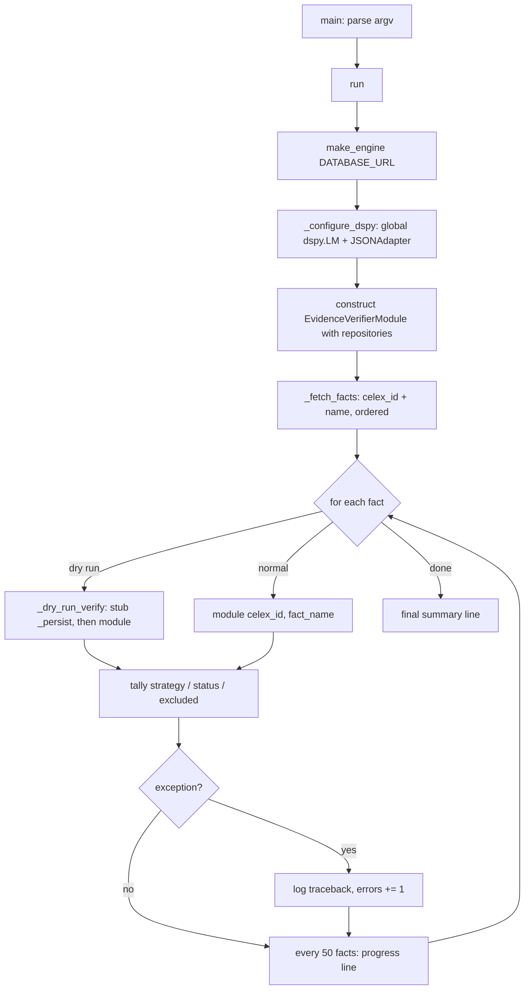

#design #batch #verification #evidence

# Design — Fact Verification Backfill (`Main_verify_facts_backfill.py`)

`Main_verify_facts_backfill.py` is the **corpus driver** for evidence verification: it
walks `celex_facts.facts`, hands every fact to the hybrid
[`EvidenceVerifierModule`](../src/pipelines/agent_dspy/evidence_verifier_module.py), and
leaves behind a complete `fact_evidence` ledger plus a populated
`facts.verification_status` for every non-excluded fact. It owns **no verification
logic of its own** — the routing, scoring and judging all live in the module. What the
script owns is scope, provisioning, LLM configuration, progress reporting and failure
isolation.

- Entry point: [Main_verify_facts_backfill.py](../src/batch/Main_verify_facts_backfill.py)
- Verifier module: [evidence_verifier_module.py](../src/pipelines/agent_dspy/evidence_verifier_module.py)
- Ledger DAO: [fact_evidence_repository.py](../src/pipelines/rag/pgvector/fact_evidence_repository.py)
- Schema: [migrate_fact_evidence.sql](../src/pipelines/rag/pgvector/migrate_fact_evidence.sql)
- Verifier design (strategies, scoring, judges): [hybrid evidence verifier.md](hybrid%20evidence%20verifier.md)
- Module tests: [test_evidence_verifier_module.py](../src/pipelines/agent_dspy/tests/test_evidence_verifier_module.py), [test_evidence_verifier_e2e.py](../src/pipelines/agent_dspy/tests/test_evidence_verifier_e2e.py)

---

## 1. Why it exists

A fact in this system is trusted because it was extracted and carries provenance, not
because any chunk was ever shown to *support* its claim. The verifier module closes
that gap for one fact at a time. Something still has to apply it to every fact in the
corpus, exactly once per fact, cheaply, restartably, and without a single bad fact
aborting the pass. That is this script.

The division of labour is deliberate and should stay that way:

| Concern                                       | Owner                                        |
| --------------------------------------------- | -------------------------------------------- |
| Which facts to verify, in which order         | `Main_verify_facts_backfill.run`             |
| DB engine, repository wiring (Provisioner)    | `Main_verify_facts_backfill.run`             |
| Global DSPy LM configuration                  | `Main_verify_facts_backfill._configure_dspy` |
| Progress, counters, per-fact error isolation  | `Main_verify_facts_backfill.run`             |
| Strategy routing, retrieval, scoring, judging | `EvidenceVerifierModule`                     |
| Ledger writes, verdict denormalization        | `FactEvidenceRepository`                     |

The script therefore stays short (about 180 lines) and has no branch on fact name,
strategy or status anywhere in it — adding a new verification strategy never touches
this file.

## 2. Command-line surface

```
PYTHONPATH=src .venv/bin/python src/batch/Main_verify_facts_backfill.py [--dry-run] [--celex-id CELEX_ID] [--fact-name FACT_NAME]
```

| Flag | Default | Effect |
| --- | --- | --- |
| `--dry-run` | off | Runs the full verification (including LLM calls) but persists nothing. See [§8](Design%20Fact%20Verifier.md#8-dry-run). |
| `--celex-id CELEX_ID` | none | Restricts the pass to one document. Exact-match on `facts.celex_id`. |
| `--fact-name FACT_NAME` | none | Restricts the pass to one fact name across every document. Exact-match on `facts.name`. |

Both filters are scope selection only — they are ANDed into the `WHERE` clause of
`_fetch_facts` and change nothing about how a selected fact is verified. Combining them
addresses exactly one fact.

Usage examples, taken from the module docstring
([Main_verify_facts_backfill.py:22-28](../src/batch/Main_verify_facts_backfill.py#L22-L28)):

```bash
# full corpus pass
PYTHONPATH=src .venv/bin/python src/batch/Main_verify_facts_backfill.py

# rehearse without writing
PYTHONPATH=src .venv/bin/python src/batch/Main_verify_facts_backfill.py --dry-run

# one document (CELEX natural key, prefix included)
PYTHONPATH=src .venv/bin/python src/batch/Main_verify_facts_backfill.py --celex-id CELEX-31982D0123

# one document (AT / numeric case id form)
PYTHONPATH=src .venv/bin/python src/batch/Main_verify_facts_backfill.py --celex-id 39813_1554_3

# one fact name, corpus-wide
PYTHONPATH=src .venv/bin/python src/batch/Main_verify_facts_backfill.py --fact-name fines

# one fact
PYTHONPATH=src .venv/bin/python src/batch/Main_verify_facts_backfill.py \
    --celex-id CELEX-32002D0180 --fact-name fines
```

The `--celex-id` value is the stored natural key verbatim. The corpus mixes
`CELEX-31990D0645`-style ids with `39813_1554_3` / `AT_40940_...` ids, and the filter
does no normalization: the `CELEX-` prefix must be included when the document has one.

**Why `--fact-name` exists.** Verdicts go stale one *extractor* at a time, not one
document at a time: `upsert_fact`
([fact_repository.py:517-531](../src/pipelines/rag/pgvector/fact_repository.py#L517-L531))
keeps the fact id and overwrites the value, so a re-extraction leaves the old
`fact_evidence` row attached to a value that no longer exists. Re-verifying that name
via `--celex-id` would mean one invocation per affected document, each re-verifying all
~53 facts of that document — for a name present corpus-wide, that is a full corpus pass
to refresh 1.9% of the ledger. `--fact-name` makes it one pass over the affected rows.
Stale rows are found with:

```sql
SELECT f.name, count(*)
FROM celex_facts.facts f
JOIN celex_facts.fact_evidence e ON e.fact_id = f.id
WHERE f.created_at > e.verified_at
GROUP BY 1 ORDER BY 2 DESC;
```

## 3. Execution flow



Step by step, with the code:

1. **Engine first, LM second.** [`run`](../src/batch/Main_verify_facts_backfill.py#L82)
   builds one SQLAlchemy engine from `DATABASE_URL`, then calls
   [`_configure_dspy`](../src/batch/Main_verify_facts_backfill.py#L58). The order matters
   only in that both must complete before the module is constructed — the DSPy
   `Predict` objects created inside `EvidenceVerifierModule.__init__` resolve their LM
   from the global `dspy.settings` at call time, so configuration must be in place
   before the first `forward`.
2. **Provisioning.** Five repositories are injected into the module
   ([Main_verify_facts_backfill.py:97-104](../src/batch/Main_verify_facts_backfill.py#L97-L104)),
   never constructed inside `forward` — the Provisioner pattern the project applies to
   all DB clients.
3. **Work list.** [`_fetch_facts`](../src/batch/Main_verify_facts_backfill.py#L70) reads
   `(celex_id, name)` pairs — not whole rows — ordered by `celex_id, name`. The module
   re-loads the full fact row itself via `FactRepository.select_fact4celex`, so the
   driver never carries fact state.
4. **Per-fact call.** Each pair goes to `module(celex_id=..., fact_name=...)`. The
   module returns a `FactVerificationResult` or `None`.
5. **Tallying.** `strategy_counts` and `status_counts` are `Counter`s over the result
   enums; `None` increments `excluded`; an exception increments `errors`.
6. **Reporting.** A progress line every `_LOG_INTERVAL = 50` facts, and one final
   summary line with the same four aggregates.

## 4. What gets wired, and where its connections come from

| Injected collaborator | Purpose in verification | Connection |
| --- | --- | --- |
| [`ChunkRepository`](../src/pipelines/rag/pgvector/chunk_repository.py) | Candidate chunk text (FTS + document scan) from `pg_embedding_qwen` | builds its **own** engine from `DATABASE_URL` |
| [`LineageRepository`](../src/pipelines/rag/pgvector/lineage_repository.py) | Provenance chunks behind a fact | shares the batch engine |
| [`FactRepository`](../src/pipelines/rag/pgvector/fact_repository.py) | Loads the fact under verification | builds its **own** engine |
| [`FactEvidenceRepository`](../src/pipelines/rag/pgvector/fact_evidence_repository.py) | Ledger write, verdict write, lineage source-type counts, predecessor verdicts | shares the batch engine |
| [`QueryEmbeddingRepository`](../src/pipelines/rag/pgvector/query_embedding_repository.py) | Caches statement embeddings in `query_embeddings_qwen` so a re-run does not re-embed | builds its **own** engine |

Only `LineageRepository` and `FactEvidenceRepository` accept the `engine=` argument
today; the other three fall back to their `db_url` default and open a second, third and
fourth pool against the same database. It is harmless at batch concurrency of one, but
it means "one engine per process" is an aspiration here, not a fact — worth knowing
before tuning `pool_size` or counting connections on the server.

## 5. LLM configuration

[`_configure_dspy`](../src/batch/Main_verify_facts_backfill.py#L58) sets the **global**
DSPy LM once per process:

```python
model_name = f"ollama/{settings.LLM_MODEL_ID}"
lm = dspy.LM(model_name, api_base=settings.OLLAMA_HOST, model_type="chat",
             **lm_runtime_kwargs(model_name))
dspy.configure(lm=lm, adapter=dspy.JSONAdapter())
```

Three things are load-bearing:

- **Global, not per-module.** The two judges inside the verifier
  (`EvidenceSupportSignature` for concept/relation facts, `BooleanPolaritySignature`
  for yes/no facts) are plain `dspy.Predict` instances with no LM of their own. Without
  this call the first concept fact raises instead of being judged.
- **`JSONAdapter`.** Both judges return a Pydantic model
  (`EvidenceSupportResult`) as their `OutputField` — DSPy Rule 3. The JSON adapter is
  what makes the structured output contract work against Ollama chat models.
- **`lm_runtime_kwargs`** ([llm_factory.py:298](../src/config/llm_factory.py#L298))
  supplies the failure-behaviour knobs — `max_tokens`, `timeout`, and `num_retries` /
  `max_retries` set to the same value. This site is one of the four that historically
  carried none of them and therefore ran at DSPy's default `num_retries=3`, turning one
  hung generation into three full timeouts (see the entry in
  [ISSUES.md](../ISSUES.md) on the litellm timeout work). It also installs the token-usage
  logger as a side effect, which is how this job's LLM spend reaches
  `logs/application.log`.

Note the model prefix: this script uses LiteLLM's native `ollama/<model>` provider with
`api_base=OLLAMA_HOST`, whereas [`llm_factory.create_lm`](../src/config/llm_factory.py)
uses `openai/<model>` against `{OLLAMA_HOST}/v1`. Both reach the same server; the
divergence is the residue of the duplicated inline-LM block tracked in
[ISSUES.md](../ISSUES.md) ("Six batch scripts duplicate the inline Ollama `dspy.LM` block").
When that consolidation happens, this is one of the call sites to migrate.

Per project infrastructure rules, inference goes to the remote Ollama server
(`settings.OLLAMA_HOST`, an NVIDIA Spark DGX) — never the local GeForce card.

## 6. Scope and ordering

```sql
SELECT celex_id, name FROM celex_facts.facts
[WHERE celex_id = :celex_id]
ORDER BY celex_id, name
```

- **Deterministic order** makes a partial run resumable by eye: the log tells you which
  `celex_id` the pass reached, and `--celex-id` restarts from there.
- **Alphabetical order within a document is not a dependency order**, and the verifier
  does not require one. A derived fact (`court_list`) reached before its predecessor
  (`court_list_raw`) triggers on-demand verification of the predecessor inside
  `_verify_derived`, so the verdict does not depend on iteration order. The cost is
  that the predecessor is then verified a second time when the loop reaches it —
  correct, idempotent, and mildly wasteful.
- **Exclusions are not filtered in SQL.** `settings.EVIDENCE_EXCLUDED_FACT_NAMES`
  (default `decision_chapter_tokens`, `decision_chapter_sentences`, `heideltime_raw` —
  see [§6.1](Design%20Fact%20Verifier.md#61-what-is-excluded-and-why)) is applied by the
  module, which returns `None` before touching the DB. The driver counts those as
  `excluded`. Doing it in the module keeps the exclusion rule true for every caller,
  not just this batch.
- **Duplicate `(celex_id, name)` rows are a blind spot.** `celex_facts.facts` has a PK
  on `id` only. If the same name exists twice for a document, `_fetch_facts` yields two
  rows, but `select_fact4celex(...)[0]` verifies the *same* first row twice and the
  second row keeps `verification_status = 'unverified'` forever.

### 6.1 What is excluded, and why

The exclude list holds **machine-emitted artefacts that make no claim about the
decision**. Verification asks "does a chunk of this decision support what this fact
asserts?" — a fact that asserts nothing about the decision has no answerable question,
so a verdict on it is noise in the ledger rather than a signal.

| Excluded name | What it holds | Why it is not verifiable |
| --- | --- | --- |
| `decision_chapter_tokens` | Token count of the decision text | A counter over the document, not a claim about it |
| `decision_chapter_sentences` | Sentence count of the decision text | Same |
| `heideltime_raw` | Raw TIMEX3 annotation dump from HeidelTime | Its content *is* the chunk text it was annotated from |

**`heideltime_raw`** was added to the list on 2026-08-30. It is the unprocessed output
of the HeidelTime annotator over the decision's own chunks, so the verifier retrieves
the very text the value was copied from and the judge confirms that the annotator read
its input — a tautology. The 2026-08-22 pass scored it `verified_supported` on 737 of
745 rows, which measured nothing about the temporal facts. The temporal claims are
verified where they become claims: on the derived event facts, through the
`deterministic_temporal` branch. Excluding it also removes the largest source of stale
verdicts, since the heideltime provenance work re-ingests all ~738 rows in place.

**Leftover ledger rows.** Excluded facts are skipped *without writes*, so adding a name
to the list does not retract verdicts already recorded under it. The 745 `heideltime_raw`
rows from the 2026-08-22 pass survive as orphans of a rule that no longer applies, and
`facts.verification_status` keeps saying `verified_supported`. Purging them is a
deliberate, separate step:

```sql
-- verdicts recorded before the name was excluded
DELETE FROM celex_facts.fact_evidence e
USING celex_facts.facts f
WHERE e.fact_id = f.id AND f.name = 'heideltime_raw';

UPDATE celex_facts.facts
SET verification_status = 'unverified', verification_updated_at = now()
WHERE name = 'heideltime_raw';
```

**The setting is dual-purpose — mind the second consumer.**
`EVIDENCE_EXCLUDED_FACT_NAMES` is not read only by the verifier: `MasterPlannerModule.catalog`
([master_planner_module.py:186-198](../src/pipelines/agent_dspy/master_planner_module.py#L186-L198))
subtracts the same set from the live fact-name vocabulary it grounds the planner in, via
`build_fact_name_catalog`. Excluding a name therefore also withdraws it from the planner's
answer space. For `heideltime_raw` that is the wanted outcome — a raw annotation dump is
not a useful thing for the planner to route a user question at, and its temporal content
is reachable through the derived event facts — but any future addition to this list must
be judged against both consumers, not just the verifier.

After that, `heideltime_raw` matches the shape of the other two excluded names: no
`fact_evidence` row, status left at the `unverified` default. Note that this breaks the
complete-ledger guarantee's arithmetic ([§9](Design%20Fact%20Verifier.md#9-what-a-run-writes))
by the same 745 rows — expected, and the reason the guarantee is stated over
*non-excluded* facts.

## 7. The per-fact loop

Three outcomes per fact, and the counters distinguish them:

| Outcome | Return | Counter |
| --- | --- | --- |
| Verified (any of the 7 non-excluded strategies) | `FactVerificationResult` | `strategy_counts[strategy]`, `status_counts[status]` |
| Excluded name, **or no fact row for the pair** | `None` | `excluded` |
| Anything raised | — | `errors`, plus a full traceback via `logger.exception` |

Two properties matter operationally:

- **Failure isolation.** The `try/except Exception` around each fact
  ([Main_verify_facts_backfill.py:122-140](../src/batch/Main_verify_facts_backfill.py#L122-L140))
  means one unreachable Ollama call, one malformed `value_json`, or one missing chunk
  cannot end a multi-hour corpus pass. The traceback carries `celex_id/fact_name`, so
  failures are addressable individually afterwards.
- **`excluded` conflates two causes.** A name on the exclude list and a `(celex_id,
  name)` pair with no fact row both return `None`. The second cannot occur when the
  work list comes from `facts` itself, so in practice the counter reads as
  "excluded" — but a future caller passing its own list should not read it that way.

The final line is the run's report card:

```
Verification complete — strategies={'deterministic_entity': 812, 'derived': 190, ...},
statuses={'verified_supported': 640, 'weak_support': 210, ...}, excluded=48, errors=3
```

## 8. Dry run

`--dry-run` does **not** short-circuit the work; it removes only the writes.
[`_dry_run_verify`](../src/batch/Main_verify_facts_backfill.py#L151) swaps
`module._persist` for a no-op, calls the module, and restores it in a `finally`:

```python
original = module._persist
module._persist = lambda result: None
try:
    return module(celex_id=celex_id, fact_name=fact_name)
finally:
    module._persist = original
```

Because `_persist` is the single choke point for both writes (`upsert_evidence` and
`set_verification_status`), stubbing it is sufficient — including for predecessors
verified recursively on the same module instance.

Three caveats:

1. **It is not free.** Every LLM judge call still runs. A dry run over the whole corpus
   costs the same GPU time as the real thing; it is a rehearsal, not a preview.
2. **Derived verdicts are computed against the database as it stands.** `_verify_derived`
   reads predecessors' persisted `verification_status`. In a dry run nothing is written,
   so predecessors verified earlier in the same dry run still read as `NULL` and get
   re-verified on demand. Derived statuses from a dry run on a fresh database are
   therefore indicative, not final.
3. **It monkeypatches a private attribute.** If `_persist` is ever split or renamed, the
   dry run silently starts writing. A rename must update this call site.

## 9. What a run writes

Per verified fact, exactly two writes, both inside `EvidenceVerifierModule._persist`:

1. **`celex_facts.fact_evidence`** — one row via `upsert_evidence`: `chunk_id` (the best
   supporting chunk, or `NULL` for human / derived / no-provenance / empty-value
   summary verdicts), `support_label`, `final_score`, the five sub-scores, the exact
   `evidence_quote`, and `missing_elements` as JSONB.
2. **`celex_facts.facts`** — `verification_status`, `verification_score`,
   `verification_updated_at` via `set_verification_status`.

This is the **complete-ledger guarantee**: every non-excluded fact ends with at least
one ledger row and a non-default status, including the ones that could not be verified.
A sparse table would make "not verified" and "not yet processed" indistinguishable.

**Idempotency.** `upsert_evidence` runs `DELETE FROM fact_evidence WHERE fact_id = :id`
followed by a single `INSERT`, in one transaction. Re-running the backfill therefore
replaces prior verdicts rather than duplicating them, *and* cleans up correctly when a
fact's strategy changes between runs (LLM support to derived, say) — the stale row from
the old strategy is removed rather than orphaned. The script can be run as often as
wanted; the last run wins.

The schema in
[migrate_fact_evidence.sql](../src/pipelines/rag/pgvector/migrate_fact_evidence.sql)
still carries two partial unique indexes from the original multi-row ledger design:
`uq_fact_evidence_chunk` on `(fact_id, chunk_id)` and `uq_fact_evidence_summary` on
`fact_id` where `chunk_id IS NULL`. With one row per fact the per-chunk index is never
hit — it is **not** what makes a re-run idempotent; the `DELETE` is. It is kept
deliberately as the natural key of a chunk-pinned row: `FactVerificationResult` already
carries the full scored `candidates` list, so persisting more than the single best
candidate would need a writer change and no migration. Dropping the index would remove
that protection and buy nothing.

**The strategy is not persisted.** `strategy_counts` exists only in the run log; the
ledger stores `support_label` (`human_authored`, `derived_from_facts`, `empty_value`,
`supports`, `insufficient`, ...), from which the strategy is only partly recoverable.
Post-hoc questions of the form "how many facts took the LLM path last month?" must be
answered from the log, not from SQL.

## 10. Cost profile

The pass is cheap by construction: the module is deterministic-first, and the driver
adds nothing on top.

| Strategy | LLM calls per fact |
| --- | --- |
| `excluded`, `trusted_human`, `derived`, `no_provenance` | 0 |
| `deterministic_entity`, `deterministic_temporal` | 0 |
| `boolean` | 0 on a deterministic marker hit, otherwise 1 polarity judge call |
| `llm_support` | up to `settings.EVIDENCE_JUDGE_TOP_N` (default 3), stopping early on the first `supports` verdict with an exact quote |

Embeddings are the other recurring cost, and `QueryEmbeddingRepository` caches statement
embeddings across runs, so a second pass over the same corpus re-embeds nothing.

## 11. Configuration

Everything is read from [`settings`](../src/config/settings.py); the script defines no
thresholds of its own beyond `_LOG_INTERVAL`.

| Setting | Default | Role in this job |
| --- | --- | --- |
| `DATABASE_URL` | from env | The one database the whole pass reads and writes |
| `LLM_MODEL_ID` | `qwen3-coder:30b` | Model behind both judges |
| `OLLAMA_HOST` | remote Spark DGX | Inference endpoint |
| `EVIDENCE_EXCLUDED_FACT_NAMES` | `decision_chapter_tokens,decision_chapter_sentences,heideltime_raw` | Names skipped with no row and no status churn ([§6.1](Design%20Fact%20Verifier.md#61-what-is-excluded-and-why)) |
| `EVIDENCE_SUPPORT_MIN_SCORE` | `0.75` | At or above: `verified_supported` |
| `EVIDENCE_WEAK_MIN_SCORE` | `0.4` | Between the two: `weak_support` |
| `EVIDENCE_CANDIDATE_LIMIT` | `40` | Candidates pulled per retrieval leg before gating |
| `EVIDENCE_JUDGE_TOP_N` | `3` | Gated candidates that may reach the LLM judge |
| `EVIDENCE_USE_EXTRACTION_QUESTION` | `true` | Enrich retrieval and judging with the original extraction question |

## 12. Operating the job

**Prerequisites**

1. Schema applied: `psql -f src/pipelines/rag/pgvector/migrate_fact_evidence.sql`
   (idempotent — safe to re-run).
2. Ollama reachable at `settings.OLLAMA_HOST` with `settings.LLM_MODEL_ID` pulled.
3. Chunks and embeddings present in `settings.EMBEDDING_TABLE` for the documents in
   scope; the entity, temporal and concept branches all match against chunk text.

**Recommended first pass**

```bash
# 1. rehearse on one document
PYTHONPATH=src .venv/bin/python src/batch/Main_verify_facts_backfill.py \
    --celex-id CELEX-31982D0123 --dry-run

# 2. commit that document
PYTHONPATH=src .venv/bin/python src/batch/Main_verify_facts_backfill.py \
    --celex-id CELEX-31982D0123

# 3. inspect, then run the corpus
PYTHONPATH=src .venv/bin/python src/batch/Main_verify_facts_backfill.py
```

**Inspecting the outcome**

```sql
-- verdict distribution
SELECT verification_status, count(*)
FROM celex_facts.facts
GROUP BY 1 ORDER BY 2 DESC;

-- complete-ledger check: verified facts with no ledger row (should be empty,
-- excluding the configured exclude list)
SELECT f.celex_id, f.name
FROM celex_facts.facts f
LEFT JOIN celex_facts.fact_evidence e ON e.fact_id = f.id
WHERE e.id IS NULL
  AND f.name NOT IN ('decision_chapter_tokens', 'decision_chapter_sentences');

-- what needs human attention for one document
SELECT name, verification_status, verification_score
FROM celex_facts.facts
WHERE celex_id = 'CELEX-31982D0123'
  AND verification_status NOT IN ('verified_supported', 'manual_approved')
ORDER BY name;
```

`FactEvidenceRepository.list_unverified(celex_id=None)` is the programmatic form of that
last query.

**Exit status.** `run` always returns normally; the process exits `0` even when
`errors > 0`. A scheduler cannot tell a clean pass from one that failed on 300 facts —
the error count is only in the final log line. Anything wrapping this job in CI or a
timer must grep the log or query the ledger.

## 13. Known gaps

- **No unit test for the driver.** [src/batch/tests/](src/batch/tests/) has tests for
  `Main_classify_sections`, `Main_enrich_chunk_context` and `Main_ingest_generic_facts`,
  but none for this script. The dry-run stub, the
  `None`-means-excluded contract and the counter arithmetic are all untested. The module
  underneath is well covered.
- **Exit code always `0`** — see [§12](Design%20Fact%20Verifier.md#12-operating-the-job).
- **Duplicate `(celex_id, name)` facts leave the second row unverified** — see
  [§6](Design%20Fact%20Verifier.md#6-scope-and-ordering).
- **Single-threaded.** One fact at a time, one LLM call at a time. Fine for a
  deterministic-first pass, but a corpus-wide re-run after a threshold change is a long
  serial job with no parallelism knob.

## 14. Related documents

- [hybrid evidence verifier.md](hybrid%20evidence%20verifier.md) — the verifier's own
  design: strategy router, scoring weights, judge signatures, fact classes.
- [Design 101 -- Provisioner Pattern.md](Design%20101%20--%20Provisioner%20Pattern.md) — why repositories are injected.
- [Data Lineage Option & Implementation.md](Data%20Lineage%20Option%20&%20Implementation.md) — `fact_source_link` / `fact_source_registry`, the source of the derived branch's truth.
- [Quality-persistency-design.md](Quality-persistency-design.md) — where verification verdicts sit in the wider quality model.

## 15. Run stats

2026-08-22 19:36:26,022 - INFO - verify_facts_backfill - Verification complete — 
strategies={'no_provenance': 11947, 'derived': 5694, 'deterministic_temporal': 2877, 'boolean': 5157, 'deterministic_entity': 10839, 'llm_support': 3149, 'trusted_human': 1407}, statuses={'unverified': 11947, 'weak_support': 6527, 'verified_supported': 18368, 'missing_required_entity': 482, 
'insufficient_evidence': 1771, 
'manual_approved': 1407, 'missing_required_time': 431, 'contradicted': 137}, 
excluded=1274, errors=0
