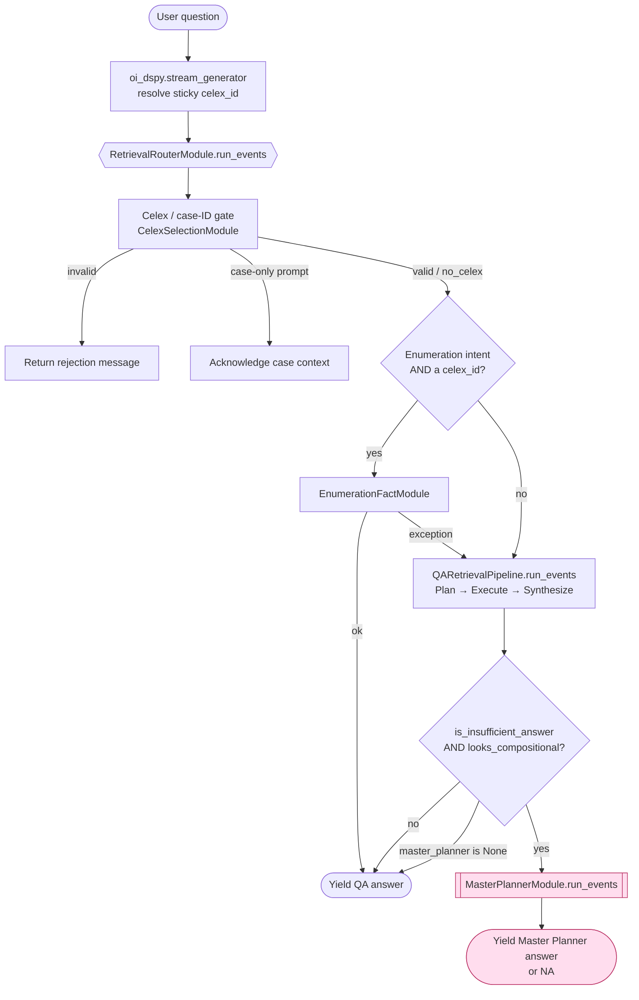
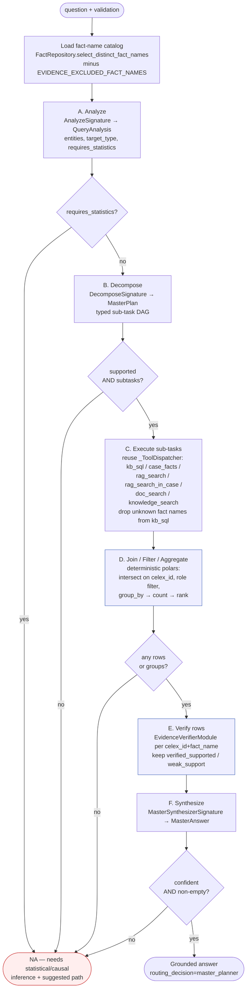
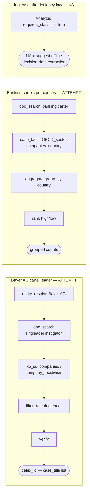

# Design — Master Planner Agent

The Master Planner is a **fallback** over the primary Plan → Execute → Synthesize
QA pipeline. It activates only when the primary pipeline returns insufficient
evidence on a *compositional* query (multi-entity filtering, or count / group-by
aggregation). Out-of-scope queries (statistical / causal / trend inference)
return a clean **NA** instead of a hallucination.

Key code:
- Router seam: [retrieval_router.py](../src/pipelines/agent_dspy/retrieval_router.py) (`RetrievalRouterModule._should_escalate`)
- Agent: [master_planner_module.py](../src/pipelines/agent_dspy/master_planner_module.py) (`MasterPlannerModule.run_events`)
- Gate helpers: [master_planner_text.py](../src/pipelines/agent_dspy/master_planner_text.py) (`is_insufficient_answer`, `looks_compositional`)

## End-to-end retrieval flow

The router holds the QA terminal result back, applies the two-part gate, and
either yields the QA answer unchanged (the common case) or escalates. Simple
queries never construct or invoke the Master Planner.

## Master Planner internal flow

## Worked examples

## NA boundary (capability envelope)

| Attempt | NA |
|---|---|
| Entity-filtered case lists | Trend / before-after / time-series |
| Count / group-by aggregation | Causal inference, correlation, regression |
| Simple two-group comparison | Anything the planner marks `supported=false` |

Each row that reaches the answer is verified against its source chunks via the
existing deterministic-first `EvidenceVerifierModule`; unverified rows are
dropped before aggregation, and an answer with no surviving verified rows
degrades to NA rather than guessing.

see: [Master Planner Agent](obsidian://open?vault=celex-facts&file=docs%2FMaster%20Planner%20Agent)

# Tool Usage

The Master Planner reuses the same six retrieval tools as the primary pipeline
(via `_ToolDispatcher` in [retrieval_dispatch.py](../src/pipelines/agent_dspy/retrieval_dispatch.py))
and adds three DSPy LLM predictors and two SQL-store accessors of its own.

## LLM Predictors (DSPy `ChainOfThought`)

| Predictor | Signature | Stage | Purpose |
|---|---|---|---|
| `self.analyze` | `AnalyzeSignature` | A — Analyze | Identifies entities in the question, classifies the target type (`case_list` / `count_group` / `compare`), maps entities to candidate fact names from the live catalog, and sets `requires_statistics=True` for out-of-scope queries. |
| `self.decompose` | `DecomposeSignature` | B — Decompose | Turns the `QueryAnalysis` into a typed sub-task DAG (`MasterPlan`). Produces `supported=False` for statistical / causal queries. |
| `self.synthesize` | `MasterSynthesizerSignature` | F — Synthesize | Composes a grounded markdown answer from the joined and pre-verified rows. Returns `confident=False` only on true failure (empty evidence, contradictory rows). |

## Retrieval Tools (dispatched by `_ToolDispatcher`)

All `retrieve` and `entity_resolve` sub-tasks are routed through `_ToolDispatcher.dispatch`.
Each tool returns a typed `EvidenceResult` (text + fact_ids + chunk_ids + fact_names).

| Tool | Backing component | Input | What it returns |
|---|---|---|---|
| `kb_sql` | `CrossCaseAggregator.aggregate_facts` | Read-only `SELECT` / `WITH` SQL (validated by `_validate_read_only_sql`; auto-capped at `LIMIT 500`) | Rows from the `celex_facts.facts` EAV table **and, since 20260830, the two flat entity-graph views** `company_case_relations_vw` / `case_provision_relations_vw` (see below); enriched with `case_title` when rows carry a `celex_id`. Unknown fact-name literals in `name =` / `name IN` / `source_fact_name =` filters are stripped before execution. |
| `case_facts` | `SQLFactStore.select_facts4celex_with_ids` | `celex_id` | All structured facts for one case (name, value, fact_id). |
| `rag_search` | `KBFactSearcher.semantic_search_facts` | Natural-language query | Top-10 fact rows ranked by vector similarity across all cases; enriched with `case_title`. |
| `rag_search_in_case` | `HybridSearcher.search` | `celex_id` + query | Top-15 document chunks inside one case using hybrid FTS + vector (Reciprocal Rank Fusion). |
| `doc_search` | `DocChunkSearcher` (keyword + semantic) | Natural-language query | Cross-case document chunks: ILIKE keyword pass first (one chunk per matching case), then semantic supplement for cases not already surfaced; includes per-case chunk counts for "how many" queries. |
| `knowledge_search` | `KnowledgeSearcher` (FTS, AND then OR fallback) | Natural-language query | Up to 20 distilled knowledge nuggets from `celex_facts.knowledge_items`; used as a supplementary step for procedural context or legal-principle reasoning not directly answerable from structured facts. |

### SQL safety gate (`kb_sql`)

Before any SQL reaches the database, `_validate_read_only_sql` enforces:
- Statement must start with `SELECT` or `WITH` (CTEs allowed).
- Blocked keywords: `INSERT`, `UPDATE`, `DELETE`, `DROP`, `ALTER`, `CREATE`, `TRUNCATE`, `GRANT`, `REVOKE`.
- No multi-statement (`;`) queries.
- `LIMIT 500` appended automatically when absent.

### Entity-graph views (`kb_sql`)

The typed entity graph (`celex_facts.entities` / `entity_edges`) is reachable
through two flat views created by
[migrate_graph_qa_views.sql](../src/pipelines/rag/pgvector/migrate_graph_qa_views.sql),
gated by `settings.GRAPH_QA_ENABLED`. Per decision D4 of the country/LEI plan
the LLM is taught the views, never the raw tables. They exist for the
*relational* query class only -- cross-case company questions and provision
questions; per-case detail still belongs to `case_facts`.

| View | Rows | What it answers |
|---|---|---|
| `company_case_relations_vw` | 9,954 | company -> case: `participated_in`, `fined`, `leniency_applied`, `leniency_granted`, `leniency_rejected`; carries `lei_id`, `company_country`, `amount` |
| `case_provision_relations_vw` | 665 | case -> provision (`violated`), with the treaty renumbering already collapsed into `canonical_concept` |

Both project `source_fact_id` (FK -> `facts.id`) and `source_fact_name`, so a
graph-derived row still resolves through `fact_provenance()`,
`LineageRepository` and the Stage-E `EvidenceVerifierModule`. `_run_kb_sql`
harvests `source_fact_id` as a provenance edge when no `id` column is projected.

Two traps the schema prose warns about explicitly, both measured 20260830:
`relation = 'leniency_applied'` is emitted by *both* `leniency_applicants` (441
rows) and `exemption_applicants` (1,813 rows), so it must be filtered by
`source_fact_name`; and `canonical_concept` is a comma-separated list, so it
must be matched with `ILIKE`, never `=`.

### Fact-name grounding (`kb_sql`)

Before dispatching a `kb_sql` step, the planner extracts every `name = '...'` and
`name IN (...)` literal from the SQL and checks them against the live catalog loaded
from `FactRepository.select_distinct_fact_names`. Unknown names are dropped with a
warning; if all names are unknown the step is skipped entirely.

## SQL-Store Accessors (direct, outside `_ToolDispatcher`)

| Method | When called | Purpose |
|---|---|---|
| `FactRepository.select_distinct_fact_names` | Lazy, cached on first access | Loads the live set of distinct fact names that grounds the Analyze and Decompose signatures (minus `EVIDENCE_EXCLUDED_FACT_NAMES`). |
| `FactRepository.select_facts4celex_with_ids` | Stage D — Join/Aggregate | Fetches all structured `(fact_id, name, value)` rows for each candidate `celex_id` into a polars DataFrame for deterministic join, role filter, and group-by aggregation. |

## Verifier (Stage E)

| Component | Interface | Purpose |
|---|---|---|
| `EvidenceVerifierModule` (injected as `self.verifier`) | `.forward(celex_id, fact_name)` | LLM-based per-row evidence gate. Keeps rows with `status` in `{verified_supported, weak_support, manual_approved}`; drops the rest. Bounded by `MASTER_PLANNER_MAX_VERIFY_ROWS` to prevent runaway LLM calls on large result sets. Bypassed when `verifier is None` or `MASTER_PLANNER_VERIFY_ROWS=False`. |

## Tool selection by sub-task kind

| Sub-task `kind` | Handled by | Notes |
|---|---|---|
| `entity_resolve` | `doc_search` (default) | Finds cases mentioning a named entity in document text. |
| `retrieve` | Tool named in `SubTask.tool` | Any of the six retrieval tools above. |
| `filter` | Deterministic polars (Stage D) | Role-keyword matching against fact values and evidence text; never dispatched to a retrieval tool. |
| `join` | Deterministic polars (Stage D) | Intersection of `celex_id` sets from dependency sub-tasks. |
| `aggregate` | Deterministic polars (Stage D) | `group_by(value).agg(celex_id.n_unique())` over the joined fact rows. |

# Considerations
One design note worth knowing: the QA pipeline's _direct-passthrough_ shortcut (single stored fact) and the _Master Planner_ path both `return` before the QA enqueue step, so they don't write to this queue — only the full plan→execute→synthesize QA path does. That's existing behavior, not a regression, but if you want knowledge extraction to capture passthrough/master-planner answers too, that'd be a separate follow-up.