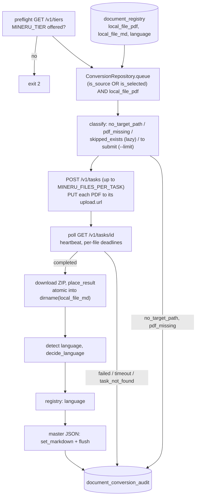

`20261031

#ingestion
# Design — MinerU PDF to Markdown conversion

This document describes what was **built** for the PDF to Markdown batch: it reads the registered PDFs from `document_registry`, converts the ones without Markdown on a MinerU server through the asynchronous Tasks API, writes each Markdown file to the path the record specifies, detects the language from the Markdown, keeps the registry and the master descriptor JSON in sync, and writes one audit row per attempt. Where the code differs from the approved design, the code wins; the differences are listed in [section 13](#13-differences-from-the-approved-design).

Plans: [approved design](claude/plans/2026-10-31-mineru-pdf-markdown-conversion-design.md), [implementation plan](claude/plans/2026-10-31-mineru-pdf-markdown-conversion-implementation.md). Related: [Design Downloader](Design%20Downloader.md) (produces the PDFs and registry rows this batch consumes), [Design 101 -- Provisioner Pattern](Design%20101%20--%20Provisioner%20Pattern.md) (client, repository and store are injected into the orchestrator). MinerU contract: Tasks API 4.1 (`~/a/mineru/MinerU/docs/en/usage/tasks.md`, https://opendatalab.github.io/MinerU/usage/tasks/).

---

## 1. Intent and non-goals

**Intent.** Chunk ingestion, fact extraction and the UI viewer need Markdown; the downloader only stores PDFs. Every `is_source` or `is_selected` PDF is converted, whatever its language, including the "undecided" language candidates, so that their language is known when a decision's source document is chosen. Runs take hours (~360 PDFs at minutes each), so a run must survive interruption and a rerun must pick up where it stopped.

**Non-goals.**

- Choosing which candidate becomes a decision's `is_source` document; this batch only supplies the detected language.
- Chunking or embedding (that is `Main_ingest_case_markdown2pgvector`).
- Moving the 744 existing `mineru/<stem>/auto/<stem>.md` files to the new layout.
- Translation; any LLM inference (MinerU is the only model involved; no DSPy).

**Rules the code enforces.**

- **The converter is purely a consumer of paths.** It reads `local_file_pdf` and `local_file_md` from the record and never builds a path; `pipelines/convert/*` and `Main_convert_pdf_markdown.py` do not import the layout helper. Paths are written only by the code that creates records (section 4).
- No half-written Markdown at a target path, ever (section 6).
- A language from the eur-lex URL marker is never silently relabelled (section 7).
- Registry and master JSON stay in sync (ADR, section 8).

---

## 2. Data flow



The CLI runs the preflight before it reads the queue, also for `--dry-run`, so a dry run proves server and tier; classification then happens in the orchestrator before anything is submitted. One task is in flight at a time: the GPU is the bottleneck, client parallelism gains nothing. Each completed file is finished immediately, not at task end.

---

## 3. Module map

| Module | Responsibility |
| :--- | :--- |
| `src/batch/Main_convert_pdf_markdown.py` | CLI, wiring, preflight, SIGTERM handler, summary log, exit codes. Reads paths only. |
| `src/batch/Main_backfill_markdown_paths.py` | One-off `local_file_md` backfill for existing registry rows (section 4). |
| `src/pipelines/convert/models.py` | Pydantic models: `ConversionOutcome`, `LanguageAction`, MinerU response models (`MineruTask`, `MineruFile`, `MineruParse`, `MineruUpload`, `MineruError`; `extra="ignore"`, open-string statuses), `ConversionItem`, `ConversionAuditRecord`. |
| `src/pipelines/convert/mineru_client.py` | `MineruTaskClient` (httpx): `preflight`, `create_task`, `upload`, `get_task`, `cancel_task`, `download_result`, `close`; `make_mineru_client()`. No business logic. |
| `src/pipelines/convert/result_unpacker.py` | `place_result`: ZIP to temp dir, validation, atomic placement, `ResultMetrics`. |
| `src/pipelines/convert/language.py` | `detect_markdown_language`, `decide_language` (rules of section 7) on top of `pipelines/legal/language_audit.py`. |
| `src/pipelines/convert/orchestrator.py` | `ConversionOrchestrator.run`: classification, task loop, deadlines, master sync, audit, `ConversionSummary`. |
| `src/pipelines/convert/progress.py` | `ProgressTracker`: per-file progress line with ETA, heartbeat line. |
| `src/pipelines/rag/pgvector/conversion_repository.py` | `ConversionRepository`: `probe`, `queue`, `set_language`, `record`; `ConversionNotReady`. |
| `src/pipelines/download/local_pdf.py` | `markdown_path_for(pdf)`: the single layout rule (writers only). |
| `src/pipelines/download/descriptor_store.py` | `MasterDescriptorStore`: new-entry `txt_md_file` by the layout rule; `set_markdown`, `markdown_entry`, `mineru_flag`. |
| `src/pipelines/rag/pgvector/document_registry_repository.py` | Downloader upsert sets `local_file_md` on registration. |
| `src/pipelines/rag/pgvector/migrate_document_conversion.sql` | `local_file_md` column and the audit table (comments in `schema_comments.sql`). |

---

## 4. Path rules

**Layout** (`markdown_path_for`): `<dirname(local_file_pdf)>/mineru/<stem(local_file_pdf)>.md`. The name is the **PDF file stem, never a `document_id`**; there is no `auto/` folder.

| PDF | Markdown |
| :--- | :--- |
| `<docs>/CELEX-31968D0318/CELEX-31968D0318.pdf` | `<docs>/CELEX-31968D0318/mineru/CELEX-31968D0318.md` |
| `<docs>/40013_1084_2/candidates/AT_40013_5708398_1084_5.pdf` | `<docs>/40013_1084_2/candidates/mineru/AT_40013_5708398_1084_5.md` |

**Who writes `document_registry.local_file_md`** (never the converter):

- `Main_backfill_markdown_paths` (one-off, idempotent, `--dry-run`): `is_source` rows whose master entry has the same `local_file_pdf` copy the entry's `txt_md_file` (the legacy `auto/` paths are kept); all other rows get the layout path. Only NULL values are filled. Live run 2026-10-31: 1104 rows, 744 `master`, 360 `layout`, 0 NULL left.
- The downloader's document upsert: `local_file_md` from the layout rule when a file is registered; an existing value is kept, **unless `local_file_pdf` changes** (a candidate promoted from `candidates/` to the decision folder), then the path follows the PDF.
- `MasterDescriptorStore`: a new master entry gets `txt_md_file` by the layout rule.

A registry row without `local_file_md` is audited `no_target_path` and not converted.

---

## 5. Queue and modes

Queue: `document_registry` rows with `(is_source OR is_selected) AND local_file_pdf IS NOT NULL`, ordered by `decision_id, document_id`; `local_file_md` is not filtered in SQL.

| Item state | lazy (default) | force |
| :--- | :--- | :--- |
| `local_file_md` NULL | audit `no_target_path` | same |
| PDF missing, empty or not `%PDF-` | audit `pdf_missing` | same |
| Markdown exists and is non-empty | counted `skipped_exists`, **no audit row**; master reconcile (section 8) | submitted, output replaced |
| Markdown missing | submitted | submitted |

Options: `--ids ID` (decision ids, repeatable), `--limit N` caps the number of files **submitted** (applied after classification; skips and pre-decided rows do not count), `--dry-run` (preflight, classify and log; no submit, no write, no audit, no flush).

Live queue 2026-10-31 (flash dry run): 1104 rows, 363 to convert, 741 `skipped_exists`.

---

## 6. MinerU interaction and placement

**Client.** `POST /v1/tasks` with `files[]` (`file_name` = PDF basename, `bytes`, `sha256sum` so MinerU's source cache can skip re-uploads) and `tier`; `PUT` raw bytes to each returned `upload.url`; poll `GET /v1/tasks/{id}`; `GET result_url` for the ZIP; `POST /v1/tasks/{id}/cancel` (409 ignored). The Bearer key (`MINERU_API_KEY`, optional) is sent only to URLs with the API's origin, re-checked on every redirect hop, so it never reaches object storage. Preflight uses `GET /v1/tiers` (the 4.1.3 server answers 404 on `/health`): a transport error, a non-2xx answer or a tier missing from `data[].id` raises `MineruUnavailable` (exit 2, message names the offered tiers).

**Result ZIP** (live probe, 4.1.3): `markdown.md`, `middle_json.json`, `structured_content.json`, `images/`. `middle_json.json` is a `docvortex.middle` 2.0 envelope with top-level `pages[]`, not the legacy `pdf_info` layout.

**Placement** (`place_result`). The ZIP is extracted and validated in `<target dir>/.tmp-<uuid>` (members with `..`, absolute paths or symlinks are rejected; no `markdown.md` is `ResultInvalid`). Many targets share one `mineru/` folder (65 candidate folders hold 225 targets, one holds 57), so:

- the JSON sidecars are named after the target stem: `<stem>_middle.json`, `<stem>_structured_content.json`;
- `images/` is shared and **merged**: new image files are added (a same-named file is overwritten; MinerU names images by content hash), the folder and other files are never replaced or deleted;
- the old sidecars and overwritten images are moved aside, the new ones moved in, and the `.md` is replaced **last** with `os.replace`; any failure (including Ctrl-C) restores the old files and removes only images this placement added; the temp dir is always removed.

**Metrics** (`ResultMetrics`): `md_chars`; `image_count` = images in the ZIP (not the shared folder); `pdf_pages` = `len(pages)`; `table_count` / `formula_count` = blocks with `type == "table"` / `"equation"` (display equations; `equation_inline` not counted). A count that cannot be derived is NULL.

**Deadlines.** A file's timeout (`MINERU_FILE_TIMEOUT_SECONDS`) starts at the first poll that sees it `running`, so queue wait behind the other files of its task does not count. Files that never start are capped at `MINERU_FILES_PER_TASK * MINERU_FILE_TIMEOUT_SECONDS` after the task's polling began. A file past its deadline is audited `timeout`; the task is cancelled once, after its other files are terminal. A file that completes in the same poll as its deadline is converted.

**Errors.**

| Situation | Effect |
| :--- | :--- |
| file `failed` in a snapshot | audit `failed`, `failure_reason` = MinerU `error.code` |
| non-2xx on create or upload | that task's (or file's) items `failed`, reason = `error.code` or `http_<status>` |
| transport error (create, upload, poll) | counts toward `MINERU_MAX_CONSECUTIVE_CONNECTION_ERRORS` (reset on success); at the limit the run aborts: the task's submitted and remaining items are audited `failed` / `connection_error`, the task is cancelled, exit 1 |
| `404` on poll (server restarted, task records are in memory only) | unfinished files `failed` / `task_not_found`; the run continues with the next task |
| server returns fewer files than submitted | unmatched items `failed` / `file_missing` |
| invalid ZIP | `failed` / `result_invalid` |
| any other exception while finishing one file | `failed` / `unexpected_error: <repr>`; the run continues |
| Ctrl-C or SIGTERM while polling | in-flight task cancelled (best effort), master flushed, exit via `KeyboardInterrupt` |

There are no retries inside a run: a lazy rerun is the retry.

---

## 7. Language from the Markdown

`detect_markdown_language` splits the placed Markdown on blank lines, drops image-only blocks, table blocks (`|` or `<table`) and single-line headings, feeds the rest to `language_audit.detect_chunk_language` (seeded `langdetect`; thresholds `LANGUAGE_AUDIT_MIN_CHARS`, `..._MIN_CONFIDENCE`, `..._MIN_SCORED_CHARS`) and aggregates with `aggregate_document_language`. The detected language is the top language by scored characters; confidence is its share of the scored characters; verdict `insufficient_evidence` means undetermined.

`decide_language(detected, confidence, stored)`:

| Stored registry value | Detected | `language_action` | Registry write |
| :--- | :--- | :--- | :--- |
| NULL, empty or `NA` | `de` | `set` | `DE` (upper-case) |
| `DE` | `de` | `kept_equal` | none |
| `EN` (eur-lex URL marker) | `de` | `kept_mismatch` (WARNING log) | none |
| any | undetermined | `undetermined` | none |

The repository's `set_language` additionally guards `WHERE language IS NULL OR language = 'NA'`. The master `language_init` is filled with the lower-case detected value whatever the registry action (`set_markdown` never overwrites a set value).

---

## 8. Registry and master JSON sync (ADR)

ADR (user, 2026-10-31): the master moves from the JSON to the database; both sources are kept in sync and consumers read whichever fits them.

On `converted`, in this order: the Markdown is placed; the registry `language` is written (own transaction); then, **only when the master entry `K = decision_id` has the same `local_file_pdf` as the row** (the decision's source document), `set_markdown(K, local_file_md, language_init)` sets `txt_md_file`, `mineru_flag = true` and fills `language_init`; the store is **flushed after each converted file** (backup once per run, stale-write replay of this run's changes, atomic write) and again at the end of the run, also on abort or interrupt. Candidates without a matching master entry touch only the registry.

**Reconcile (lazy).** For a skipped item whose Markdown exists, whose master entry has the same PDF and whose `mineru_flag` is **explicitly `false`** (a downloader entry still marked pending), `set_markdown` is called without a MinerU call or audit row. An absent flag marks a legacy entry and is left untouched. This repairs a run killed between placement and flush.

A flush failure in the final `finally` is logged and does not mask an exception already propagating.

---

## 9. Audit table

`celex_facts.document_conversion_audit`: append-only, no foreign keys (like `document_download_audit`), one row per attempt; `skipped_exists` is counted in the summary but not audited.

| Column | Meaning |
| :--- | :--- |
| `id`, `created_at`, `run_id` | row id, insert time, one uuid per run |
| `decision_id`, `document_id`, `local_file_pdf`, `local_file_md` | the registry row and the paths used |
| `outcome` | CHECK: `converted`, `skipped_exists`, `no_target_path`, `pdf_missing`, `failed`, `timeout` |
| `failure_reason`, `error_message` | MinerU `error.code` or own reason (`connection_error`, `task_not_found`, `result_invalid`, `file_missing`, `file_timeout`, `http_<status>`, `unexpected_error: ...`) |
| `mineru_task_id`, `mineru_file_id`, `mineru_api_url`, `tier`, `parser_version` | which server, task and engine did the work |
| `server_duration_ms` | MinerU `parse.duration_ms` (parsing only) |
| `wall_duration_ms` | task submit to files in place |
| `pdf_size_bytes`, `pdf_sha256`, `pdf_pages` | input metrics |
| `md_chars`, `image_count`, `table_count`, `formula_count` | output metrics |
| `language_detected`, `language_confidence`, `language_stored`, `language_action` | section 7; `language_action` CHECK: `set`, `kept_equal`, `kept_mismatch`, `undetermined` |

Indexes on `run_id`, `decision_id`, `outcome`. Example, last run:

```sql
SELECT outcome, failure_reason, count(*), avg(wall_duration_ms)/1000 AS avg_s
FROM celex_facts.document_conversion_audit
WHERE run_id = '<run id from the summary log>'
GROUP BY 1, 2 ORDER BY 3 DESC;
```

---

## 10. Progress logging

One INFO line per finished file (any outcome), ETA from the mean wall time per finished file:

```
[12/363] converted CELEX-31968D0318 (advanced, 38 pages, 4m12s) | ok 11 failed 1 timeout 0 | elapsed 52m ETA 3h40m
```

A heartbeat every `MINERU_PROGRESS_HEARTBEAT_SECONDS` while waiting (task id and file states, e.g. `pending 3, running 1, completed 6`). Start line: server, tier, mode, queue size; end: counts by outcome and failure reason, runtime and run id.

---

## 11. Settings and CLI

`src/config/settings.py`, env-overridable (put overrides in `config_main/.env`):

| Setting | Default | Note |
| :--- | :--- | :--- |
| `MINERU_API_URL` | `http://127.0.0.1:8000` | the RTX 5070 box today, the DGX Spark later (running MinerU on the local GeForce is an explicit user decision) |
| `MINERU_API_KEY` | empty | Bearer, same-origin only |
| `MINERU_TIER` | `advanced` | must be offered by the server |
| `MINERU_FILE_TIMEOUT_SECONDS` | `1800` | per file, from `running` |
| `MINERU_POLL_INTERVAL_SECONDS` | `5` | |
| `MINERU_FILES_PER_TASK` | `10` | API maximum 100 |
| `MINERU_HTTP_TIMEOUT_SECONDS` | `120` | per request |
| `MINERU_PROGRESS_HEARTBEAT_SECONDS` | `60` | |
| `MINERU_MAX_CONSECUTIVE_CONNECTION_ERRORS` | `3` | abort threshold |

```bash
.venv/bin/python -m batch.Main_convert_pdf_markdown [--mode lazy|force] [--ids ID ...] [--limit N] [--dry-run]
```

Exit codes: 0 all ok or nothing to do; 1 any `failed`, `timeout`, `pdf_missing`, `no_target_path`, or an aborted run; 2 usage, preflight (server unreachable, tier not offered) or migration not applied.

---

## 12. Run book

All commands run from the repo root `~/a/celex-facts`.

### 12.1 Before a run

The MinerU server must be up and offer the tier in `MINERU_TIER` (default `advanced`). Start it in `~/a/mineru/MinerU`, e.g. `.venv/bin/mineru-kit api-server --host 0.0.0.0 --port 8000 --tier auto` (`mineru-kit hardware detect --json` shows which tiers the machine supports). Check for running batches before restarting it or Postgres.

### 12.2 Convert

| Goal                                              | Command                                                                                                                 |
| :------------------------------------------------ | :---------------------------------------------------------------------------------------------------------------------- |
| Check server, tier and queue without converting   | `.venv/bin/python -m batch.Main_convert_pdf_markdown --dry-run`                                                         |
| Trial run: convert 3 missing PDFs                 | `.venv/bin/python -m batch.Main_convert_pdf_markdown --limit 3`                                                         |
| Convert everything still missing (the normal run) | `.venv/bin/python -m batch.Main_convert_pdf_markdown`                                                                   |
| Convert the PDFs of selected decisions            | `.venv/bin/python -m batch.Main_convert_pdf_markdown --ids 40013_1084_2 --ids CELEX-31968D0318`                         |
| Reconvert existing Markdown (overwrites it)       | `.venv/bin/python -m batch.Main_convert_pdf_markdown --mode force --ids CELEX-31968D0318`                               |
| Reconvert the whole corpus (later stage)          | `.venv/bin/python -m batch.Main_convert_pdf_markdown --mode force`                                                      |
| One-off different tier or server                  | `MINERU_TIER=standard MINERU_API_URL=http://<spark>:8000 .venv/bin/python -m batch.Main_convert_pdf_markdown --dry-run` |

`--dry-run` combines with every other option. A long run is best started in the background with its log kept, e.g. `nohup .venv/bin/python -m batch.Main_convert_pdf_markdown > ~/a/celex_docs/reports/convert_$(date +%Y%m%d_%H%M).log 2>&1 &`; follow it with `tail -f` on that file (progress lines, section 10).

### 12.3 Interrupt and resume

Ctrl-C or `kill <pid>` (SIGTERM) stops cleanly: the master JSON is flushed and, when the interrupt hits while polling (nearly always), the in-flight MinerU task is cancelled. Do not use `kill -9`. Resume by running the same command again in lazy mode: finished files are skipped, the rest is converted. A run that ended with exit code 1 is retried the same way.

### 12.4 Check the result

The end-of-run summary logs the run id. Per run:

```sql
SELECT outcome, failure_reason, count(*), round(avg(wall_duration_ms)/1000) AS avg_s
FROM celex_facts.document_conversion_audit
WHERE run_id = '<run id>'
GROUP BY 1, 2 ORDER BY 3 DESC;
```

After the trial run also look at `pdf_pages`, `image_count`, `table_count`, `language_detected` and `language_action` of its rows, and open one Markdown file. `kept_mismatch` rows are documents whose language differs from the eur-lex URL marker and are worth a look.

### 12.5 One-time setup (done 2026-10-31)

1. `migrate_document_conversion.sql`, then `schema_comments.sql` (after `migrate_document_lineage.sql`).
2. `.venv/bin/python -m batch.Main_backfill_markdown_paths --dry-run`, then without `--dry-run` (1104 rows). Safe to rerun; it only fills empty `local_file_md` values.

Tests: `.venv/bin/python -m unittest discover -s src/pipelines/convert/tests -t src` (the dotted package form runs 0 tests), plus `batch.tests.test_main_convert_pdf_markdown`, `batch.tests.test_main_backfill_markdown_paths`, `pipelines.rag.pgvector.tests.test_conversion_repository`. MinerU is mocked with `httpx.MockTransport`, the DB with fake engines; the master store runs on temp files.

---

## 13. Differences from the approved design

- **Sidecar names and shared `images/`** (final review): the design placed `images/` and the JSON files beside the `.md` as plain names, which would have let candidates in one folder delete each other's files.
- **Master flush after each converted file**, SIGTERM handling and the lazy reconcile (final review); the design flushed once at the end.
- **Deadline from `running`** with a queue-wait cap (final review); the design measured from upload, which timed out healthy files queued at the end of a task.
- **`--limit` caps submissions** after classification (final review); the design's SQL `LIMIT` made `--limit 3` convert nothing when the first rows were already done.
- **Preflight on `/v1/tiers`**, not `/health` (404 on 4.1.3).
- **Metrics keys** from the 4.1.3 `docvortex.middle` 2.0 envelope (`pages[]`, block types), not the legacy `pdf_info`.
- **`skipped_exists` is not audited**, only counted (avoids ~740 noise rows per lazy run); no `document_conversion_latest_vw` view.
- **Exit code 1 also for `pdf_missing` / `no_target_path`** (both need operator attention).
- **Master `language_init` filled regardless of the registry action** (the design tied it to the registry `set`).

---

## 14. Known limitations and follow-ups

Open items are tracked at the top of `ISSUES.md`.

- `table_count` / `formula_count` use the block types `table` / `equation` from the MinerU docs, not yet seen in a live result; `_count_blocks` counts matching dicts at any depth, so nested same-type children would double count. Verify on a PDF with tables.
- Force reruns leave orphan images in the shared `images/` folder (never deleted by design).
- A SIGKILL or power loss mid-placement leaves a `.tmp-<uuid>` directory (old files inside `aside/`); nothing sweeps it.
- Ctrl-C during the upload loop does not cancel the server task (only during polling).
- A transport error while downloading a result is audited `unexpected_error` and does not count toward the abort threshold.
- The audit INSERT derives its columns from `ConversionAuditRecord` field order with `run_id` first; there is no DDL drift test.
