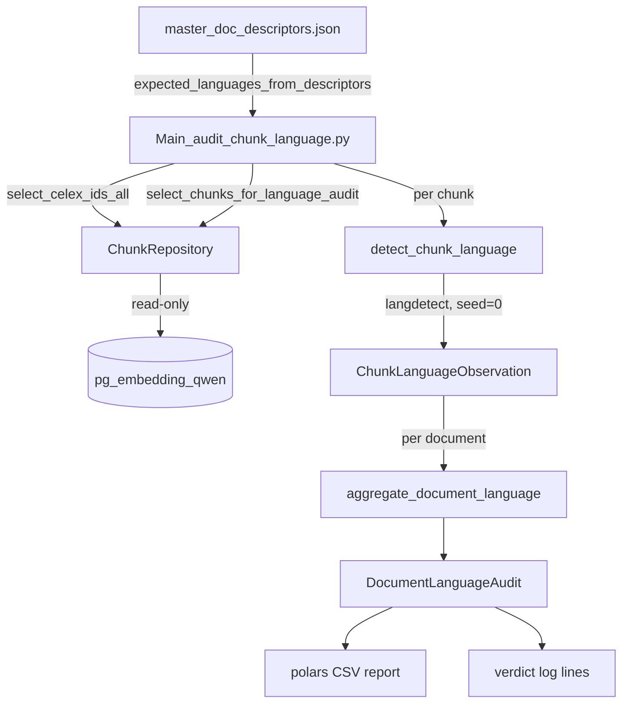

#qa #chunking #ingestion
# Design QA — Identify non-English document chunks

This document describes the **chunk-language audit**: a repeatable, read-only QA
pass that finds the `pg_embedding_qwen` documents ingested from a
non-English source PDF instead of the English translation.

It records the two decisions that shaped it — *deterministic detection over an
LLM*, and *character-weighted shares over chunk counts* — with the corpus
measurements that justify them, so neither has to be re-argued.

Implementation: [language_audit.py](../src/pipelines/legal/language_audit.py) (pure logic),
[Main_audit_chunk_language.py](../src/batch/Main_audit_chunk_language.py) (batch).
Plan: [chunk-language-audit.md](claude/plans/chunk-language-audit.md).

Related: [Data Ingestion](Data%20Ingestion.md),
[Design-Contextual-chunk-prefixes](Design-Contextual-chunk-prefixes.md),
[DESIGN Search](DESIGN%20Search.md),
[Design BgeRanker](Design%20BgeRanker.md).

---

## 1. Problem — a wrong-language document is silently invisible

The corpus is EU cartel decisions. Many pre-1990 decisions were adopted in
German, French, Italian or Dutch and only later translated; the translated
markdown is distinguished **only** by an `_en` filename suffix
(`<id>_en.md`). Nothing in Python reads the descriptors' `language_init` /
`language_translated` keys, so whenever a descriptor's `txt_md_file` points at an
original-language file, [Main_ingest_case_markdown2pgvector.py](../src/batch/Main_ingest_case_markdown2pgvector.py)
ingests it without complaint.

The damage is quiet rather than loud:

- **Fact extraction misses the document entirely.** Every signature, prompt and
  fact regex in the pipeline is English.
- **The lexical retrieval leg mis-stems it.** `document_tsv` is a generated
  column hardcoded to `to_tsvector('english', ...)`
  ([pg_celex-ddl.sql:397](../src/pipelines/rag/pgvector/pg_celex-ddl.sql)), so
  German text is stemmed with an English dictionary and is effectively
  unreachable through `HybridSearch`'s FTS leg.
- **Nothing fails.** The chunks exist, the embeddings exist, the counts look
  right. The only symptom is absence.

The audit's job is to turn that absence into a named list of `celex_id`s.

---

## 2. Decision — deterministic detection, not an LLM

The open question was whether to detect language with `langdetect` or to ask the
LLM. It was settled by measurement, not preference.

A full read-only pass over all **56,005 chunks / 744 documents** produced a
**sharply bimodal** per-document distribution:

| Document                                                             | verdict     | char share | chunk share | dominant | chunks |
| -------------------------------------------------------------------- | ----------- | ---------- | ----------- | -------- | ------ |
| `39452_3336_8`                                                       | non_english | 0.992      | 0.991       | de       | 324    |
| `CELEX-31974D0433`                                                   | review      | 0.355      | 0.516       | nl       | 33     |
| `CELEX-31996D0478`                                                   | english     | 0.167      | 0.178       | fr       | 169    |
| `CELEX-31980D0234`                                                   | english     | 0.157      | 0.161       | nl       | 31     |
| `CELEX-31992D0096`                                                   | english     | 0.086      | 0.148       | fr       | 28     |
| ... 11 documents above 0.05, 27 above 0.01, **688 at exactly 0.000** |             |            |             |          |        |

Exactly **one** document is genuinely in the wrong language. The sub-0.36 cases
were inspected by hand and are all **English decisions quoting foreign-language
material verbatim**:

- `CELEX-31974D0433` (FRUBO) is the English text of a Dutch-authentic decision
  — it literally says *"Only the Dutch text is authentic"* — dense with Dutch
  organisation names like *Nederlandse Vereniging voor de Fruit- en
  Groentenimporthandel*.
- `CELEX-31996D0478` (Bayer/Adalat) is an English decision whose annex
  reproduces German exhibit documents under the heading *"Original documents in
  support of charges"*.

**A 0.637-wide empty gap separates the one true positive from the worst false
positive.** Any threshold in that gap classifies the corpus correctly, so the
discriminating work is already done before a model is involved.

An LLM was rejected on three grounds:

1. **It has nothing to add.** The residual grey band is one document. The
   failure mode is *"an English decision that quotes foreign text"* — so the LLM
   would have to be instructed with exactly the rule that char-weighting plus the
   descriptor cross-check already encode.
2. **It would cost determinism.** A QA artifact that cannot reproduce its own
   verdicts is not much of a QA artifact (see §6).
3. **It would cost time for nothing.** `langdetect` is ~3.6 ms/chunk; the whole
   corpus scans in **3m20s**. Per-chunk LLM calls over 56k chunks are hours.

Revisit only if a future corpus pushes the `review` band past roughly 20
documents per run — that is the threshold at which manual adjudication stops
being cheaper than a model. This is noted in the module docstring.

### Why the whole corpus, not a 10% sample

Sampling was the other candidate. It is rejected outright — the script has no
sampling knob:

- **It cannot be meaningfully cheaper.** 200 seconds is already below the noise
  floor of an operator workflow.
- **It cannot support the metric.** A 10% sample of a median 75-chunk document is
  ~7 chunks. The confidence interval on a 7-chunk share straddles both
  thresholds, which defeats the precision that char-weighting exists to provide.
- **It misses the interesting case silently.** Sparse contamination — one German
  annex inside an English decision, the Bayer/Adalat shape — is precisely what a
  sample skips, and skips without any signal that it did.
- **It saves no I/O.** The query is per-document and the full `document` text is
  needed anyway; a sample fetches the same rows and discards them.

---

## 3. Decision — weight by characters, not by chunk count

This is the single most load-bearing design choice.

`langdetect` misfires on **short** text: markdown table rows, headings like
`Table 3`, bare citations such as `(456) See footnote 122.` A document's short
chunks therefore carry most of its detection noise while carrying almost none of
its meaning.

Compare the two metrics on the same document:

| Document                   | chunk share | char share | correct verdict         |
| -------------------------- | ----------- | ---------- | ----------------------- |
| `CELEX-31974D0433` (FRUBO) | **0.516**   | **0.355**  | English, quoting Dutch  |
| `CELEX-31992D0096`         | **0.148**   | **0.086**  | English, quoting French |
| `39452_3336_8`             | 0.991       | 0.992      | genuinely German        |

Chunk-counting inflates every false positive and leaves the true positive
unchanged — it compresses exactly the gap the verdict depends on. Char-weighting
widens it. `non_english_chunk_share` is still reported for continuity with the
original investigation, but **the verdict is computed from
`non_english_char_share` only**.

### Unscorable chunks are excluded from both sides of the ratio

Three classes of chunk yield no usable evidence, and are counted separately
rather than folded into either language:

| status | rule | corpus count |
| --- | --- | --- |
| `too_short` | below `LANGUAGE_AUDIT_MIN_CHARS` (200) | 1,763 |
| `low_confidence` | best probability below `LANGUAGE_AUDIT_MIN_CONFIDENCE` (0.90) | 554 |
| `no_features` | `LangDetectException` — no letters at all | 1 |
| `detected` | contributes to the shares | 53,687 |

Counting them as English would dilute a genuine foreign share; counting them as
foreign would manufacture one. Excluding them from **both** the numerator and the
denominator, and surfacing the three counters in the report, keeps evidence
quality visible instead of guessed. The `too_short` short-circuit also skips the
detector call entirely, which is most of the scan's speed.

---

## 4. Architecture



The split follows the same shape as the section classifier
([section_classifier.py](../src/pipelines/legal/section_classifier.py) + 
[Main_classify_sections.py](../src/batch/Main_classify_sections.py)):

- **[language_audit.py](../src/pipelines/legal/language_audit.py)** — pure logic.
  No DB, no LLM, no file I/O. `expected_languages_from_descriptors()` takes an
  already-parsed dict precisely so the module stays file-free and testable
  without fixtures on disk. `aggregate_document_language()` takes *observations*,
  never text, which is what lets the verdict rules be tested without invoking
  the detector.
- **[Main_audit_chunk_language.py](../src/batch/Main_audit_chunk_language.py)** —
  orchestration: work list, per-document error isolation, progress logging,
  polars report, verdict log. No `_configure_dspy`, because there is no LLM.
- **[chunk_repository.py](../src/pipelines/rag/pgvector/chunk_repository.py)** —
  two **read-only** methods (`engine.connect()`, never `engine.begin()`).

`select_chunks_for_language_audit` deliberately selects only
`id, doc_pos, document`:

- **`context_prefix` is excluded.** It is LLM-written English
  ([Design-Contextual-chunk-prefixes](Design-Contextual-chunk-prefixes.md)), so
  including it would mask the very foreign-language text being looked for.
- **`embedding` is excluded.** 2048 floats per row would dominate transfer for
  zero analytic value.

Peak memory is one document — worst case ~0.5 MB.

### Determinism

`langdetect`'s inference is stochastic. `DetectorFactory.seed = 0` is set **once,
at module import** in `language_audit.py`, which is the single place determinism
is established for the whole system. Without it, two runs of the same audit can
disagree on borderline chunks, and a QA report that cannot be diffed against its
predecessor loses most of its value.

---

## 5. Verdicts, thresholds and the descriptor cross-check

### The verdict ladder

First match wins:

| order | condition | verdict | meaning |
| --- | --- | --- | --- |
| 1 | `chars_scored < LANGUAGE_AUDIT_MIN_SCORED_CHARS` | `insufficient_evidence` | too little text to judge either way |
| 2 | `share >= LANGUAGE_AUDIT_RELOAD_SHARE` | `non_english` | **actionable** — re-load from the English source |
| 3 | `share >= LANGUAGE_AUDIT_REVIEW_SHARE` | `review` | one human glance |
| 4 | — | `english` | clean |

### Threshold derivation

Thresholds live in [settings.py](../src/config/settings.py), per project rule (no
magic numbers inline), and each carries a comment naming the observed number it
came from:

| setting | default | why this value |
| --- | --- | --- |
| `LANGUAGE_AUDIT_EXPECTED_LANGUAGE` | `en` | the language every ingested document should be in |
| `LANGUAGE_AUDIT_MIN_CHARS` | `200` | below this `langdetect` is noise; costs 1,763 of 56,005 chunks |
| `LANGUAGE_AUDIT_MIN_CONFIDENCE` | `0.90` | demotes hedged verdicts to `low_confidence` |
| `LANGUAGE_AUDIT_MIN_SCORED_CHARS` | `2000` | below this a document cannot be judged |
| `LANGUAGE_AUDIT_REVIEW_SHARE` | `0.25` | isolates the quoting documents for a human glance |
| `LANGUAGE_AUDIT_RELOAD_SHARE` | `0.75` | sits inside the 0.637-wide empty gap (0.355 → 0.992) |

`RELOAD_SHARE = 0.75` cannot flip on any noise this corpus contains — the nearest
data point in either direction is 0.24 away. `REVIEW_SHARE = 0.25` puts FRUBO
alone in the review band and leaves Bayer/Adalat (0.167) and the whole tail as
`english`. Nothing is hidden by that choice: the report carries **all 744 rows**
sorted by share descending, so the tail is one glance away.

### The descriptor cross-check

`config_main/master_doc_descriptors.json` records `language_init` and
`language_translated` per document. Nothing in the pipeline reads them (see §7),
but they make a useful *independent* label, so the audit reports how the detected
verdict relates to them:

| `descriptor_agreement` | meaning | corpus |
| --- | --- | --- |
| `agrees` | verdict and metadata are consistent | 703 |
| `no_metadata` | descriptor records no language at all | 39 |
| `expected_non_english` | flagged, and the descriptor already says the original is non-English with no English translation on record — the finding is explained | 1 |
| `unexpected_non_english` | flagged, but the descriptor claims an English original **or** an English translation — descriptor and stored text disagree | 1 |

`unexpected_non_english` is the column to sort by when triaging: it means either
the ingest picked the wrong file or the descriptor is wrong.

---

## 6. Report, CLI and idempotency

### Report

One timestamped CSV per run under `settings.REPORT_PATH`:
`language_audit_<YYYYMMDDHHMMSS>.csv`, 744 rows, sorted by
`non_english_char_share` descending then `celex_id` (the secondary key keeps
re-runs byte-identical when shares tie).

Columns: `celex_id`, `verdict`, `non_english_char_share`,
`non_english_chunk_share`, `dominant_non_english`, `descriptor_agreement`,
`language_init`, `language_translated`, `chunks_total`, `chunks_scored`,
`chunks_too_short`, `chunks_low_confidence`, `chunks_no_features`,
`chars_scored`, `top_languages`, `worst_doc_positions`.

Two fields exist purely for triage:

- **`dominant_non_english`** — the non-English language with the most scored
  characters. This is what tells the operator which translation to go and find.
- **`worst_doc_positions`** — the `doc_pos` of the three largest foreign chunks,
  so the offending text can be opened directly instead of hunted for.

CSV rather than Excel: the artifact is meant to be `git diff`-ed and `grep`-ed
across runs. `polars` per project rule.

The actionable subset is also logged, which is what an operator actually reads:

```
4 document(s) need attention:
  39452_3336_8             non_english            share=0.992 dominant=de   descriptor=expected_non_english     worst_doc_pos=[238, 292, 204]
  CELEX-31974D0433         review                 share=0.355 dominant=nl   descriptor=unexpected_non_english   worst_doc_pos=[15, 17, 25]
  AT_40940_10539411_1520_6 insufficient_evidence  share=0.000 dominant=-    descriptor=no_metadata              worst_doc_pos=-
  TEST_CELEX_042b1c09      insufficient_evidence  share=0.000 dominant=-    descriptor=no_metadata              worst_doc_pos=-
```

### CLI

```bash
PYTHONPATH=src .venv/bin/python src/batch/Main_audit_chunk_language.py
PYTHONPATH=src .venv/bin/python src/batch/Main_audit_chunk_language.py --dry-run
PYTHONPATH=src .venv/bin/python src/batch/Main_audit_chunk_language.py --celex-id 39452_3336_8
PYTHONPATH=src .venv/bin/python src/batch/Main_audit_chunk_language.py --limit 25
```

Three flags only. There are deliberately **no threshold overrides**: thresholds
are settings, and a CLI knob would reintroduce configuration outside
`settings.py`.

### Idempotency

The audit performs **zero** Postgres writes — no UPDATE, no INSERT, no DDL, and
`engine.begin()` appears nowhere in it. There is consequently no resume
predicate and no `--skip` state: every run scores every document. The only side
effect is a new timestamped CSV, which `--dry-run` suppresses.

Because the detector seed is pinned, two consecutive runs produce **byte-identical
CSV bodies** (filenames differ by timestamp). This is asserted as part of
verification, and it is what makes run-over-run diffing meaningful.

A single document that raises is logged with `logger.exception`, counted in
`stats["errors"]`, and skipped; the corpus run continues.

---

## 7. Findings from the first full run

744 documents, 56,005 chunks, 3m20s, 0 errors.

| verdict | count |
| --- | --- |
| `english` | 740 |
| `non_english` | 1 |
| `review` | 1 |
| `insufficient_evidence` | 2 |

**`39452_3336_8` — the one real defect, and it is not fixable by re-ingest.**
314 of 324 chunks German, 99.2% of scored characters. The root cause is in the
descriptor: both `txt_md_file` and `local_file_pdf` for this id point at
*another case document's* German original, `39452_3384_13.pdf` (descriptor
comment: *"issue with org PDF containing HTML error text fixed by manually
download"* — the manual re-download took the wrong doc number). Meanwhile
`39452_3384_13` is a **separate** corpus entry that correctly resolves to
`39452_3384_13_en.md` and is already ingested in English (219 chunks). So there
is no English source for `39452_3336_8` itself, and it carries its own 101 KB
`facts-39452_3336_8.json` ledger. This needs a sourcing decision — obtain the
real PDF, or retire the id and remap its fact ledger — not a mechanical reload.

**`CELEX-31974D0433` — correctly held at `review`.** The FRUBO decision, English
text of a Dutch-authentic decision. `unexpected_non_english`, because the
descriptor claims an English original. No action; it is the design's intended
worst case.

**Two `insufficient_evidence` documents, one of them a defect of a different
kind.** `AT_40940_10539411_1520_6` is legitimate: a genuine 161-character
Commission notice closing the AT.40940 interim-measures proceedings — English,
simply too short to score. `TEST_CELEX_042b1c09` is **a test fixture that leaked
into the production chunk table**: one 42-character chunk,
`"Test document content with date 2023-01-01"`, with `doc_pos IS NULL`. It
inflates the corpus count to 744.

All follow-ups are recorded in [ISSUES.md](../ISSUES.md):

1. `39452_3336_8` sourcing decision.
2. **Ingest never verifies the source language against the descriptor** — the
   root cause. `_resolve_md_path()` should assert that a descriptor claiming
   `language_init != en` resolves to a file with the `_en` suffix, and fail
   loudly otherwise. This audit *detects* the defect class; only that check
   *prevents* it.
3. `document_tsv` hardcodes `'english'`. Fixing it needs a per-chunk `lang`
   column **and** a per-language FTS strategy — a generated column cannot take a
   row-dependent regconfig (`to_tsvector(lang::regconfig, ...)` is not immutable
   and Postgres rejects it), so it means either per-language
   `document_tsv_<lang>` columns or replacing the generated column with a
   trigger. A design change, not a column add. It also affects the legitimately
   quoted foreign passages, e.g. Bayer/Adalat's German annex at 16.7% of its
   characters.
4. The leaked test fixture.

### Why no `lang` column (for now)

The audit is deliberately **report-only**. Persisting a per-chunk language would
be justified by item 3 above — but on its own a `lang` column fixes nothing,
because the FTS problem needs the trigger-or-multi-column redesign regardless.
Adding the column now would mean shipping schema that no consumer reads. It
belongs with that design change, not with the detection pass.

---

## 8. Testing and verification

Unit tests — `unittest`, per project convention:

- **[test_language_audit.py](../src/pipelines/legal/tests/test_language_audit.py)**
  (22 tests) — pure. Constructs observations directly, so the aggregation and
  verdict rules are tested without the detector. Notable cases: the
  **char-weighting discriminator** (6 short foreign chunks + 4 long English →
  0.6 chunk share but <0.1 char share → `english`), the `39452_3336_8` and FRUBO
  shapes, unscorable chunks excluded from both shares, inclusive threshold
  boundaries, the four `descriptor_agreement` outcomes, and `"NA"`/empty
  normalization. The detector is invoked in exactly two tests, one of which pins
  the seeded contract on a fixed German sentence.
- **[test_Main_audit_chunk_language.py](../src/batch/tests/test_Main_audit_chunk_language.py)**
  (14 tests) — `MagicMock` repository at the DB boundary. Covers stats
  counters, empty documents, `--dry-run` writing nothing, `--celex-id` skipping
  the corpus query, `--limit`, a raising document not aborting the run, and the
  report's column order and sort order. Reports are written into a
  `TemporaryDirectory`, never `settings.REPORT_PATH`.

End-to-end:

```bash
ruff check
PYTHONPATH=src .venv/bin/python -m unittest \
  src.pipelines.legal.tests.test_language_audit \
  src.batch.tests.test_Main_audit_chunk_language

# read-only proof: no write path in the repository change
git diff -U0 -- src/pipelines/rag/pgvector/chunk_repository.py \
  | grep -E "^\+" | grep -inE "engine\.begin|UPDATE |INSERT |DELETE |ALTER "   # expect none

# the known true positive, and the two known false positives
PYTHONPATH=src .venv/bin/python src/batch/Main_audit_chunk_language.py --celex-id 39452_3336_8 --dry-run
PYTHONPATH=src .venv/bin/python src/batch/Main_audit_chunk_language.py --celex-id CELEX-31974D0433 --dry-run
PYTHONPATH=src .venv/bin/python src/batch/Main_audit_chunk_language.py --celex-id CELEX-31996D0478 --dry-run

time PYTHONPATH=src .venv/bin/python src/batch/Main_audit_chunk_language.py
```

Acceptance criteria, all met on the first full run:

- ~200 s for 744 documents / 56,005 chunks; `stats["errors"] == 0`.
- 744 report rows; 1 `non_english` (`39452_3336_8`, dominant `de`), 1 `review`
  (`CELEX-31974D0433`), 2 `insufficient_evidence`, 740 `english`.
- `CELEX-31996D0478` reports `english` — the quoted-German-annex false positive
  must **not** be flagged.
- Two consecutive runs produce byte-identical CSV bodies.
- `SELECT count(*), sum(length(document)) FROM celex_facts.pg_embedding_qwen`
  unchanged before and after (56,005 / 86,870,885).

---

## 9. Operating it

Run the audit **after every ingest or re-ingest batch**. It is read-only, takes
~3 minutes, and its whole purpose is to catch a class of defect that produces no
error and no visible symptom.

Triage order:

1. `verdict = non_english` — re-load from the English source; use
   `dominant_non_english` to find it.
2. `descriptor_agreement = unexpected_non_english` — descriptor and stored text
   disagree; check which is wrong.
3. `verdict = review` — one glance at `worst_doc_positions`; expect quoted
   foreign material.
4. `verdict = insufficient_evidence` — usually a legitimately tiny document, but
   check it is a real document at all.

### Note on the environment

`from config.settings import settings` requires `opencorporates_api_token` to be
exported — it is read with `os.environ[...]` in
[settings.py](../src/config/settings.py) and is absent from both `.env` files.
A `KeyError: 'opencorporates_api_token'` on startup is that, not the audit.
