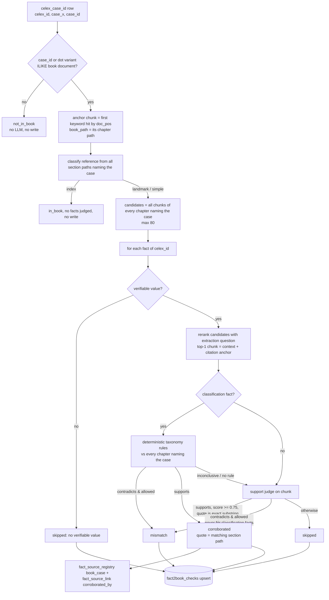
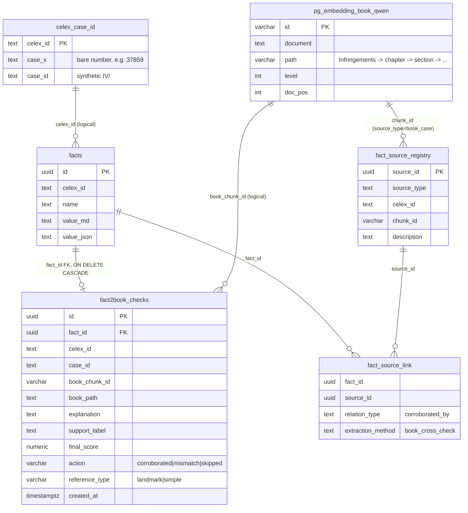

Reconciles the facts that the DSPy extractors produce from EU Commission decisions (CELEX documents) with the *human-authored* analysis of the same cases in Russo, Schinkel, Günster & Carree (2010). The book is a second, independent source: when it confirms a fact the fact gains a corroborating lineage link, and when it contradicts a fact the disagreement is recorded for review.

> **This document is the forensic record**: findings F-1 to F-7, issues I-1 to I-9 and their dated status, kept so a design decision can be traced to the measurement that forced it. For the system as it stands today and the results of the 2026-09-17/18 runs, read [Design Fact 2 Book Reconcilation](<Design Fact 2 Book Reconcilation.md>) first.

| Component    | File                                                                                                                                                                                             |
| ------------ | ------------------------------------------------------------------------------------------------------------------------------------------------------------------------------------------------ |
| Batch driver | [src/batch/Main_cross_check_facts_vs_book.py](../src/batch/Main_cross_check_facts_vs_book.py)                                                                                                    |
| DSPy module  | [src/pipelines/agent_dspy/book_cross_check_module.py](../src/pipelines/agent_dspy/book_cross_check_module.py)                                                                                    |
| Shared judge | [src/pipelines/agent_dspy/evidence_support.py](../src/pipelines/agent_dspy/evidence_support.py) (`EvidenceSupportSignature`, `judge_support`, `fact_statement`)                                  |
| Ledger DAO   | [src/pipelines/rag/pgvector/fact2book_check_repository.py](../src/pipelines/rag/pgvector/fact2book_check_repository.py)                                                                          |
| Book DAO     | [src/pipelines/rag/pgvector/book_chunk_repository.py](../src/pipelines/rag/pgvector/book_chunk_repository.py)                                                                                    |
| Migration    | [src/pipelines/rag/pgvector/migrate_fact2book_checks.sql](../src/pipelines/rag/pgvector/migrate_fact2book_checks.sql)                                                                            |
| Tests        | `agent_dspy/tests/test_book_cross_check_module.py` (45 unit), `test_book_cross_check_integration.py` (15, live IV/26.699 Chiquita), `rag/pgvector/tests/test_fact2book_check_repository.py` (17) |

Related: [Design Book](Design%20Book.md) (ingestion + `HybridBookSearch`), [Design Fact Verifier](Design%20Fact%20Verifier.md) (the document-chunk verifier this deliberately does not touch), [Design fact_source_registry](Design%20fact_source_registry.md). Plans: [fact2book-mismatch-cross-check](claude/plans/fact2book-mismatch-cross-check.md), [fact2book-checks-full-ledger](claude/plans/fact2book-checks-full-ledger.md), [book-reference-type-differentiation](claude/plans/book-reference-type-differentiation.md), [fact2book_processed_log_load](claude/plans/fact2book_processed_log_load.md) (not implemented).

---

## 1. Pipeline



### 1.1 Driver (`Main_cross_check_facts_vs_book.py`)

*Update 2026-09-17.* The driver lists cases and returns on `--dry-run` before any LM, reranker or ledger repository is built; the LM comes from `config.llm_factory.batch_profile()`; the DGX thermal gate is checked before every case (`--no-thermal-gate` to disable); every visited case is written to `celex_facts.fact2book_case_runs` under `--run-id` (default: a timestamp), and `--resume` skips the keys already finished under that id. Counters report `not_in_book` split into `no_surface` / `no_anchor` and `already_checked` (facts left alone by `--skip-existing`) apart from `skipped`.

1. Configures the global DSPy LM (`openai/{settings.LLM_MODEL_ID}` against `OLLAMA_HOST/v1`, `cache=False`).
2. Wires the module through the Provisioner pattern. One `FactRepository` and one engine are shared, `HybridBookSearchToolkit` is built from `CelexDatabaseToolkit`, and the ranker is `create_ranker()`, the **batch** profile (`RERANKER_BACKEND`, default `bge`).
3. Reads every row of `celex_facts.celex_case_id` and optionally filters them in Python by `--celex-id` / `--case-id`.
4. Calls the module once per row. Rows with an empty `celex_id`/`case_id` count as `incomplete_rows`. An exception is logged and counted as `errors`, and the loop continues.
5. Logs progress every 10 cases and ends with a summary: `actions`, `reference_types`, `not_in_book`, `incomplete_rows`, `errors`.

| Flag | Effect |
|------|--------|
| `--dry-run` | Logs the cases it would process. No LLM calls and no DB writes (but see I-9). |
| `--celex-id`, `--case-id` | Exact-match scoping; can be combined. |
| `--skip-existing` | `overwrite=False`: facts that already have a ledger row for the CELEX are neither re-judged nor rewritten. |
| `--fact-prefix P` | Repeatable; only facts whose `name` starts with one of the prefixes are checked. |

### 1.2 Case resolution

A case counts as "in the book" when `pg_embedding_book_qwen.document ILIKE '%<surface>%'` matches. `case_id_variants()` builds the candidate surfaces in this order:

1. the stored `case_id`;
2. the same with thousands dots removed;
3. the same with the last four digits regrouped (`IV/26699` -> `IV/26.699`);
4. steps 1-3 again under every other prefix in `settings.BOOK_CASE_ID_PREFIXES` (`IV/`, `COMP/`), so `IV/36545` also probes `COMP/36545` and `COMP/36.545`.

The first surface that matches is used for every book lookup, while the canonical `case_id` is what gets persisted. Prefix variants were added on 2026-09-13 (finding F-1); before that only punctuation varied.

### 1.3 Reference type (validation policy)

`classify_book_reference(paths)` looks at the distinct `path` values of all chunks that name the case:

| Type | Rule | Policy |
|------|------|--------|
| `landmark` | any path contains `BOOK_LANDMARK_SECTION_MARKERS` (`"F Economic landmark cases"`) | Every fact can be corroborated or contradicted. |
| `simple` | default, including chronological decision listings | Every fact can be corroborated; only `infringement*` facts can be contradicted. A `contradicts` verdict on any other fact is downgraded to `skipped` and keeps its label. |
| `index` | every path starts with `BOOK_INDEX_PATH_PREFIXES` (`Annex`, `Index`) | Returns early; nothing is judged or written. It never fires in practice, because ingestion covers chapters 2-8 only. |

### 1.4 Per-fact context

- **Candidates** (once per case, two pools since 2026-09-17): the *case pool* is every chunk whose text names the case (`keyword_search`, up to `BOOK_CROSSCHECK_CANDIDATE_LIMIT`=80); the *chapter pool* is `fetch_chapters_for_keyword`, which expands every such chunk to its chapter prefix (first three `path` segments) and returns all chunks of those chapters.
- **Pool per fact**: a case-specific fact (`BOOK_CASE_SPECIFIC_FACT_PREFIXES`: decision date, HeidelTime periods, cartel period, fines, companies, commission) is reranked over the case pool only; every other fact over the case pool followed by the chapter pool, deduplicated by id. A case-specific fact whose judged context does not name the case (case-insensitively) is recorded as `skipped` without an LLM call (F-5).
- **Selection** (per fact): the ranker scores the pool against the fact's latest extraction question (or against `name: value` when there is none), with `top_k=1`. The winning chunk, capped at `BOOK_CROSSCHECK_CONTEXT_CHARS`=8000 characters, is both what the judge reads and the `book_chunk_id` anchor. The two must be the same text because a corroboration requires a verbatim quote from the context.
- **Fallback**: without a ranker, candidates or a value, the context is the concatenated chapter of the first keyword hit, anchored on that hit.
- `book_path` is always `chapter[0].path`, the chapter of the **earliest** (`doc_pos`) chunk that names the case. It is the same for every fact in the case.

### 1.5 Judges

| Judge | Signature | Input | Used for |
|-------|-----------|-------|----------|
| Taxonomy (deterministic, no LLM) | `book_taxonomy.judge_taxonomy` | fact value + `book_placement(reference_paths)` | classification facts with a rule in `BOOK_TAXONOMY_LABEL_NUMBERS` / `BOOK_TAXONOMY_BOOLEAN_CHAPTERS` |
| Support | `EvidenceSupportSignature` (shared with the document verifier) | statement, required elements, chunk, question, case reference | all other facts; classification facts with no rule or an inconclusive taxonomy (corroborate only) |

Both return `EvidenceSupportResult` (`label`, `support_score`, `evidence_quote`, `reason`). A judge exception or unstructured output becomes a `skipped` verdict and never aborts the batch. Since 2026-09-17 the book module passes the resolved case surface as `case_reference` (text about another case is insufficient, never contradicting), and a `supports` verdict is promoted when its quote occurs in the context up to surface folding (`evidence_support.quote_in_text`: NFKC, typographic quotes/dashes, soft hyphens, hyphenated line breaks, whitespace runs); a paraphrase still fails (F-6).

**Taxonomy rules** ([book_taxonomy.py](../src/pipelines/agent_dspy/book_taxonomy.py), since 2026-09-13; this replaces the LLM `BookClassificationConsistencySignature`, which judged against the single `book_path`):

- **Placement:** the numbered chapters (`2`) and sections (`2.1`) of the case's landmark paths if it has any, otherwise of every path naming the case. Paths are sorted so the cited path is stable between runs.
- **Label facts** (`hor_vert_lic_joint` mapped to chapters; horizontal/vertical subcategories mapped to sections 2.x / 5.x). A label counts as claimed when it occurs anywhere in the value, so lists, `;`-joined values and table-formatted values all work.
  - `supports`: a claimed number is in the placement. The quote is that section path.
  - `contradicts`: no claimed *chapter* is in the placement, but the placement includes a decisive conduct chapter (`BOOK_TAXONOMY_DECISIVE_CHAPTERS` = 2-6).
  - Inconclusive: any other outcome, including a different section of a claimed chapter, or a placement only in chapter 7 (Art. 106) or 8 (mergers).
- **Boolean facts** (`abuse_of_dominance` = chapter 3, `member_states` = chapter 7): `True` supports and `False` contradicts when the book files the case under that chapter. Book silence is inconclusive.
- An inconclusive result falls through to the support judge, which may corroborate with an exact quote but can no longer contradict a classification fact.
- A match has no prose quote because a label such as `abuse_of_dominance: True` has no verbatim surface in the text; the section path stands in as the quote.

---

## 2. Data model



### 2.1 Inputs (read-only)

| Table | Role | Notes |
|-------|------|-------|
| `celex_facts.celex_case_id` | Case list driving the batch | 699 rows, 1:1 `celex_id`:`case_id`. **Every `case_id` is `IV/<number>`**, including COMP-era and AT cases; `case_x` holds the bare number. `schema_comments.sql` describes these two columns the other way round (I-5). Distinct from the regex-discovered `case_celex_id`. |
| `celex_facts.pg_embedding_book_qwen` | Book corpus | 637 `BookNode` sections of one book (chapters 2-8), `path` encodes the taxonomy. |
| `celex_facts.facts` | Facts under test | `select_all_facts_for_celex`; the value is `value_md` or `value_json`. Placeholder values (`""`, `na`, `none`, `null`, `[]`, ...) are never judged. |
| extraction question | Rerank query + judge rubric | `FactRepository.select_latest_question(celex_id, name)`. |

### 2.2 Outputs

**`celex_facts.fact2book_checks`**, the complete per-fact ledger:

- Natural key `uq_fact2book_checks (fact_id, celex_id)`, one verdict per fact per case. `upsert_check` is `ON CONFLICT DO UPDATE` and bumps `created_at`, so `created_at` really means "last judged".
- `book_chunk_id` is deliberately **not** part of the key. The reranker re-picks the anchor on every run, and keying on it produced duplicate rows (fixed 2026-08-04: 179 legacy `action IS NULL` rows and 47 drifted duplicates deleted).
- `action` is `NOT NULL` with `CHECK IN ('corroborated','mismatch','skipped')`. `reference_type` is `landmark`/`simple`; `index` cases write no rows.
- `explanation` is `NOT NULL`: the judge reason, otherwise the quote, otherwise a generic sentence for the action.
- The live constraint names still carry the old `fact2book_mismatch_*` prefix (cosmetic).

**Lineage** (corroborations only): `LineageRepository.register_book_source(celex_id, chunk_id=book_chunk_id)` upserts a `book_case` source on `(source_type, chunk_id)`, and `link_fact_to_source(relation_type='corroborated_by', extraction_method='book_cross_check', dspy_module='BookCrossCheckModule')` upserts on `(fact_id, source_id)`. Since 2026-09-13 the lineage follows the ledger. After a corroboration, `LineageRepository.retract_fact_links` removes this module's links to any earlier (drifted) anchor. Any other written verdict (`mismatch`, `skipped`) removes all of them. The retraction is scoped to `relation_type='corroborated_by'`, `extraction_method='book_cross_check'` and `source_type='book_case'`, so other producers' provenance is untouched. Facts left alone by `--skip-existing` keep their links. Registry rows are shared and never deleted. Invariant: every book link of this module points at the `book_chunk_id` of a `corroborated` ledger row.

**`celex_facts.fact2book_case_runs`** (since 2026-09-17), the case-level run ledger: one row per `(celex_id, case_id)` with `run_id`, `in_book`, `absence_reason` (`none` / `no_surface` / `no_anchor`), `reference_type`, the four per-fact counters and `started_at` / `finished_at`. Upserted after every case by the driver; `--resume` reads it. It answers "was this case visited, and why did it produce no verdicts", which the per-fact ledger cannot.

**Not written, on purpose**: `fact_evidence` and `facts.verification_status`. Those belong to the document-chunk verifier, and `upsert_evidence` is delete-then-insert, so a book write would overwrite the document verdict (open design question in ISSUES).

### 2.3 Configuration (`src/config/settings.py`)

| Setting | Default | Used in |
|---------|---------|---------|
| `EVIDENCE_SUPPORT_MIN_SCORE` | 0.75 | support + taxonomy corroboration threshold |
| `BOOK_CROSSCHECK_CONTEXT_CHARS` | 8000 | judge context cap |
| `BOOK_CROSSCHECK_CANDIDATE_LIMIT` | 80 | per-case rerank pool |
| `BOOK_CROSSCHECK_REFERENCE_PATH_LIMIT` | 200 | paths read for classification |
| `BOOK_CLASSIFICATION_FACT_PREFIXES` | `infringement_category`, `infringement_subcategory` | taxonomy judge |
| `BOOK_INFRINGEMENT_FACT_PREFIXES` | `infringement` | contradiction allowed on simple references |
| `BOOK_LANDMARK_SECTION_MARKERS` | `F Economic landmark case` (singular also matches plural; 3.9, 6.3 and chapter 8 use the singular) | landmark detection, taxonomy placement |
| `BOOK_TAXONOMY_LABEL_NUMBERS` | value label -> chapter/section per label fact | taxonomy rules |
| `BOOK_TAXONOMY_BOOLEAN_CHAPTERS` | `abuse_of_dominance`: 3, `member_states`: 7 | taxonomy rules |
| `BOOK_TAXONOMY_DECISIVE_CHAPTERS` | 2, 3, 4, 5, 6 | chapters that can contradict a label fact |
| `BOOK_INDEX_PATH_PREFIXES` | `Annex`, `Index` | index detection |
| `BOOK_CASE_ID_PREFIXES` | `IV/`, `COMP/` | case-id prefix variants for book resolution |
| `RERANKER_BACKEND` / `RERANKER_MODEL_ID` | `bge` / `BAAI/bge-reranker-v2-m3` | batch ranker profile |

---

## 3. Results

Snapshot queried from the live DB on 2026-09-13. The ledger was last written by the full runs of **2026-08-03 and 2026-08-04** (max `created_at` 2026-08-04 11:45 UTC); there has been no run since.

### 3.1 Coverage funnel

| Stage | Count | Note |
|-------|------:|------|
| `celex_case_id` rows | 699 | |
| matched literally (`IV/<n>` in book) | 38 | equals the 2026-06-26 run: `not_in_book=661` before the punctuation resolver existed |
| + matched via dot variant (`IV/nn.nnn`) | 303 | |
| **cases judged** (distinct `celex_id` in ledger) | **341** | 341 distinct `case_id` |
| written as `COMP/nn.nnn` in book, **missed** | 56 | prefix not varied (F-1); ~3,100 facts never checked |
| no surface found in book | 302 | genuinely absent or other spelling |
| facts in the 341 CELEX | 18,715 | |
| ledger rows | 18,453 | |
| facts without a ledger row | 262 | all created after the run (`heideltime_*` x3, `eu_commisssion_decision_date`) |

### 3.2 Verdicts

| action | landmark | simple | total | share |
|--------|---------:|-------:|------:|------:|
| corroborated | 445 | 2,062 | 2,507 | 13.6 % |
| mismatch | 51 | 171 | 222 | 1.2 % |
| skipped | 1,708 | 14,016 | 15,724 | 85.2 % |

Breakdown of `skipped` by judge label:

| support_label | rows | Meaning |
|---------------|-----:|---------|
| `insufficient` | 11,410 | book silent on the fact (expected majority) |
| *(null)* | 3,619 | fact has no verifiable value; no LLM call |
| `supports` | 317 | judge supported, but the quote was not an exact substring (296) or the score was < 0.75 (21) |
| `contradicts` | 250 | simple reference, non-infringement fact, downgraded by policy |
| `partially_supports` | 128 | not promoted |

By book chapter (`book_path` segment 2): Horizontal restrictions 7,654 rows (99 mismatches), Vertical restrictions 5,031 (40), Joint ventures 2,894 (30), Abuse of dominance 1,420 (23), Licensing 1,183 (24), Mergers 158 (4), Art. 106 decisions 113 (2).

### 3.3 Corroborations

The most corroborated fact names are `infringement_concept` 196, `exemption_case` 181, `human_index_title` 169, `market_oligopoly` 146, `case_title` 144, `infringement_gravity` 134, `market_geographical` 119, `human_index_year` 110, `case_commission_decision` 107 and `case_commissioner` 87. The ledger's 2,507 corroborated rows sit alongside **3,939** `corroborated_by` links from 239 `book_case` sources (F-4).

### 3.4 Mismatches

| fact name | simple | landmark |
|-----------|-------:|---------:|
| `infringement_category_hor_vert_lic_joint` | 63 | 13 |
| `infringement_subcategory_vertical_restraints` | 44 | 3 |
| `infringement_subcategory_horizontal_restraints` | 39 | 7 |
| `infringement_category_abuse_of_dominance` | 23 | 3 |
| `eu_commisssion_decision_date` | – | 17 |
| `market_outside_eu` | – | 3 |
| `infringement_category_member_states` | 2 | – |
| 5 other landmark facts | – | 1 each |

**197 of 222 mismatches (89 %) are taxonomy-judge verdicts on classification facts.** Across all 566 classification rows there are 197 mismatches, 167 corroborations and 202 skips; this is the "197 out of 694 infringement facts contradict the book" item in ISSUES.

---

### 3.5 After run `book-20260917` (2026-09-17/18)

Full rerun with the 2026-09-17 code (two candidate pools, case reference, folded quotes, operative-article gating not yet applied to the stored facts): 397 cases in the book (the 56 `COMP/` cases included), 302 without a surface, 0 without an anchor, 0 errors, 24 h wall clock.

| action | landmark | simple | total |
|--------|---------:|-------:|------:|
| corroborated | 478 | 2,542 | 3,020 |
| mismatch | 62 | 91 | 153 |
| skipped | 2,048 | 16,967 | 19,015 |

Lineage: 3,020 `book_case` links for 3,020 corroborated rows, no fact with more than one. Decision-date mismatches 17 -> 10, all on chunks naming the case. Infringement facts: 700 supports / 105 contradicts (was 497 / 197). `supports` verdicts skipped by the quote gate: 417, of which a re-judged sample shows most carry an *empty* quote (no quotable surface) rather than a whitespace difference. One regression found and fixed the same day: a 12k-character chunk head-truncated to 8,000 characters lost the case surface, so 300 case-specific facts in 32 cases were skipped unjudged; the context is now windowed around the surface (`_window_around`) and those cases were re-judged under `book-20260917-window` (480 facts: 81 corroborated, 0 mismatch, 399 skipped). Ledger after both runs: corroborated 3,066 / mismatch 153 / skipped 18,969; 3,066 links for 3,066 corroborated rows.

## 4. Findings

**F-1 Case resolution misses every `COMP/` surface.** `celex_case_id.case_id` is always generated as `IV/<number>`, but the book writes post-1999 cases as `COMP/nn.nnn` (120 `COMP/` occurrences against 711 `IV/`). All 56 cases whose number appears in the book but that are missing from the ledger are `COMP/` spellings (e.g. `CELEX-32001D0418` `IV/36545` -> book `COMP/36.545`), and most are modern cartel decisions with 50-59 facts each. `case_id_variants` should also vary the prefix (`IV/`, `COMP/`, `AT.`), or resolution should match on `case_x` with a word-bounded regex. No prefix-collision false positives were found (every literal ILIKE hit is also a word-bounded match), but `ILIKE '%IV/511%'` is not structurally safe against `IV/5110`.
*Status 2026-09-13: fixed in code.* `case_id_variants` now also varies the prefix (`settings.BOOK_CASE_ID_PREFIXES`); `AT.` was left out because the 2010 book contains no `AT.` surface. The 56 cases enter the ledger on the next run.

**F-2 Most taxonomy mismatches are judge or path artefacts, not extractor errors.** Sampled `mismatch` explanations include clear false negatives:
- `hor_vert_lic_joint = license` under `4 Licensing -> 4.2 Patents ...`, flagged as "mutually exclusive with a horizontal or vertical license classification";
- `abuse_of_dominance = True` under `7 Decisions addressed to Member States pursuant to Article 106`, even though Art. 106 cases are frequently Art. 102 abuses by public undertakings.

The book's level-1 chapters map almost one to one onto the `hor_vert_lic_joint` value set (2 horizontal, 4 licence, 5 vertical, 6 joint), so this check is a deterministic lookup that currently goes through a free-form LLM judge.

**F-3 Single-path taxonomy is wrong for cases the book discusses in several chapters.** `book_path` is the chapter of the earliest mention, so a case analysed in `5 Vertical restrictions` but first cited as an example in `2 Horizontal restrictions` is judged against the horizontal taxonomy. Classification facts on the 28 multi-chapter cases show **36 mismatches against 6 corroborations**, compared with 161 against 161 on the 260 single-chapter cases (288 of the 341 cases were attributable by regex). The classifier already collects every path for `reference_type`, but the taxonomy judge sees only one of them.

*Status 2026-09-13 (F-2 and F-3): fixed in code* with the deterministic taxonomy rules in §1.5. A read-only replay of the rules over the 566 existing classification rows (no LLM calls, scratchpad `taxonomy_impact.py`) gives:

| old action | new: corroborated | new: mismatch | new: prose fallback | new: no value |
|------------|------------------:|--------------:|--------------------:|--------------:|
| corroborated (167) | 164 | 1 | 1 | 1 |
| mismatch (197) | 41 | 91 | 53 | 12 |
| skipped (202) | 153 | 0 | 21 | 28 |

- **Mismatches** fall from 197 to **92**: 56 `hor_vert_lic_joint`, 22 vertical and 14 horizontal subcategory.
- **Taxonomy corroborations** rise from 167 to **359**.
- **Chiquita (IV/26.699)** comes out as the integration test expects: `abuse_of_dominance=True` corroborated; `horizontal` and its market-sharing subcategory contradicted by "3 Abuse of dominance".
- **Remaining judgement calls** among the 92: `horizontal` claims for cases the book files under "6 Joint ventures and alliances" (the extractor could have answered `joint venture`), and `vertical` claims for abuse cases (vertical clauses used abusively). Removing chapter 6 or 3 from the decisive set for those labels would turn them inconclusive.

**F-4 Lineage is never retracted and drifts with the anchor.** `corroborated_by` links are created on corroboration but never removed when a re-run downgrades the verdict. The results:
- 1,028 links on facts whose current ledger action is `skipped`;
- 3 links on facts now marked `mismatch`, which gives contradictory provenance;
- because `register_book_source` keys on `chunk_id` and the anchor is re-ranked on every run, 432 facts carry more than one book link.

This is the same anchor-drift defect that was fixed for the ledger on 2026-08-04, still present in the lineage tables.
*Status 2026-09-13: fixed in code* (see §2.2). All 3,939 existing book links are `extraction_method='book_cross_check'`, and every corroborated ledger row still has its anchor link. The existing data was healed on 2026-09-13 by the 20260913 section of `migrate_fact2book_checks.sql`, applied with a post-condition check: 1,432 links were deleted, leaving 2,507 links for 2,507 corroborated ledger rows and no fact with more than one book link.

**F-5 Case-specific scalar facts are judged against other cases' text.** The candidate pool is every chunk of the chapter, and a landmark chapter covers several cases. All 17 landmark `eu_commisssion_decision_date` mismatches read like "the chunk states the decision date as 28 July 1978, which contradicts 2001-12-02": the reranker picked a date paragraph and the judge was not told which case the paragraph belongs to. Facts that identify a specific case (dates, fines, parties) should only use chunks that contain the case surface, or the judge should receive `case_id`.

*Status 2026-09-17 (F-5): fixed in code* -- two candidate pools and the case-surface guard (§1.4), plus `case_reference` on the judge (§1.5). The ledger changes on the `book-20260917` run.

**F-6 Verbatim-quote gate costs ~300 corroborations.** 296 `supports` verdicts at or above 0.75 were skipped only because the quote was not an exact substring. The main causes are likely whitespace, hyphenation and ligature differences in MinerU output. A normalised containment check (collapsed whitespace, de-hyphenation) would recover these without accepting paraphrase.
*Status 2026-09-17: fixed in code* with `quote_in_text` (§1.5); the document verifier keeps its exact check for now (ISSUES.md 20260917).

**F-7 Low corroboration is expected, not a defect.** 85 % skipped fits a book that mostly mentions a case as an example: 88 % of rows are `simple` references. Landmark cases corroborate at 20 % (445/2,204), simple references at 12.8 % (2,062/16,249).

---

## 5. Issues

Existing open items in [ISSUES.md](../ISSUES.md) that this design depends on:

- Re-run for classification facts after the 2026-08-04 taxonomy-corroboration fix; the fix and the last run happened on the same day, so the ledger may still understate taxonomy corroborations.
- 197 of 694 infringement facts contradict the book: investigate root causes. F-2 and F-3 explain most of this.
- The Art.102-vs-Art.101 audit (IV/26.699 Chiquita) depends on trustworthy taxonomy mismatches, so it should wait for F-2/F-3. Rows filtered to `book_path ILIKE '%Abuse of dominance%'` currently yield only 23 mismatches, 6 of which are `hor_vert` claims.
- Book corroboration is not surfaced in `fact_evidence` (canonical record undecided).
- `BookChapterVo` carries no chunk id; `HybridBookSearchToolkit.search` ignores `keyword`.
- The batch is not thermal-gated (`OllamaHealthGate`), unlike `BatchJobRunner` batches. **Done 2026-09-17** (`build_thermal_gate` / `stop_on_thermal_abort`, shared with the other hand-rolled batches).
- The shared LM factory has not been adopted; the driver still builds `dspy.LM` inline. **Done 2026-09-17** (`batch_profile()` at every batch site).
- `fact2book_processed` (log-derived case ledger) was planned but never created; the table does not exist in the live DB. **Superseded 2026-09-17** by `fact2book_case_runs`, written by the driver itself.

New items raised by this review (added to ISSUES.md on 20260913):

| Id | Issue |
|----|-------|
| I-1 | F-1: add prefix variants (`COMP/`, `AT.`) to case resolution; 56 in-book cases and ~3,100 facts are unchecked. **Fixed in code 2026-09-13.** |
| I-2 | F-2/F-3: make classification checks deterministic from the chapter taxonomy and evaluate against *all* chapters naming the case. **Fixed in code 2026-09-13**; the ledger changes on the next run. |
| I-3 | F-4: retract `corroborated_by` book links when a re-run no longer corroborates, and key the book source per `(fact, case)` rather than per drifting chunk. **Fixed in code 2026-09-13** by retracting links to drifted anchors rather than re-keying the source; data healed the same day (1,432 stale links removed). |
| I-4 | F-5: restrict case-specific facts to chunks containing the case surface. **Fixed in code 2026-09-17** (§1.4, §1.5). |
| I-5 | `schema_comments.sql` is wrong: `fact2book_checks.reference_type` is described as "confirms, contradicts or merely mentions" (actual: landmark/simple) and `action` as "Reviewer disposition" (actual: machine routing); `celex_case_id.case_x` / `case_id` descriptions are swapped. The repository module docstring still claims the `(fact_id, book_chunk_id)` key. **Fixed and applied 2026-09-17.** |
| I-6 | 262 facts created after the 2026-08-04 run have no ledger row; a `--skip-existing` top-up covers them. **Covered by the full `book-20260917` run.** |
| I-7 | F-6: verbatim-quote containment should normalise whitespace/hyphenation. **Fixed in code 2026-09-17** (`quote_in_text`). |
| I-8 | Driver counters: in `--skip-existing` mode already-checked facts are added to `skipped` without a write, which inflates the summary; `not_in_book` conflates "no surface" with "no anchor chunk". **Fixed 2026-09-17** (`already_checked_count`, `BookAbsence`). |
| I-9 | `--dry-run` still configures the LM, loads the BGE cross-encoder and probes the DB before listing cases; build the module only when it is not a dry run. **Fixed 2026-09-17.** |

---

## 6. Operating notes

- **Re-run semantics.** The default run re-judges and overwrites the ledger. It is idempotent on `(fact_id, celex_id)`, but with the LLM non-deterministic a re-run can flip individual verdicts. Every upsert commits separately, so a crash leaves one case partially refreshed, and the next run heals it.
- **Restart.** `--run-id <label>` names the run in `fact2book_case_runs`; after a crash or a thermal abort, `--run-id <label> --resume` skips every case that run finished. The abort banner prints the exact command.
- **Cost.** One support or taxonomy call per fact with a value (~15k calls for a full run) plus one rerank per fact. The 2026-06-28 log shows roughly 50-75 s per case on the Spark.
- **Useful queries.**

```sql
-- verdict distribution per reference type
SELECT action, reference_type, count(*)
FROM celex_facts.fact2book_checks GROUP BY 1, 2 ORDER BY 1, 2;

-- mismatches for review, with the fact value
SELECT c.celex_id, c.case_id, f.name, coalesce(f.value_md, f.value_json) AS value,
       c.book_path, c.explanation
FROM celex_facts.fact2book_checks c
JOIN celex_facts.facts f ON f.id = c.fact_id
WHERE c.action = 'mismatch'
ORDER BY c.celex_id, f.name;

-- stale book corroboration links (F-4)
SELECT c.action, count(*)
FROM celex_facts.fact_source_link l
JOIN celex_facts.fact_source_registry sr ON sr.source_id = l.source_id
LEFT JOIN celex_facts.fact2book_checks c ON c.fact_id = l.fact_id
WHERE l.relation_type = 'corroborated_by' AND sr.source_type = 'book_case'
GROUP BY 1;
```
