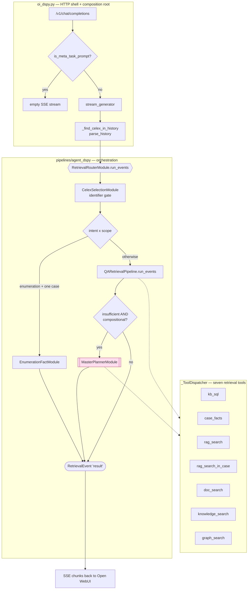

# Design — UI Modules

How a question typed into Open WebUI becomes a grounded, cited answer: the HTTP
shell (`oi_dspy`) and the DSPy modules behind it.

Scope: the **serving path** only. Deeper subsystems have their own documents and
are linked rather than repeated:

* [DSPy QA Complex Retrieval Module](<docs/DSPy QA Complex Retrieval Module>)
- [Design — Master Planner Agent](Design%20Master%20Planner%20Agent.md) — the compositional fallback agent
- [DESIGN Search](DESIGN%20Search.md) — hybrid retrieval, RRF, lexical reserve
- [Design BgeRanker](Design%20BgeRanker.md) — the reranker factory, both backends and their profiles
- [FlashRanker](FlashRanker%20(obsolete).md) — the FlashRank backend this service runs by default
- [Design Fact Verifier](Design%20Fact%20Verifier.md) — the per-row evidence gate
- [DESIGN Knowledge](DESIGN%20Knowledge.md) — the distilled knowledge store
- [Design 101 — Provisioner Pattern](Design%20101%20--%20Provisioner%20Pattern.md) — the DI convention used throughout

## The layering in one picture



The load-bearing idea: **`oi_dspy` owns no orchestration.** It parses the
request, hands the question to `RetrievalRouterModule.run_events`, and maps the
events it gets back onto Server-Sent Events. Every routing, retrieval and
synthesis decision lives in the DSPy modules, so the non-streaming
`forward()` contract and the streaming UI run the *same* code path.

---

# Part 1 — `oi_dspy.py`

[src/ui/backend_server/oi_dspy.py](../src/ui/backend_server/oi_dspy.py) (743 lines)

An OpenAI-compatible FastAPI server. Open WebUI is configured with an OpenAI
connection pointing at it, so the whole UI is off-the-shelf and this file is the
only bespoke serving code.

## Routes

| Route | Purpose |
| --- | --- |
| `GET /models`, `GET /v1/models` | Model discovery. Advertises one model, `celex-dspy-agent`. |
| `POST /chat/completions`, `POST /v1/chat/completions` | The chat endpoint. Honours the OpenAI `stream` flag: `true` returns a `StreamingResponse` of SSE chunks, `false` (the default, and what Open WebUI's background tasks send) returns one aggregated `chat.completion` JSON object. |
| `GET /chunk/{chunk_id}` | Renders one source chunk as HTML — the target of provenance links in an answer. |
| `GET /doc/{celex_id}` | Document viewer landing page for a case. |
| `GET /doc/{celex_id}/md` | The mineru markdown rendering. |
| `GET /doc/{celex_id}/pdf` | The source PDF (`FileResponse`). |

The `/doc` routes read from `settings.CELEX_DOCS_DIR`, resolved once into
`_DOCS_ROOT`. `_resolve_doc_path` validates the id against `_CELEX_ID_PATTERN`
(`^[A-Za-z0-9_-]+$`) and resolves inside `_DOCS_ROOT` — a path-traversal guard,
since the id arrives from the URL.

## Composition root

Lines 86-137 provision the entire object graph **at import time**, following the
Provisioner pattern: every dependency is constructed once and injected, never
created inside a `forward()`.

```
create_lm(ui_planner_profile())  -> dspy.configure(lm=...)
FactRepository()                 -> fact_repo         (owns the engine)
CelexDatabaseToolkit(fact_repo)  -> toolkit, chunk_repo
FactAggregator(engine=...)       -> aggregator        (CrossCaseAggregator)
create_ranker(ui_ranker_profile()) -> ranker          (see below)
HybridSearch(repo, ranker, embed_query)
LineageRepository(engine=...)    -> lineage_repo
KnowledgeRepository()            -> knowledge_repo
EntityGraphRepository(engine=...)-> entity_graph_repo (when GRAPH_SEARCH_ENABLED)
        |
        +-> QARetrievalPipeline
        +-> EnumerationFactModule
        +-> MasterPlannerModule    (when MASTER_PLANNER_ENABLED)
                |
                +-> RetrievalRouterModule  == `orchestrator`
```

One engine is shared by every repository (`engine=fact_repo.engine`), so the
process holds a single connection pool. `FactAggregator` is defined inline in
this file rather than imported — it is the concrete `CrossCaseAggregator`, a
seven-line read-only SQL executor.

`pipeline.enqueue_fn = _enqueue_for_knowledge_extraction` injects the
knowledge-extraction sink after construction, so the QA branch can queue an
answered turn for later distillation without the pipeline importing a DB model.

> **Known issue.** Import-time provisioning means importing this module builds a
> reranker, opens a live DB engine, and needs a reachable Ollama. That makes the
> test suite unrunnable for a contributor without those and is why
> `unittest discover` over the whole tree stalls. It is tracked in
> [ISSUES.md](../ISSUES.md) as a Provisioner-rule violation; the fix is a
> FastAPI lifespan handler or a factory function. The reranker half of the cost
> is what the `ui` profile below exists to bound.

## The reranker: why this service runs its own profile

`create_ranker()` with no argument resolves the **batch** profile
(`settings.RERANKER_BACKEND`, `bge`), and that is what every ingestion CLI gets.
This server is the one caller that passes a profile explicitly:

```python
ui_ranker = ui_ranker_profile()          # settings.UI_RERANKER_BACKEND
ranker = create_ranker(ui_ranker)        # -> FlashRanker by default
```

The split is deliberate, and the reason is the composition root above. A bare
`create_ranker()` here would load the ~2.3 GB BGE cross-encoder **at import**,
onto the same 6 GB card an ingestion run wants, for a chat turn that reranks a
few dozen candidates. FlashRank answers that from a ~35 MB ONNX model on CPU. So
the chat container stays light while the batch keeps the accurate reranker, and
the two are configured under different names so a shell that exported
`RERANKER_BACKEND` for a batch CLI cannot re-point the running service.

The same `ranker` instance is injected into both `HybridSearch` and
`EnumerationSearch`; the factory caches per `(backend, model id)`, so this is one
model in the process either way.

| | `ui` profile (this service) | `batch` profile (ingestion CLIs) |
| --- | --- | --- |
| Selector | `ui_ranker_profile()` | `batch_ranker_profile()`, i.e. bare `create_ranker()` |
| Setting | `UI_RERANKER_BACKEND` | `RERANKER_BACKEND` |
| Default | `flashrank` | `bge` |
| Model | `ms-marco-MiniLM-L-12-v2`, pinned in `FlashRanker` | `RERANKER_MODEL_ID`, default `BAAI/bge-reranker-v2-m3` |
| Cost | ~35 MB ONNX, CPU | ~2.3 GB, CUDA when visible |
| In the chat image | yes | no, needs a rebuild |

That reasoning was eventually followed to its conclusion: the image itself no
longer contains the bge stack. It installs `requirements-ui.txt`, which omits
`torch`, `sentence-transformers`, `transformers`, `safetensors` and `networkx`
because `bge_reranker.py` is their only importer in the tree, and the
compose service reserves no GPU. So `UI_RERANKER_BACKEND=bge` is a **rebuild**,
not an environment flip: `docker-compose.cpu.yml` restores the backend on CPU,
`REQUIREMENTS_FILE=requirements.txt` plus a device reservation restores it on
CUDA. Setting it on the lean image raises a `RuntimeError` from the factory that
names the lock to rebuild with, rather than a bare missing-module error.

The factory logs `Loading reranker for profile <name>: backend=<b> model=<m>`
once per loaded model, which is the authoritative answer for a running container.

### FlashRank's first start needs egress

`FlashRanker.__init__` constructs `flashrank.Ranker`, which downloads the model
zip with plain `requests` from huggingface.co and unpacks it into
`settings.CACHE_DIR`. This happens **during import of this module**, and it is
outside the Hugging Face machinery entirely, so `HF_HUB_OFFLINE` and
`RERANKER_LOCAL_FILES_ONLY` do not apply to it. On a host with no egress and an
empty cache, the container raises `ConnectionError` at import and restart-loops.

Three things keep that to a one-time event, or remove it:

1. Compose sets `CACHE_DIR=/app/data/cache/huggingface/flashrank`, a
   subdirectory of the `hf_cache` volume, so the download survives a container
   recreate. A subdirectory of the existing mount rather than a volume of its
   own: that path is already owned by uid 10001, whereas a fresh named volume
   arrives root-owned and the download fails with `EACCES`.
2. The image sets the same path as `ENV CACHE_DIR`, so a bare `docker run`
   without compose lands the model in the same place.
3. `PREFETCH_FLASHRANK=true` as a build arg downloads the model into the image
   at build time, for an air-gapped host. Docker seeds a named volume from the
   image only when that volume is **created**, so an `hf_cache` volume that
   already exists is not re-seeded; remove it first, or populate it by hand.

See [README](../README.md) (Deployment and Troubleshooting) for the commands.

## The request path

`chat_completions` does two things before delegating:

1. **Meta-task rejection.** Open WebUI fires background completions against the
   same endpoint to generate chat titles, tags and follow-up suggestions. These
   are not questions. `is_meta_task_prompt` detects them and
   `_empty_completion_stream` returns a well-formed but contentless SSE stream,
   so the UI falls back to its own default. Without this, every conversation
   costs three extra full pipeline runs and pins a bogus case set onto the
   thread. Gated by `settings.WEBUI_REJECT_TASK_PROMPTS`.
2. Hands the last user message plus the full thread to `stream_generator`.

`stream_generator` is the whole streaming contract:

| Step | Behaviour |
| --- | --- |
| Reset command | If the prompt is in `_RESET_PHRASES`, acknowledge and stop. No plan, no LLM call. |
| Sticky case | `_find_celex_in_history` scans prior *user* messages newest-first for a case id that resolves in the DB, stopping at any reset command. |
| Thread parse | `parse_history` turns the raw messages into `ConversationTurn`s with UI furniture stripped. |
| Orchestrate | Iterate `orchestrator.run_events(question, fallback_celex_id, history)`. |
| Map events | `status` -> SSE text; `case_context_set` -> acknowledge, emit doc footer, end the stream; `result` -> capture the answer. |
| Stream answer | The answer is emitted in 200-character fragments for a typing effect. |
| Footer | `_doc_footer` appends viewer links for the resolved case (no-op when none resolved). |
| Pin | `encode_pinned_context` appends an invisible marker naming this turn's case set. |

### Statelessness is the design

There is no server-side session state at all. Two mechanisms replace it, both
carried in the transcript that Open WebUI replays on every turn:

- **Sticky case** is *re-derived* from the message history each request, using
  the same registry-backed validation `CelexSelectionModule` uses — so a
  follow-up behaves exactly as the original turn did. This replaced a mutable
  global `_active_celex` dict that suffered cross-request races.
- **Pinned case set** is encoded into the answer itself. The marker renders as
  nothing in the UI, Open WebUI replays the assistant message verbatim, and the
  next turn decodes it. So a refinement ("which of those had fines?") re-queries
  exactly the cases the user was just shown — with no server state to key, lose
  on restart, or race on.

## Known defects in this file

Three are already tracked in [ISSUES.md](../ISSUES.md): import-time provisioning,
wildcard CORS combined with `allow_credentials=True`, and streaming raw
exception text (`f"Pipeline error: {exc}"`) to the user, which can leak the DSN
and failing SQL from a SQLAlchemy error.

A fourth, found while writing this document (2026-09-07):

```python
_RESET_PHRASES = frozenset(
    {
        "reset"          # <- missing comma
        "unset"          # <- missing comma
        "celex all",
        ...
```

Adjacent string literals concatenate in Python, so those three entries collapse
into the single token `"resetunsetcelex all"`. The bare commands **`reset`,
`unset` and `celex all` therefore do nothing** — they fall through to the full
pipeline as ordinary questions. The seven comma-terminated phrases
(`celex reset`, `reset case`, `celex_id null`, ...) work correctly.

---

# Part 2 — the planner modules

All under [src/pipelines/agent_dspy/](../src/pipelines/agent_dspy/).

| Module | Role |
| --- | --- |
| `retrieval_router.py` | `RetrievalRouterModule` — top-level dispatch and Master Planner escalation. |
| `retrieval_modules.py` | The QA pipeline: `CelexSelectionModule`, `QAPlannerModule`, `QAExecutorModule`, `QASynthesizerModule`, `QARetrievalPipeline`, and `RetrievalEvent`. |
| `retrieval_dispatch.py` | `_ToolDispatcher`, the read-only SQL gate, and `KB_SCHEMA_DESCRIPTION`. |
| `dspy_signature.py` | Declarative signatures and typed models for the primary pipeline. |
| `master_planner_module.py` | The compositional fallback agent. |
| `master_planner_signature.py` | Its declarative half. |
| `master_planner_text.py` | Pure gate heuristics: `is_insufficient_answer`, `looks_compositional`. |
| `conversation_context.py` | Follow-up condensing and the pinned-context codec. |
| `enumeration_fact_module.py` | Map-then-aggregate enumeration strategy. |
| `evidence_verifier_module.py` | Per-row evidence gate. |
| `retrieval_provenance.py` | Renders the `References:` trail. |
| `retrieval_text.py` | Synonyms, empty-evidence detection, direct-fact passthrough. |
| `dspy_protocols.py` | The `Protocol` interfaces every dependency is injected as. |
| `query_router.py` | A *different* router — extraction-time, not serving-time (see below). |

## Two routers, easily confused

- **`QueryRouterModule`** (`query_router.py`) dispatches **batch fact
  extraction**, one YAML fact target at a time against a known `celex_id`. It is
  not in the serving path.
- **`RetrievalRouterModule`** (`retrieval_router.py`) dispatches **ad-hoc user
  questions**. This is the one `oi_dspy` calls.

They mirror each other's shape deliberately, which is why the names collide.

## `RetrievalRouterModule` — two-axis dispatch

`run_events` is the single orchestration core. Order of operations:

1. **Condense** a dependent follow-up. `looks_dependent()` is a cheap pre-gate;
   when it fires (or `CONVERSATION_CONDENSE_ALWAYS`), `ConversationCondenserModule`
   rewrites "list those cases" into a standalone question against the thread.
2. **Gate** the identifier. `CelexSelectionModule` resolves any case/celex token
   against the registry-backed index. An unknown id is rejected *here* — the
   planner is never asked to reason about a case that does not exist.
3. **Promote** the sticky case. When the question names no case,
   `fallback_celex_id` (derived by `oi_dspy` from history) is promoted to the
   resolved case, so a follow-up behaves like an inline id.
4. **Case-context-only** prompts (`_is_celex_only_prompt`) — a prompt that names
   a case and asks nothing gets an acknowledgement, not an answer. No planning,
   no synthesis, no LLM call.
5. **Dispatch on two axes**:
   - *Intent*: does the question have enumeration intent
     (`classify_retrieval_intent`, regex-based)?
   - *Scope*: does it resolve to exactly one case?

   Only **enumeration intent AND a single case** routes to
   `EnumerationFactModule`. Cross-case enumeration ("list all cases with
   leniency") has no single case to enumerate within, so it stays on the QA
   pipeline where `kb_sql` and `doc_search` work corpus-wide. An exception from
   the enumeration branch falls back to QA and is tagged `qa_fallback`.
6. **Escalate** when warranted (below).

Every terminal prediction carries `routing_decision` — `"enumeration"`, `"qa"`,
`"qa_fallback"`, `"case_context"`, `"invalid"`, `"master_planner"`, or
`"master_planner_na"` — so a misroute is visible in logs rather than silent.

### The escalation gate

```python
def _should_escalate(self, qa_result_event, question_for_planner) -> bool:
    # ... guards: a planner is wired in, and a terminal prediction exists
    return is_insufficient_answer(
        getattr(prediction, "answer", "") or "",
        getattr(prediction, "evidence", "") or "",
    ) and looks_compositional(question_for_planner)
```

Both halves are pure functions in `master_planner_text.py` with no I/O, so the
expensive fallback is gated by something cheap and unit-testable.
`looks_compositional` fires on aggregation cues, **relational cues** (how two
companies are connected), role-filter cues paired with a proper noun, and
`cases ... where` clauses. The relational cues exist so a graph-shaped question
reaches the planner at all — see
[Design — Master Planner Agent](Design%20Master%20Planner%20Agent.md).

## `QARetrievalPipeline` — Plan, Execute, Synthesize

`run_events` streams these stages, each preceded by a status line:

| Stage | Module | Notes |
| --- | --- | --- |
| 0. Gate | `CelexSelectionModule` | Rejects unknown identifiers before any LLM call. |
| 0b. Direct fact | `retrieval_text` passthrough | When the question names a fact that is already stored, return the stored value — no plan, no synthesis. |
| 1. Plan | `QAPlannerModule` | One LLM call producing a typed `RetrievalPlan` of `RetrievalStep`s. |
| 1b. Inject | `_inject_case_facts_step`, `_inject_rag_step` | Deterministic post-plan repairs (below). |
| 2. Execute | `QAExecutorModule` | Runs each step through `_ToolDispatcher`, with chaining and fallbacks. |
| 3. Synthesize | `QASynthesizerModule` | One LLM call over the collected evidence. |
| 4. Provenance | `retrieval_provenance` | Appends the `References:` trail. |

### Deterministic plan repair

The planner is an LLM and sometimes omits a step its own rules require. Rather
than re-prompting, the pipeline **repairs the plan in code**:

- `_needs_case_facts_step` / `_inject_case_facts_step` enforce the SINGLE-CASE
  RULE — a question naming a `celex_id` always gets a `case_facts` step.
- `_needs_rag_followup` / `_inject_rag_step` enforce the UNSTRUCTURED TOPIC
  RULE — court rulings and assessments live in document text, not in facts.
- `_scope_plan_to_celex_ids` / `_scope_sql_to_celex_ids` bind a pinned case set
  from the previous turn into this turn's SQL.

This is a deliberate pattern: **prompt rules state the intent, code enforces
it.** A rule the model can skip is a rule that gets skipped.

### Executor chaining and fallbacks

`QAExecutorModule.forward` supports **chained steps**: a step carrying
`input_from_step` (or a `{celex_ids}` placeholder in its SQL) receives the case
ids the referenced upstream step discovered — SQL substitution for `kb_sql`,
per-case fan-out for `case_facts` / `rag_search_in_case`, bounded by
`_MAX_CHAINED_CASES`. A `kb_sql` step whose `ILIKE` returns nothing is retried
with progressively shorter word stems (`_MAX_STEM_RETRIES`), which recovers the
common vocabulary mismatch where a user writes "brewery" and the corpus stores
"brewing".

When *every* step yields nothing, two fallbacks run: a synonym fallback over the
full fact bag, then a fact-name fallback that queries a fact the question named
explicitly.

## The tool layer

[retrieval_dispatch.py](../src/pipelines/agent_dspy/retrieval_dispatch.py) holds
`_ToolDispatcher`, shared by `QAExecutorModule` and `MasterPlannerModule` — so a
tool added here reaches both planners.

| Tool | Surface |
| --- | --- |
| `kb_sql` | Read-only SQL over `celex_facts.facts` and the graph views. |
| `case_facts` | Every stored fact for one case. |
| `rag_search` | Semantic search over fact embeddings, all cases. |
| `rag_search_in_case` | Hybrid document search scoped to one case. |
| `doc_search` | Keyword + FTS + semantic over raw chunks, all cases. |
| `knowledge_search` | Full-text over distilled knowledge nuggets. |
| `graph_search` | Multi-hop traversal over `entity_edges` — company-to-company adjacency. |

Every tool returns a typed `EvidenceResult` carrying `text` plus the identity of
what was retrieved (`fact_ids`, `chunk_ids`, `fact_names`, `celex_ids`). Ids are
collected *before* the rendered text is truncated to `_MAX_EVIDENCE_CHARS`, so
provenance survives truncation.

`kb_sql` passes through `_validate_read_only_sql`: markdown fences stripped,
single statement only, must start `SELECT`/`WITH`, write keywords blocked by
token match, and an implicit `LIMIT 500` when absent.

`KB_SCHEMA_DESCRIPTION` is the schema prose injected into both planners, built
by `build_kb_schema(graph_enabled, traversal_enabled)` from four blocks: the EAV
facts table, the flat graph views (`GRAPH_QA_ENABLED`), the `graph_search`
traversal tool (`GRAPH_SEARCH_ENABLED`), and the knowledge store. Both flags
default the prose to byte-identical output when off, which is what makes them
clean A/B switches.

## The event protocol

`RetrievalEvent` is a three-field dataclass — `kind`, `text`, `prediction` —
with `kind` one of `status`, `case_context_set`, `result`.

It exists so that streaming and non-streaming callers share one orchestration
implementation. `forward()` is uniformly a drain:

```python
def forward(self, question):
    result = None
    for event in self.run_events(question):
        if event.prediction is not None:
            result = event.prediction
    if result is None:
        raise RuntimeError("run_events produced no terminal result")
    return result
```

`RetrievalRouterModule`, `QARetrievalPipeline` and `MasterPlannerModule` all
follow this shape. The alternative — a streaming path beside a batch path —
guarantees the two drift.

> The status strings in `retrieval_modules.py` and `retrieval_router.py` carry
> emoji prefixes, which violates the project's no-emoji rule. Already tracked in
> [ISSUES.md](../ISSUES.md); listed here so the strings are not copied as a
> pattern.

## Conversation context

[conversation_context.py](../src/pipelines/agent_dspy/conversation_context.py)
supplies two halves, each independently switchable:

- **Condense** — `ConversationCondenserModule` rewrites a dependent turn into a
  standalone question and classifies an unrelated turn as `standalone` so the
  history is dropped rather than dragged along. `looks_dependent()` is the pure
  pre-gate that avoids paying for an LLM call on every turn.
- **Pin** — `encode_pinned_context` / `decode_pinned_context` are the codec for
  the invisible transcript marker described in Part 1.
  `strip_agent_noise` and `_is_status_line` remove the streamed status lines and
  footers so a replayed answer reads as prose.

## Provenance

[retrieval_provenance.py](../src/pipelines/agent_dspy/retrieval_provenance.py)
turns the fact names that grounded an answer into a `References:` section: it
narrows a full case dump to the facts actually used, resolves lineage rows via
`LineageRepository`, and renders chunk terminals as inline collapsible
`<details>` blocks with term highlighting, linking to the `/chunk/{chunk_id}`
route.

This is why every tool returns `fact_ids`: `entity_edges.source_fact_id`,
`facts.id` and the lineage tables form one chain, so even a graph-derived answer
resolves back to the chunk text that supports it.

---

## Configuration

Read at the call site (never bound to a module constant at import) so a test can
flip one with `patch.object(settings, ...)`.

| Setting | Default | Effect |
| --- | --- | --- |
| `UI_LLM_PROVIDER` | `ollama` | LM backend for the serving path. `deepseek` routes to the cloud API. Separate from the batch profile. |
| `UI_LLM_MODEL_ID` | blank | Model id; blank means the provider default. |
| `UI_LLM_THINKING_MODE` | — | Chain-of-thought toggle for the UI profile. |
| `UI_RERANKER_BACKEND` | `flashrank` | Reranker for the serving path. `bge` switches to the batch cross-encoder. Independent of `RERANKER_BACKEND`. |
| `UI_RERANKER_MODEL_ID` | blank | CrossEncoder id when the ui backend is `bge`; blank follows `RERANKER_MODEL_ID`. Ignored by FlashRank. |
| `CACHE_DIR` | `~/.cache/flashrank` | FlashRank's ONNX model directory. Compose and the image both set it inside the `hf_cache` volume. |
| `WEBUI_REJECT_TASK_PROMPTS` | `true` | Reject Open WebUI title/tag/follow-up background calls. |
| `CONVERSATION_HISTORY_ENABLED` | `true` | Master switch for thread context. |
| `CONVERSATION_CONDENSE_ENABLED` | `true` | Rewrite dependent follow-ups. |
| `CONVERSATION_CONDENSE_ALWAYS` | `false` | Bypass `looks_dependent()`; costs one LLM call per turn. |
| `CONVERSATION_PIN_CELEX_ENABLED` | `true` | Pin the resolved case set into the answer. |
| `CONVERSATION_HISTORY_MAX_TURNS` | `6` | Prior turns shown to the condenser. |
| `CONVERSATION_PIN_MAX_CASES` | `60` | Cap on pinned ids, bounding the follow-up `IN` list. |
| `MASTER_PLANNER_ENABLED` | `true` | Enable the compositional fallback. |
| `MASTER_PLANNER_MAX_SUBTASKS` | `8` | Sub-task budget. |
| `MASTER_PLANNER_MAX_CASES` | `60` | Cases whose facts load for the join stage. |
| `MASTER_PLANNER_VERIFY_ROWS` | `true` | Gate contributing rows through the verifier. |
| `MASTER_PLANNER_MAX_VERIFY_ROWS` | `120` | Runaway guard; rows past the cap pass through unverified. |
| `MASTER_PLANNER_EVIDENCE_SNIPPET` | `300` | Per-value character budget in the synthesizer prompt. |
| `GRAPH_QA_ENABLED` | `true` | Advertise the flat entity-graph views. |
| `GRAPH_SEARCH_ENABLED` | `true` | Advertise and dispatch the `graph_search` traversal tool. |
| `GRAPH_SEARCH_MAX_HOPS` | `2` | Traversal depth ceiling. |
| `GRAPH_SEARCH_MAX_SEEDS` | `25` | Company nodes one stem may seed. |
| `GRAPH_SEARCH_MAX_PEERS` | `80` | Peers rendered into one evidence block. |
| `CHUNK_VIEW_BASE_URL` | — | Base for provenance links handed to the browser. |
| `CELEX_DOCS_DIR` | `~/a/celex_docs` | Source PDFs and markdown for the `/doc` routes. |

In Docker, only variables named in the compose `environment:` block reach the
container — `config_main/.env` is `COPY`d at build time, so a value set there
costs a rebuild. See [docker-compose.yml](../docker-compose.yml).

## Testing seams

Every module takes its dependencies by constructor injection against a
`Protocol`, so tests substitute at the boundary and run the real logic between:

| Seam | Substituted with |
| --- | --- |
| LLM | `_FakePredictor(output_attr, value)` in place of a `dspy.ChainOfThought`. |
| Tools | `_FakeDispatcher({tool: EvidenceResult})`, recording the steps it saw. |
| SQL store | `MagicMock` stubbing `select_distinct_fact_names` / `select_facts4celex_with_ids`. |
| Verifier | `_FakeVerifier({(celex_id, fact_name): status})`. |
| Celex registry | `FakeCelexChecker` over a sample registry fixture. |
| Reranker | Patch the model class, then `reset_ranker_cache()` so the mock does not survive in the factory cache. |

The integration tests reuse the same fakes and mock **only** those four seams,
so ordering, celex extraction, the polars join, the verify gate and evidence
rendering all execute for real. Tests live in
[src/pipelines/agent_dspy/tests/](../src/pipelines/agent_dspy/tests/).

Run them without touching `oi_dspy` (which provisions a reranker and a live DB at import):

```bash
PYTHONPATH=src .venv/bin/python -m unittest \
  pipelines.agent_dspy.tests.test_retrieval_modules \
  pipelines.agent_dspy.tests.test_retrieval_router \
  pipelines.agent_dspy.tests.test_master_planner_module
```
