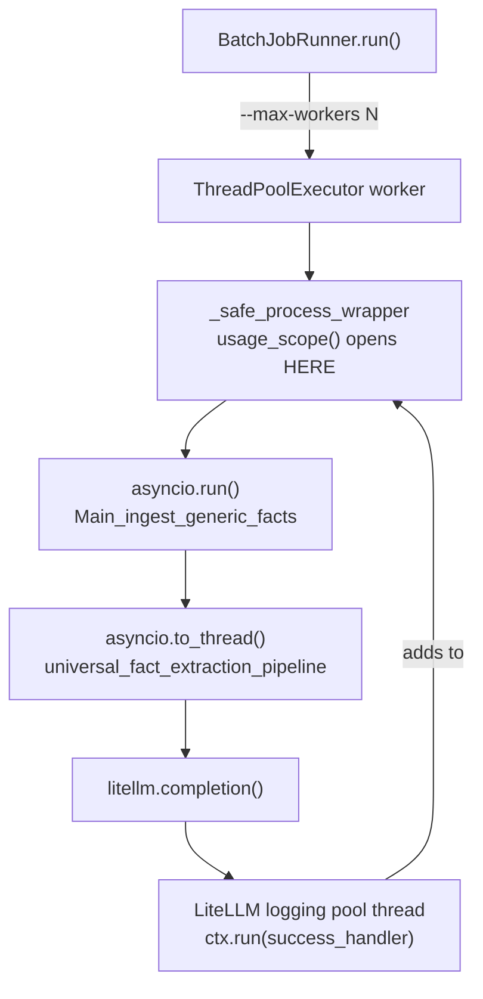

#observability
# Howto — LLM Token & Cost Stats

Every LiteLLM request this project makes is measured: prompt tokens, completion
tokens, cost, and latency. This document explains **how that measurement works**
and **how to get a report out of it**.

Related: [Performance of LLM with MTP](infra/Performance%20of%20LLM%20with%20MTP.md)
(the server-side timing curve these numbers are read against),
[dspy LLM config](dspy%20LLM%20config.md).

Source: [llm_usage.py](file://~/a/celex-facts/src/config/llm_usage.py),
[llm_factory.py](file://~/a/celex-facts/src/config/llm_factory.py),
[BatchJobRunner.py](file://~/a/celex-facts/src/batch/BatchJobRunner.py).

---

## 1. The three surfaces

| Surface | Where | Granularity |
| --- | --- | --- |
| Per-request line | `logs/application.log` | one LLM call |
| `llm_usage` block | `logs/pipeline_audit.jsonl` | one CELEX |
| `TOTAL` line | `logs/application.log`, end of a batch run | one run |

```
LLM usage model=qwen3-coder:30b prompt_tokens=12888 completion_tokens=111 total_tokens=12999 cost_usd=0.00000000 latency_s=7.16
LLM usage TOTAL requests=6 failures=0 prompt_tokens=120 completion_tokens=445 total_tokens=565 cost_usd=0.00001010 unpriced_requests=0 llm_seconds=20.22 by_model: qwen3-coder:30b=6
```

```json
{"celex_id": "CELEX-31982D0367", "results": [...],
 "llm_usage": {"requests": 2, "failures": 0, "prompt_tokens": 40,
               "completion_tokens": 144, "cost_usd": 0.0,
               "unpriced_requests": 0, "llm_seconds": 5.03,
               "by_model": {"qwen3-coder:30b": 2}}}
```

All three carry the same `LLM usage` prefix (the audit block excepted), so one
grep collects per-request lines and run totals together.

**Field notes**

- `llm_seconds` is **summed service time, not wall-clock**. With
  `--max-workers 4` requests overlap, so this exceeds the run's duration. It is
  the LLM-time bill, not how long you waited.
- `unpriced_requests` counts successful calls LiteLLM could not price. It is what
  makes `cost_usd=0.0` unambiguous: *free* and *unpriced* both look like zero
  otherwise.
- A `-1` in any token field, or `cost_usd=-1.00000000`, is the **unknown**
  sentinel — never a real measurement. See §6.

---

## 2. Mechanics

### 2.1 Where the numbers come from

`PromptUsageLogger` is a LiteLLM `CustomLogger`, registered once per process from
`lm_runtime_kwargs()` — the function every `dspy.LM` in this project splats into
its constructor. That single choke point is why accounting covers every call site
without per-site edits.

It is a LiteLLM callback rather than a `dspy.BaseCallback` deliberately: DSPy's
`on_lm_end` receives only the outputs list, so usage would have to be scraped
from `lm.history[-1]` — which attributes to the wrong call as soon as a batch runs
with `--max-workers` above 1, and carries no latency. LiteLLM hands over the
response object and both timestamps per request.

### 2.2 Why cost needed registering

LiteLLM computes a cost only for models in its own price map, and **no locally
served tag is in it**. Before this was fixed:

```
litellm.completion_cost(model="openai/qwen3-coder:30b")
  -> Exception: This model isn't mapped yet
```

so LiteLLM stored `response_cost = None` and every local run was priceless in the
unhelpful sense. `register_local_model_costs()` adds the served model to that map
at the rates in `settings.LOCAL_LLM_*_COST_PER_TOKEN`.

Two things worth knowing:

- It registers the **bare** id. LiteLLM normalizes a `openai/`-prefixed key down
  to the bare one and strips the prefix again on lookup, so one entry prices both
  spellings — and both are in play (`dspy.LM` uses `openai/qwen3-coder:30b`, the
  callback reports `model=qwen3-coder:30b`).
- It **never overwrites a model LiteLLM already prices**. It runs from the shared
  choke point, cloud models included, and silently repricing `deepseek-reasoner`
  at a local 0.0 would report a paid run as free.

> This is the SDK equivalent of a LiteLLM **proxy** `config.yaml` `model_info:`
> block. This project does not run the proxy — `dspy.LM` calls
> `litellm.completion()` in-process — so a `model_list:` entry would do nothing.

### 2.3 Attribution to one CELEX

The audit column needs each request charged to the CELEX that caused it. The
request does not run on the thread that started the CELEX — it is **three threads
down**:



The scope is a `contextvars.ContextVar`, not a `threading.local`, and each hop is
the reason:

- A **pool worker starts with an empty context**, so the scope must be opened
  *inside* the worker — `_safe_process_wrapper` is the innermost frame that still
  maps one-to-one to a CELEX.
- `asyncio.run` and `asyncio.to_thread` **copy** the context, carrying the var
  down. Because the copies share one `UsageTotals` object *by reference*, counts
  added on the innermost thread are visible to the scope that opened it.
- LiteLLM's **sync** wrapper submits `ctx.run(success_handler, ...)` with an
  explicit `contextvars.copy_context()` ("essential for OpenTelemetry span context
  propagation"), which is what carries the scope onto its logging pool thread.

A `threading.local` would record zeros at every one of those hops.

### 2.4 Why the scope waits before it closes

**LiteLLM reports a success after the call has already returned to the caller.**
Measured against the DGX Spark:

```
pre-call hook   MainThread              +0.016s
success         ThreadPoolExecutor-0_0  +0.704s
lm() returned   MainThread              +0.705s
```

One millisecond. Reading the totals the moment a CELEX finishes therefore loses
its last request or two — a silent undercount in the audit trail, which is worse
than no number at all.

The fix is in two halves:

1. `log_pre_api_call` counts each request as *issued*. It is the one hook LiteLLM
   runs **inline on the requesting thread**, dispatched exactly once per request.
2. `usage_scope()` waits on exit until every issued request has been accounted
   for, bounded by `settings.LLM_USAGE_DRAIN_TIMEOUT`.

The wait is normally microseconds. A timeout **warns and continues** — an
incomplete count must never fail the extraction that produced it.

### 2.5 What is deliberately not counted

- **DSPy cache hits.** A cache hit never reaches LiteLLM, so it logs nothing. That
  is correct: no request, no prefill, no tokens. A run that looks suspiciously
  cheap may simply have been served from `cache=True`.
- **`dspy.LM` built without `lm_runtime_kwargs`.** Roughly ten such constructions
  exist under `src/**/tests/`; they get tokens but no registered price, so they log
  `cost_usd=-1.00000000`.
- **LiteLLM's `acompletion` path**, which submits its callback *without* the
  context copy. Such a request would reach the process totals but not the
  per-CELEX line. Every call site here is sync, so this does not currently arise —
  but it is the first thing to check if attribution ever goes empty.

---

## 3. Configuration

All in [settings.py](file://~/a/celex-facts/src/config/settings.py),
env-overridable.

| Setting | Default | Meaning |
| --- | --- | --- |
| `LOCAL_LLM_INPUT_COST_PER_TOKEN` | `0.0` | USD per prompt token for locally served models |
| `LOCAL_LLM_OUTPUT_COST_PER_TOKEN` | `0.0` | USD per completion token, same |
| `LLM_USAGE_DRAIN_TIMEOUT` | `10.0` | Seconds to wait for in-flight accounting |

The default of `0.0` is a deliberate measurement, not a placeholder: local
inference is free at the margin, the hardware being already bought. Set a
GPU-hour-amortized rate to compare a local run against a DeepSeek one **in money**
rather than in tokens:

```bash
LOCAL_LLM_INPUT_COST_PER_TOKEN=1e-8 LOCAL_LLM_OUTPUT_COST_PER_TOKEN=2e-8 \
  PYTHONPATH=src .venv/bin/python src/batch/Main_ingest_generic_facts.py --filter-celex-id CELEX-31982D0367
```

DeepSeek needs no configuration — LiteLLM prices it, and §2.2 keeps that price.

> The cost is logged to **8 decimals**, not the conventional 6. At 1e-8 USD/token
> a real 17-token request costs 1.9e-07, which six places round to a flat
> `0.000000` and make the knob look broken. The audit trail carries the raw float
> regardless.

---

## 4. Getting reports

### 4.1 What did this run cost?

Read the line the batch already logs:

```bash
grep "LLM usage TOTAL" logs/application.log | tail -1
```

### 4.2 Aggregate the per-request lines

For a non-batch entrypoint that logs no total, or to re-aggregate a slice:

```bash
grep -h "LLM usage model=" logs/application.log | awk '
  { delete v
    for (i = 1; i <= NF; i++) if (split($i, kv, "=") == 2) v[kv[1]] = kv[2]
    n++
    if (v["prompt_tokens"]     >= 0) p += v["prompt_tokens"]
    if (v["completion_tokens"] >= 0) c += v["completion_tokens"]
    if (v["latency_s"]         >= 0) s += v["latency_s"]
    if ("cost_usd" in v && v["cost_usd"] >= 0) cost += v["cost_usd"]; else unpriced++ }
  END { printf "requests=%d prompt=%d completion=%d cost_usd=%.8f unpriced=%d llm_seconds=%.1f\n",
        n, p, c, cost, unpriced, s }'
```

```
requests=156 prompt=344379 completion=17478 cost_usd=0.00148629 unpriced=5 llm_seconds=402.1
```

Three details in that script are load-bearing, and each one was a wrong answer
first:

- **Match `LLM usage model=`, never the bare prefix.** The `TOTAL` line also
  carries `prompt_tokens=`, and would be counted as one more request.
- **Guard every field against the `-1` sentinels.** Summing them naively turns a
  real `0.00148629` into `-4.99851371` — five unpriced requests at `-1` each. A
  cost total that comes out negative is this bug, not a refund.
- **`delete v` per line.** The array persists across lines otherwise, so a line
  missing a field silently inherits the previous line's value. This matters when a
  log spans a format change, as `logs/application.log` does.

### 4.3 Prompt-size distribution

This is the report the accounting was built for. `OLLAMA_TIMEOUT` and
`OLLAMA_LLM_INFERENCE_PROMPT_TOKEN_LIMIT` should be set from a measured p99, not
from an old incident:

```bash
grep -h "LLM usage model=" logs/application.log* \
  | grep -o "prompt_tokens=[0-9]*" | cut -d= -f2 | sort -n | awk '
  { a[NR] = $1 }
  function q(p) { i = int(NR * p + 0.5); return a[i < 1 ? 1 : i] }
  END { printf "n=%d p50=%d p95=%d p99=%d max=%d\n", NR, q(0.50), q(0.95), q(0.99), a[NR] }'
```

Over the retained logs as of 2026-08-27 this gives:

```
n=15035 p50=1276 p95=1489 p99=1988 max=12888
```

Read against `OLLAMA_LLM_INFERENCE_PROMPT_TOKEN_LIMIT=40000`, the circuit breaker
sits about 20x above the observed p99 and 3x above the largest prompt ever sent.
Nothing legitimate comes near the ~65k knee where prefill leaves its throughput
plateau — so the breaker is doing its job without ever having to fire.

Note the shape: p95 and p99 sit close together at ~1.5-2k while the maximum is
12888. The distribution is a tight body with a thin tail, so a limit tuned to the
p99 alone would clip the legitimate large-document retrievals. Tune to the
maximum, sanity-check with the p99.

### 4.4 Per-CELEX, from the audit trail

Run totals reconciled from the JSONL:

```bash
jq -s '[.[] | select(.celex_id | startswith("ID") | not) | .llm_usage // empty]
       | {celex_with_usage: length,
          requests: (map(.requests) | add // 0),
          prompt_tokens: (map(.prompt_tokens) | add // 0),
          cost_usd: (map(.cost_usd) | add // 0),
          unpriced: (map(.unpriced_requests) | add // 0)}' logs/pipeline_audit.jsonl
```

The `startswith("ID")` filter is not cosmetic. `batch.tests.test_batch_runner`
patches `sys.argv` without `--audit-file`, so it falls through to the default and
appends fixture rows for `ID1`/`ID2`/`ID3` to the **real**
`logs/pipeline_audit.jsonl` every time the suite runs. Those rows carry an
all-zero `llm_usage` block, so they do not distort any token or cost total — but
they do inflate a count of CELEX processed. Tracked in ISSUES.md.

`add // 0` guards the other end: over a file with no matching rows `add` returns
`null`, and a report of `null` reads as breakage rather than as "nothing yet".

Most expensive CELEX first, in readable columns (cost in **micro-dollars**, since
a local run's figures are tiny):

```bash
jq -r 'select(.llm_usage) | .llm_usage as $u
       | [.celex_id, $u.requests, $u.prompt_tokens, ($u.cost_usd * 1000000 | floor), $u.llm_seconds]
       | @tsv' logs/pipeline_audit.jsonl \
  | sort -k4 -nr \
  | awk -F'\t' 'BEGIN { printf "%-16s %5s %8s %9s %8s\n", "CELEX", "reqs", "prompt", "micro$", "llm_s" }
                { printf "%-16s %5s %8s %9s %8.1f\n", $1, $2, $3, $4, $5 }' \
  | head -20
```

`.llm_usage // empty` matters: `pipeline_audit.jsonl` predates this feature by a
long way, and lines written before it carry no `llm_usage` key. They are skipped
cleanly rather than erroring.

### 4.5 Diagnostics

```bash
# Anything LiteLLM could not price? Should be 0.
jq -s 'map(.llm_usage.unpriced_requests // 0) | add' logs/pipeline_audit.jsonl

# CELEX that burned LLM calls and still failed.
jq -r 'select(.celex_id | startswith("ID") | not) | select(.llm_usage)
       | select(.llm_usage.failures > 0 or .results == false)
       | [.celex_id, .llm_usage.requests, .llm_usage.failures] | @tsv' logs/pipeline_audit.jsonl

# Which models did this run actually use?
grep -o "LLM usage model=[^ ]*" logs/application.log | sed 's/.*model=//' | sort | uniq -c | sort -rn
```

A worked example of the first two together. On 2026-08-27 the log showed:

```
    151 qwen3-coder:30b
      5 qwen3.6:35b
```

and the aggregate in §4.2 reported exactly `unpriced=5`. The two line up: those
five requests came from `llm_benchmark_test.py` and
`test_vertical_restraints_integration.py`, which build `dspy.LM` directly instead
of through `lm_runtime_kwargs()`, so `qwen3.6:35b` was never registered and
LiteLLM could not price it. That is §2.5 showing up in real data — an unpriced
count that is not zero tells you *which* model to go looking for.

---

## 5. Verifying the wiring after a change

```bash
PYTHONPATH=src .venv/bin/python -m unittest config.tests.test_llm_usage
```

34 tests, no network. They pin the line shape, the unknown sentinels, the
scope isolation under concurrency, the pool → `asyncio.run` → `to_thread`
propagation, and the late-callback race of §2.4.

---

## 6. Troubleshooting

| Symptom | Cause | Fix |
| --- | --- | --- |
| `cost_usd=-1.00000000` | LiteLLM priced nothing — the model is absent from its map | The LM was built without `lm_runtime_kwargs()`; route it through that (see §2.5) |
| `cost_usd=0.00000000` on every line | Working as configured | Expected at the default rates; set `LOCAL_LLM_*_COST_PER_TOKEN` for a notional cost |
| `prompt_tokens=-1` | The provider returned no `usage` block | Provider-side; the `-1` keeps it distinct from an empty prompt |
| `requests=0` but calls clearly happened | The scope never saw them | Either a DSPy cache hit (§2.5), or attribution broke — check `asyncio`/`acompletion` (§2.3, §2.5) |
| `LLM usage accounting did not settle within 10.0s` | A pre-call had no matching success or failure callback | Totals undercount; raise `LLM_USAGE_DRAIN_TIMEOUT` or investigate the lost request |
| `Failed to fetch remote model cost map ... Network is unreachable` | LiteLLM's import-time price-map fetch | Set `LITELLM_LOCAL_MODEL_COST_MAP=true` **in the process environment** — a `config_main/.env` entry loads too late (see ISSUES.md) |
