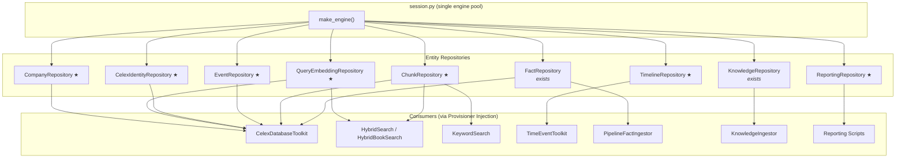

> Historical record of the 2026 DAO migration. Superseded in part: the SpaCy
> date-event pipeline and `celex_facts.events_in_chunks` were dropped on
> 2026-08-07 (see docs/claude/plans/drop-events-in-chunks.md), as were the
> langextract tables. `EventRepository` now covers `heideltime_extractions`
> only.


Ran command: `.venv/bin/python src/batch/Main_ingest_generic_facts.py --filter-celex-id 39226_8310_11 --filter-fact court_list_raw --limit 1 --overwrite`

Let me start by examining the existing repository pattern and then search for all other pgvector database access patterns across the codebase.

Viewed fact_repository.py:1-344
Viewed knowledge_repository.py:1-568
Listed directory pgvector
Listed directory src

Now let me search for all pgvector-related database access patterns across the codebase:

Searched for "make_engine\|sessionmaker\|create_engine"
Searched for "DATABASE_URL"
Searched for "pg_embedding"
Searched for "celex_facts\."

Let me now examine the key files that have scattered database access:

Viewed celex_tools.py:1-603
Viewed chunk_repository.py:1-168
Viewed hybrid_book_search.py:1-385
Viewed time_event_tool.py:1-59
Viewed fact_ingestor.py:1-151

Now let me examine the remaining scattered DB access files:

Viewed db.py:1-20
Viewed session.py:1-42
Viewed heideltime_ingestor.py:1-250
Viewed timeline_table.py:1-263
Viewed celex_checker.py:1-39

Now let me check the remaining files with scattered DB access:

Viewed celex_case_checker.py:1-56
Viewed celex_case_id_loader.py:1-76
Viewed corp_lei_index_ingestor.py:1-210
Viewed knowledge_ingestor.py:1-386
Viewed report_celex_facts.py:1-412

Let me check a few more files:

Viewed PipelineFactIngestor.py:1-133
Viewed models.py:1-453
Viewed key_word_search.py:1-65

Let me check the remaining scattered access patterns:

Viewed hybrid_search.py:1-197
Viewed loader_celex_id2case_id.py:1-223
Viewed load_company_standard_alias.py:1-60

Now let me also check the event-related ingestors and the embedding ingestion files:

Viewed event_date_extract2pgvector.py:1-124
Viewed celex_chunks2pgvector.py:1-245
Viewed retrieve_case_summary_md2disk.py:1-327

Now I have a comprehensive understanding of the codebase. Let me create the implementation plan:

Created migration_plan.md

The implementation plan is ready at [migration_plan.md](file://~/.gemini/antigravity/brain/b26e621a-56d4-4b51-98c2-3b5afc2cd6a7/artifacts/migration_plan.md).

# Implementation Plan: Entity Repository Consolidation

## Executive Summary

The codebase has **15+ files** that directly construct their own `create_engine` / `sessionmaker` or run raw SQL against the `celex_facts` schema, bypassing the Provisioner pattern established in `FactRepository` and `KnowledgeRepository`. This plan migrates all scattered data access into **7 canonical repository classes** under `src/pipelines/rag/pgvector/`, following the identical pattern already proven in production.

---

## 1. Current State: Audit of Database Access Patterns

### ✅ Already Consolidated (Gold Standard)

| Repository | File | Tables Covered |
|:---|:---|:---|
| `FactRepository` | [fact_repository.py](file://~/a/celex-facts/src/pipelines/rag/pgvector/fact_repository.py) | `facts`, `rule_facts.facts`, `case_celex_id`, `pg_embedding_qwen` (first page only) |
| `KnowledgeRepository` | [knowledge_repository.py](file://~/a/celex-facts/src/pipelines/rag/pgvector/knowledge_repository.py) | `knowledge_items`, `knowledge_question_embeddings`, `knowledge_edges` |

### ❌ Scattered Access — Must Migrate

#### Category A: **Document Chunk Access** (highest duplication)

| File | Anti-Pattern | Raw SQL Tables Hit |
|:---|:---|:---|
| [celex_tools.py](file://~/a/celex-facts/src/tools/celex_tools.py) | 10+ raw SQL queries inline in tool methods | `pg_embedding_qwen`, `query_embeddings_qwen`, `question2fact2embeddings_vw`, `company_canonical2celex_id`, `company_canonical2alias`, `facts_cartel_legal_period_category_vw` |
| [chunk_repository.py](file://~/a/celex-facts/src/extract/rag/chunk_repository.py) | Receives bare `Engine` — no shared session/pool pattern | `pg_embedding_qwen` |
| [hybrid_book_search.py](file://~/a/celex-facts/src/extract/rag/hybrid_book_search.py) | Own `_get_or_cache_embedding`, hardcoded table constants | `pg_embedding_book_qwen`, `query_embeddings_qwen` |

#### Category B: **Event / Timeline Access**

| File | Anti-Pattern | Raw SQL Tables Hit |
|:---|:---|:---|
| [time_event_tool.py](file://~/a/celex-facts/src/extract/rag/time_event_tool.py) | `create_engine` in `__init__`, own connection pool | `timeline_chunks_vw` |
| [timeline_table.py](file://~/a/celex-facts/src/pipelines/rag/pgvector/timeline_table.py) | Direct ORM session against `Facts`, duplicate upsert logic | `facts`, `timeline_table_vw` |
| [event_date_extract2pgvector.py](file://~/a/celex-facts/src/pipelines/rag/pgvector/event_date_extract2pgvector.py) | Own `make_engine` + `sessionmaker` | `events_in_chunks` |

#### Category C: **CELEX Identity / Lookup Access**

| File | Anti-Pattern | Raw SQL Tables Hit |
|:---|:---|:---|
| [celex_checker.py](file://~/a/celex-facts/src/tools/celex_checker.py) | `create_engine` on every method call | `celex_case_id` |
| [celex_case_checker.py](file://~/a/celex-facts/src/pipelines/rag/pgvector/celex_case_checker.py) | Reads `config.yaml` manually, `create_engine` inline | `celex_case_id` |
| [loader_celex_id2case_id.py](file://~/a/celex-facts/src/pipelines/utils/loader_celex_id2case_id.py) | Module-level `create_engine(settings.DATABASE_URL)` | `pg_embedding_qwen`, `pg_embedding_book_qwen`, `case_celex_id` |

#### Category D: **Fact Ingestion / Write Path**

| File | Anti-Pattern | Raw SQL Tables Hit |
|:---|:---|:---|
| [PipelineFactIngestor.py](file://~/a/celex-facts/src/tools/PipelineFactIngestor.py) | Uses `FactTable` shim, direct ORM `session.query(Facts)` for upsert | `facts`, `celex_fact_ingestion_audit_trail` |
| [fact_ingestor.py](file://~/a/celex-facts/src/pipelines/rag/fact_ingestor.py) | **Marked `!! OBSOLETE !!`**, still imports `FactTable` | `facts` |

#### Category E: **Reporting / Read-Only Bulk**

| File | Anti-Pattern | Raw SQL Tables Hit |
|:---|:---|:---|
| [report_celex_facts.py](file://~/a/celex-facts/src/reporting/report_celex_facts.py) | Polars `read_database_uri` with cleaned URL | `facts`, `celex_fact_ingestion_audit_trail`, `question2fact` |
| [retrieve_case_summary_md2disk.py](file://~/a/celex-facts/src/reporting/retrieve_case_summary_md2disk.py) | Same Polars pattern | `celex_index_vw` |

#### Category F: **Utility / Migration Scripts**

| File | Anti-Pattern |
|:---|:---|
| [load_company_standard_alias.py](file://~/a/celex-facts/src/pipelines/utils/load_company_standard_alias.py) | `create_engine` inline |
| [load_company_canonical_alias.py](file://~/a/celex-facts/src/pipelines/utils/load_company_canonical_alias.py) | `create_engine` inline |
| [migrate_company_names.py](file://~/a/celex-facts/src/pipelines/utils/migrate_company_names.py) | `create_engine` inline |
| [celex_case_id_loader.py](file://~/a/celex-facts/src/pipelines/rag/pgvector/celex_case_id_loader.py) | `create_engine` from `config.yaml` |

---

## 2. Target Architecture: Repository Map



> ★ = new repository to create

---

## 3. New Repository Specifications

### 3.1 `ChunkRepository` (refactor existing)

**File:** `src/pipelines/rag/pgvector/chunk_repository.py` (new location — move from `src/extract/rag/`)

**Absorbs queries from:**
- [celex_tools.py](file://~/a/celex-facts/src/tools/celex_tools.py): `search_document_chunk4celex_id`, `search_document_chunk`, `search_document_chunks_with_meta_coordinates`, `semantic_search_chunks`, `keyword_search_chunks_all_cases`, `keyword_count_chunks_all_cases`, `select_distinct_celex_id4doc_chunk_query`, `search_semantic_chunks`
- [chunk_repository.py](file://~/a/celex-facts/src/extract/rag/chunk_repository.py): all methods (`keyword_search`, `semantic_search_in_celex`, `regex_retriever`)
- [hybrid_book_search.py](file://~/a/celex-facts/src/extract/rag/hybrid_book_search.py): `_keyword_search`, `_semantic_search`, `_fetch_chapter_text` (book-specific sub-class or separate methods)

**Init signature:**
```python
class ChunkRepository:
    def __init__(self, db_url: str = DATABASE_URL, embedding_table: str = settings.EMBEDDING_TABLE):
        self.engine = make_engine(db_url)
        self.Session = sessionmaker(bind=self.engine)
        self.embedding_table = embedding_table
```

**Key methods:**
- `keyword_search(celex_id, keyword) -> List[ChunkVo]`
- `keyword_search_all_cases(keyword, hits) -> List[ChunkVo]`
- `keyword_count_all_cases(keyword) -> list[dict]`
- `semantic_search(query_embedding, celex_id=None, hits=5) -> List[ChunkVo]`
- `semantic_search_in_celex(celex_id, query_embedding, hits) -> List[ChunkVo]`
- `semantic_search_with_meta(query_embedding, celex_id=None, limit=3) -> list[dict]`
- `select_distinct_celex_for_keyword(keyword) -> list[dict]`
- `regex_retriever(celex_id, regex) -> list[dict]`
- `select_first_page(celex_id) -> Optional[str]` (move from FactRepository)

> [!IMPORTANT]
> The `embed_query` callable is **not** injected here. The repository receives pre-computed embeddings. The embedding concern stays with `QueryEmbeddingRepository` and the calling toolkit/module.

### 3.2 `BookChunkRepository`

**File:** `src/pipelines/rag/pgvector/book_chunk_repository.py`

**Absorbs from:** [hybrid_book_search.py](file://~/a/celex-facts/src/extract/rag/hybrid_book_search.py)

Identical pattern to `ChunkRepository` but targeting `pg_embedding_book_qwen`. Methods:
- `keyword_search(keyword, limit) -> List[ChunkVo]`
- `semantic_search(query_embedding, hits) -> List[ChunkVo]`
- `fetch_chapter_text(row_id) -> list[BookChapterVo]`

### 3.3 `QueryEmbeddingRepository`

**File:** `src/pipelines/rag/pgvector/query_embedding_repository.py`

**Absorbs from:**
- [celex_tools.py](file://~/a/celex-facts/src/tools/celex_tools.py): `_get_or_cache_embedding`
- [hybrid_book_search.py](file://~/a/celex-facts/src/extract/rag/hybrid_book_search.py): `_get_or_cache_embedding`

```python
class QueryEmbeddingRepository:
    def __init__(self, db_url: str = DATABASE_URL, cache_table: str = "query_embeddings_qwen"):
        ...
    def get_cached(self, query: str) -> Optional[list[float]]: ...
    def cache(self, query: str, embedding: list[float]) -> None: ...
    def get_or_cache(self, query: str, embed_fn: Callable[str](str)) -> list[float]: ...
```

### 3.4 `TimelineRepository`

**File:** `src/pipelines/rag/pgvector/timeline_repository.py`

**Absorbs from:**
- [fact_repository.py](file://~/a/celex-facts/src/pipelines/rag/pgvector/fact_repository.py): `TimelineTable` class (move here)
- [time_event_tool.py](file://~/a/celex-facts/src/extract/rag/time_event_tool.py): `select_timeline_events` query
- [timeline_table.py](file://~/a/celex-facts/src/pipelines/rag/pgvector/timeline_table.py): `TimelineFactIngestor` (timeline reading part)

### 3.5 `EventRepository`

**File:** `src/pipelines/rag/pgvector/event_repository.py`

**Absorbs from:**
- [event_date_extract2pgvector.py](file://~/a/celex-facts/src/pipelines/rag/pgvector/event_date_extract2pgvector.py): all `ingest*` methods
- [event_langextract2pgvector.py](file://~/a/celex-facts/src/pipelines/rag/pgvector/event_langextract2pgvector.py): all methods
- [heideltime_ingestor.py](file://~/a/celex-facts/src/pipelines/rag/pgvector/heideltime_ingestor.py): read queries (`select_chunks_with_dates`, `build_proxy_fact_payload`, `already_processed_chunk_ids`); ingestion stays in `HeidelTimeIngestor` but delegates to `EventRepository` for the shared engine

**Tables:** `heideltime_extractions`

### 3.6 `CelexIdentityRepository`

**File:** `src/pipelines/rag/pgvector/celex_identity_repository.py`

**Absorbs from:**
- [celex_checker.py](file://~/a/celex-facts/src/tools/celex_checker.py): `check_celex_or_case_id`
- [celex_case_checker.py](file://~/a/celex-facts/src/pipelines/rag/pgvector/celex_case_checker.py): duplicate of above
- [fact_repository.py](file://~/a/celex-facts/src/pipelines/rag/pgvector/fact_repository.py): `select_case_ids_for_celex` (move here)
- [loader_celex_id2case_id.py](file://~/a/celex-facts/src/pipelines/utils/loader_celex_id2case_id.py): `insert_into_celex_case_id`

**Tables:** `case_celex_id` (a.k.a. `celex_case_id`)

### 3.7 `CompanyRepository`

**File:** `src/pipelines/rag/pgvector/company_repository.py`

**Absorbs from:**
- [celex_tools.py](file://~/a/celex-facts/src/tools/celex_tools.py): `insert_canonical_company_and_aliases`
- [load_company_standard_alias.py](file://~/a/celex-facts/src/pipelines/utils/load_company_standard_alias.py)
- [load_company_canonical_alias.py](file://~/a/celex-facts/src/pipelines/utils/load_company_canonical_alias.py)
- [migrate_company_names.py](file://~/a/celex-facts/src/pipelines/utils/migrate_company_names.py)

**Tables:** `company_canonical2celex_id`, `company_canonical2alias`, `company_standard2celex_id2alias`

### 3.8 `ReportingRepository` (optional — low priority)

**File:** `src/pipelines/rag/pgvector/reporting_repository.py`

**Absorbs from:**
- [report_celex_facts.py](file://~/a/celex-facts/src/reporting/report_celex_facts.py): all `fetch_*` functions
- [retrieve_case_summary_md2disk.py](file://~/a/celex-facts/src/reporting/retrieve_case_summary_md2disk.py): `fetch_index`

> [!NOTE]
> Reporting uses Polars `read_database_uri` (connectorx driver) for performance. This pattern is fundamentally different from the ORM/session approach. Consider keeping reporting queries in a lightweight `ReportingRepository` that wraps the connectorx calls with the cleaned `DATABASE_URL` — or defer this to a later phase.

---

## 4. Migration Strategy — Phased Approach

### Phase 1: Foundation (No breaking changes)
**Create new repositories alongside existing code.**

| Step | Action | Files Touched |
|:---|:---|:---|
| 1.1 | Create `ChunkRepository` in `pgvector/` with methods from `extract/rag/chunk_repository.py` + inline SQL from `celex_tools.py` | New file |
| 1.2 | Create `QueryEmbeddingRepository` | New file |
| 1.3 | Create `BookChunkRepository` | New file |
| 1.4 | Create `CelexIdentityRepository` | New file |
| 1.5 | Create `CompanyRepository` | New file |
| 1.6 | Create `TimelineRepository` (move `TimelineTable` here) | New file + edit fact_repository.py |
| 1.7 | Create `EventRepository` | New file |

**Test:** Unit tests per repository in `src/pipelines/rag/pgvector/tests/`.

### Phase 2: Wire Consumers (Provisioner injection)
**Swap inline SQL in consumers for repository method calls.**

| Step | Consumer File | Repositories Injected |
|:---|:---|:---|
| 2.1 | `celex_tools.py` | `ChunkRepository`, `QueryEmbeddingRepository`, `CompanyRepository`, `FactRepository` (already done) |
| 2.2 | `hybrid_book_search.py` | `BookChunkRepository`, `QueryEmbeddingRepository` |
| 2.3 | `time_event_tool.py` | `TimelineRepository` |
| 2.4 | `PipelineFactIngestor.py` | Move upsert logic into `FactRepository.upsert_fact()` |
| 2.5 | `celex_checker.py` + `celex_case_checker.py` | `CelexIdentityRepository` |
| 2.6 | `event_date_extract2pgvector.py` | `EventRepository` |
| 2.7 | `heideltime_ingestor.py` | Share engine from `EventRepository` or accept injected engine |
| 2.8 | `loader_celex_id2case_id.py` | `CelexIdentityRepository`, `ChunkRepository` |

**Backward-compatible shims:** Keep `extract/rag/chunk_repository.py` as a thin re-export wrapper (same pattern as `db.py`).

### Phase 3: Cleanup
**Remove dead code and redundant engine creation.**

| Step | Action |
|:---|:---|
| 3.1 | Delete `extract/rag/chunk_repository.py` body, replace with re-export shim |
| 3.2 | Delete `celex_case_checker.py` (duplicates `celex_checker.py`) |
| 3.3 | Delete `fact_ingestor.py` (already marked `!! OBSOLETE !!`) |
| 3.4 | Move `select_first_page4celex` from `FactRepository` to `ChunkRepository` (it queries `pg_embedding_qwen`, not `facts`) |
| 3.5 | Remove module-level `engine = create_engine(...)` from `loader_celex_id2case_id.py` |
| 3.6 | Remove `TimelineTable` from `fact_repository.py` (replaced by `TimelineRepository`) |

### Phase 4: Reporting (Optional / Low Priority)

| Step | Action |
|:---|:---|
| 4.1 | Create `ReportingRepository` wrapping Polars/connectorx queries |
| 4.2 | Migrate `report_celex_facts.py` and `retrieve_case_summary_md2disk.py` |

---

## 5. Enrichments to `FactRepository`

As part of Phase 2.4, add these methods to the existing `FactRepository`:

```python
def upsert_fact(self, celex_id: str, name: str, value_md: str,
                value_json: str, references_doc_json=None) -> uuid.UUID:
    """Atomic upsert: insert-or-update + self-heal duplicates."""
    ...

def select_cartel_legal_period(self, celex_id: str) -> Optional[dict]:
    """Query facts_cartel_legal_period_category_vw."""
    ...

def select_fact_embeddings(self, query_embedding: list, celex_id: str = None,
                           hits: int = 10) -> List[FactSearchResult]:
    """Semantic search over question2fact2embeddings_vw."""
    ...
```

---

## 6. Design Rules (Enforced Across All Repositories)

| Rule | Rationale |
|:---|:---|
| Every repository takes `db_url: str = DATABASE_URL` in `__init__` | Consistency; testable with override |
| Engine created via `make_engine()` from `session.py` | Single pool config; `search_path` set once |
| All methods use `with self.Session() as session:` context | No leaked connections |
| No f-string SQL with user input — always `:param` binds | SQL injection prevention |
| Return ORM models or Pydantic VOs — never raw tuples | Type safety (Rule 3) |
| Embedding concern stays **outside** repositories | Repositories accept `list[float]`, never call `embed_query` |
| Test files in `src/pipelines/rag/pgvector/tests/` | Rule 5: Test Localization |

---

## 7. Dependency Graph & Safe Ordering

```
Phase 1 (no deps, parallel):
  ├── ChunkRepository
  ├── BookChunkRepository
  ├── QueryEmbeddingRepository
  ├── CelexIdentityRepository
  ├── CompanyRepository
  ├── TimelineRepository
  └── EventRepository

Phase 2 (sequential, test after each):
  celex_tools.py  →  depends on ChunkRepository, QueryEmbeddingRepository, CompanyRepository
  hybrid_book_search.py  →  depends on BookChunkRepository, QueryEmbeddingRepository
  time_event_tool.py  →  depends on TimelineRepository
  PipelineFactIngestor.py  →  depends on FactRepository.upsert_fact()
  celex_checker.py  →  depends on CelexIdentityRepository
  ...

Phase 3 (cleanup, after all Phase 2 tests green):
  delete / shim old files
```

---

## 8. Estimated Effort

| Phase | Effort | Risk |
|:---|:---|:---|
| Phase 1 | ~3–4 hours | Low (additive, no existing code changed) |
| Phase 2 | ~4–6 hours | Medium (consumer rewiring) |
| Phase 3 | ~1–2 hours | Low (dead code removal) |
| Phase 4 | ~1 hour | Low (reporting is read-only) |
| **Total** | **~10–13 hours** | |

> [!WARNING]
> `celex_tools.py` (Phase 2.1) is the highest-risk migration — it has 10+ inline SQL queries and is imported across the UI, batch, and pipeline layers. Recommend migrating it last in Phase 2 and gating behind integration tests.

---

## 9. Files NOT Migrated (Intentional Exceptions)

| File | Reason |
|:---|:---|
| `celex_pgvector.py` | LangChain `PGVector` subclass — managed by LangChain's session lifecycle; not a DAO |
| `embedding_converter.py` | One-off migration script |
| `embeddings/celex_chunks2pgvector.py` | Uses `CelexPGVector.add_documents()` (LangChain API) — not raw SQL |
| `embeddings/book_chunks2pgvector.py` | Same as above |
| `knowledge_ingestor.py` | Already delegates to `KnowledgeRepository` (Provisioner pattern) ✅ |
| `batch/Main_ingest_knowledge.py` | Raw SQL for queue management — could be a `QueueRepository` in a future phase |

## Summary

I audited **25+ files** across your codebase and found **15+ files** with scattered pgvector/PostgreSQL access patterns that bypass the Provisioner pattern established in your `FactRepository` and `KnowledgeRepository`. The plan proposes:

### 7 New Repositories to Create

| Repository | Consolidates From |
|:---|:---|
| **ChunkRepository** | `celex_tools.py` (10+ inline queries), `extract/rag/chunk_repository.py` |
| **BookChunkRepository** | `hybrid_book_search.py` |
| **QueryEmbeddingRepository** | Duplicate `_get_or_cache_embedding` in `celex_tools.py` + `hybrid_book_search.py` |
| **TimelineRepository** | `TimelineTable`, `time_event_tool.py` |
| **EventRepository** | `event_date_extract2pgvector.py`, `event_langextract2pgvector.py`, `heideltime_ingestor.py` |
| **CelexIdentityRepository** | `celex_checker.py`, `celex_case_checker.py` (duplicate!), `loader_celex_id2case_id.py` |
| **CompanyRepository** | Company alias insert/load scripts |

### Key Findings

- **`celex_tools.py`** is the worst offender — 10+ raw SQL queries, highest-risk migration
- **`celex_case_checker.py`** is a direct duplicate of `celex_checker.py` — delete one
- **`fact_ingestor.py`** is already marked `!! OBSOLETE !!` — safe to delete
- **`time_event_tool.py`** creates its own `create_engine` on every instantiation

### 4-Phase Approach

1. **Foundation** — Create repositories (no breaking changes)
2. **Wire** — Inject via Provisioner pattern
3. **Cleanup** — Delete dead code, add shims
4. **Reporting** — Optional Polars/connectorx migration

**Estimated: ~10–13 hours total.** Please review the plan and let me know which phase you'd like to start with, or if you'd like to adjust the repository boundaries.