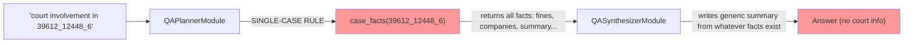
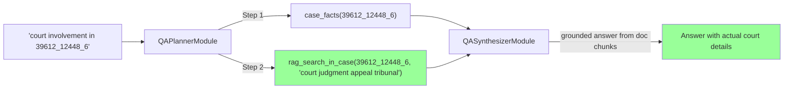

# Court-Involvement Gap & Planner Strictness Analysis

## Problem Statement

The question *"explain the court involvement in case 39612_12448_6"* produces a generic summary from `case_facts` rather than court-specific evidence. Two issues compound:

1. **No court-related structured facts exist** in `celex_facts.facts`.
2. **The planner lacks guidance** to route court/tribunal/appeal questions to document-chunk tools.

---

## 1. Root Cause: Missing Court Facts

### What `case_facts` returns

The `case_facts` tool calls [select_facts4celex](file://~/a/celex-facts/src/pipelines/rag/pgvector/fact_repository.py#L129-L152), which returns **all** rows from `celex_facts.facts` for that celex_id as a `{name: value_md}` dict.

The fact names in the schema ([KB_SCHEMA_DESCRIPTION](file://~/a/celex-facts/src/pipelines/agent_dspy/retrieval_modules.py#L291-L375)) are:

| Category | Fact Names |
|---|---|
| Boolean | `leniency_case`, `exemption_case`, `market_outside_eu`, `market_oligopoly` |
| Date | `eu_commisssion_decision_date` |
| Date-range | `heideltime_cartel_period` |
| Free-text | `leniency_applicants`, `fines`, `companies_investigated`, `companies_country`, `case_commissioner`, `case_summary`, `OECD_sector`, `market_geographical`, `products`, `case_title`, `decision_remedies`, `cartel_period`, etc. |

> [!IMPORTANT]
> **None of these facts capture court involvement** — no `court_judgment`, `appeal_outcome`, `tribunal_ruling`, `annulment`, or equivalent fact exists.

Court-related information (General Court appeals, Court of Justice judgments, fine reductions on appeal) is only present in the **raw document chunks** (`pg_embedding_qwen`), not in structured facts.

### What happens today



The planner correctly recognises a celex_id → fires the SINGLE-CASE RULE → emits `case_facts` as step 1. But `case_facts` returns facts that have **zero court data**. The synthesiser then hallucinates or writes a generic overview.

### What SHOULD happen



---

## 2. How to Make the Planner More Strict

The planner is driven by [QAPlannerSignature](file://~/a/celex-facts/src/pipelines/agent_dspy/dspy_signature.py#L470-L529). There are **four concrete levers** to tighten it:

### Lever A: Add a "Court / Unstructured Topic" routing rule to the signature docstring

Currently the signature has 5 rules. A new **Rule 6** should explicitly tell the planner that certain topic domains are **not covered by structured facts** and must be routed to `rag_search_in_case`:

```python
#     6. UNSTRUCTURED TOPIC RULE: For questions about topics NOT captured in the
#        structured facts schema (court judgments, appeals, tribunal rulings,
#        annulment proceedings, procedural history, settlement details, dawn raids,
#        statement of objections), you MUST add a **rag_search_in_case** step
#        (when a celex_id is known) or a **doc_search** step (cross-case).
#        The `case_facts` bag does NOT contain this information — it only
#        exists in the raw document text.
```

### Lever B: Add a `_TOPIC_SYNONYMS` entry for court-related terms

This strengthens the **synonym fallback** path in the executor so that even if the planner misroutes, the fallback can recover by searching doc chunks.

### Lever C: Add a "mandatory RAG follow-up" heuristic in `QAPlannerModule.forward`

After the LLM emits the plan, post-process it: if the question contains court/tribunal/appeal keywords **and** the plan only contains `case_facts`, inject a `rag_search_in_case` step.

### Lever D: (Future) DSPy few-shot optimisation

Add hand-labelled training examples to the planner's few-shot set:

```python
dspy.Example(
    question="explain the court involvement in case 39612_12448_6",
    plan=RetrievalPlan(
        question_type="single_case",
        steps=[
            RetrievalStep(step_id=1, tool="case_facts", query="all facts", case_id="39612_12448_6", rationale="Baseline facts"),
            RetrievalStep(step_id=2, tool="rag_search_in_case", query="court judgment appeal tribunal ruling annulment", case_id="39612_12448_6", rationale="Court info is in document chunks, not structured facts"),
        ],
    ),
)
```

---

## 3. Recommended Implementation

### 3a. Signature Update (Lever A) — `dspy_signature.py`

Add Rule 6 to `QAPlannerSignature` docstring. Minimal, high-impact change.

### 3b. Topic Synonyms (Lever B) — `retrieval_modules.py`

```python
# Add to _TOPIC_SYNONYMS:
("court",        "case_commission_decision"),
("tribunal",     "case_commission_decision"),
("appeal",       "case_commission_decision"),
("judgment",     "case_commission_decision"),
("annulment",    "case_commission_decision"),
```

> [!WARNING]
> These synonyms map to the *closest* structured fact but the real fix is the planner routing to document chunks (Lever A). The synonym fallback is a safety net only.

### 3c. Post-plan injection (Lever C) — `retrieval_modules.py`

```python
# In QAPlannerModule.forward(), after the LLM plan is generated:
_UNSTRUCTURED_TOPICS = ("court", "tribunal", "appeal", "judgment", "annul", 
                         "dawn raid", "statement of objections", "settlement")

def _needs_rag_followup(question: str, plan: RetrievalPlan) -> bool:
    """True when the question touches unstructured topics but the plan has no doc-search step."""
    q_lower = question.lower()
    has_unstructured_topic = any(t in q_lower for t in _UNSTRUCTURED_TOPICS)
    has_doc_step = any(s.tool in ("rag_search_in_case", "doc_search") for s in plan.steps)
    return has_unstructured_topic and not has_doc_step
```

---

## Decision Point

> [!NOTE]
> **Which levers do you want me to implement?**
> 
> - **A only** (signature docstring update) — safest, zero risk of regression
> - **A + B** (+ synonym fallback) — adds a safety net
> - **A + B + C** (+ post-plan injection) — most strict, deterministic override
> - **A + B + C + D** (+ few-shot examples) — requires labelled examples

I recommend starting with **A + C** — the signature rule gives the LLM the right guidance, and the post-plan injection catches any remaining misroutes deterministically.
