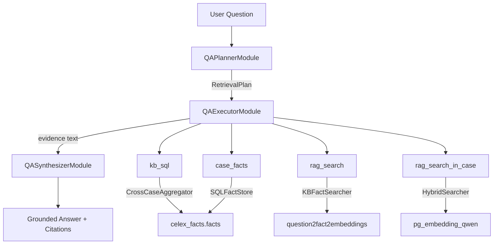

# Q&A Retrieval Pipeline — Architecture Summary

## Architecture

## Files Modified / Created

| File | Action | Purpose |
|------|--------|---------|
| [dspy_protocols.py](file://~/a/celex-facts/src/pipelines/agent_dspy/dspy_protocols.py) | Modified | Added `KBFactSearcher` and `CrossCaseAggregator` protocols |
| [dspy_signature.py](file://~/a/celex-facts/src/pipelines/agent_dspy/dspy_signature.py) | Modified | Added `RetrievalStep`, `RetrievalPlan`, `QAPlannerSignature`, `QASynthesizerSignature` |
| [retrieval_modules.py](file://~/a/celex-facts/src/pipelines/agent_dspy/retrieval_modules.py) | Created | Full pipeline: `QAPlannerModule`, `QAExecutorModule`, `QASynthesizerModule`, `QARetrievalPipeline` |
| [test_retrieval_modules.py](file://~/a/celex-facts/src/pipelines/agent_dspy/tests/test_retrieval_modules.py) | Created | 18 unit/integration tests — all passing |
| [pipeline.MD](file://~/a/celex-facts/src/pipelines/agent_dspy/pipeline.MD) | Modified | Added `qa_retrieval` pipeline entry |

## Four Retrieval Tools

| Tool | Surface | Use Case |
|------|---------|----------|
| `kb_sql` | Structured KB (`celex_facts.facts`) | Aggregation over ~800 cases (counts, trends, filtering) |
| `case_facts` | Structured KB | Single-case lookup — all facts for one `celex_id` |
| `rag_search` | Fact embeddings (`question2fact2embeddings`) | Cross-case semantic search when celex_id unknown |
| `rag_search_in_case` | Document chunks (`pg_embedding_qwen`) | Hybrid search scoped to one case |

## Safety

- SQL gate validates **read-only SELECT/WITH** only
- Blocks `INSERT`, `UPDATE`, `DELETE`, `DROP`, `ALTER`, `CREATE`, `TRUNCATE`
- Blocks multi-statement queries (`;` separator)
- Auto-appends `LIMIT 500` when missing

## Next Steps

> [!IMPORTANT]
> The `CrossCaseAggregator` protocol needs a concrete implementation. A simple class wrapping `sqlalchemy.text()` against `FactRepository.engine` with read-only mode would suffice.

> [!TIP]
> To wire this up in production, instantiate `QARetrievalPipeline` with:
> - `sql_store` = `FactRepository()`
> - `kb_searcher` = `CelexDatabaseToolkit()` (already satisfies `KBFactSearcher`)
> - `aggregator` = new `FactAggregator` class (to be created)
> - `hybrid_searcher` = `HybridSearch(repo, ranker)`
